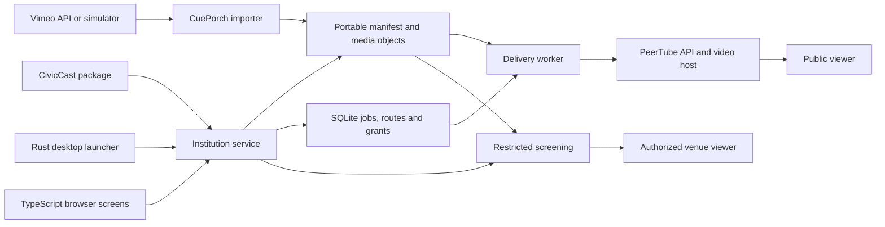
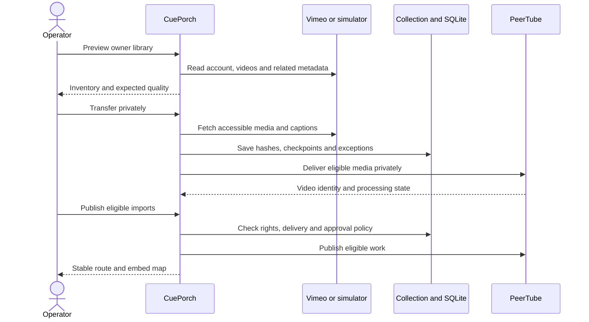
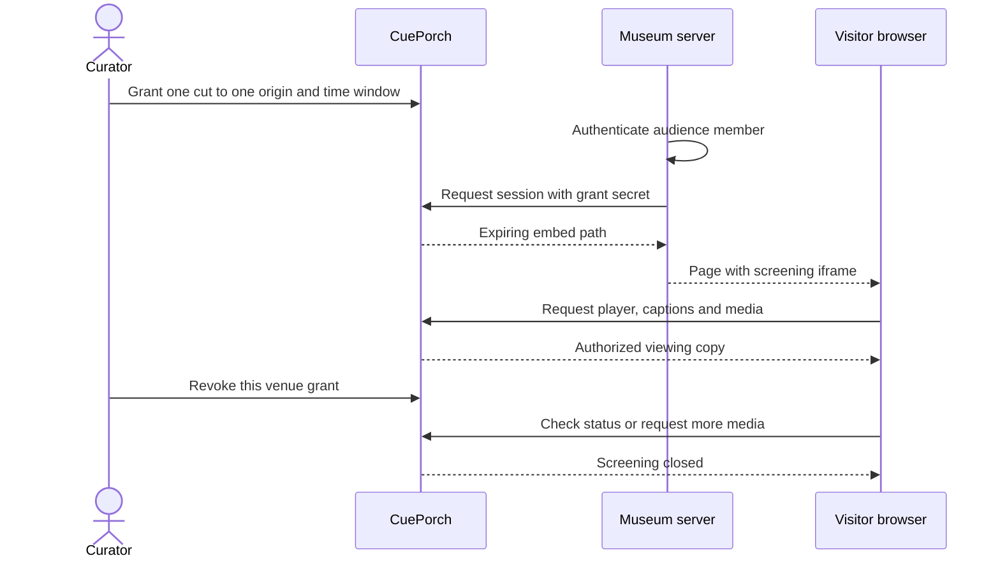

# CuePorch user manual

**Version 0.2.0 · ForkCommons**

[Project home](README.md) · [README](README.md) · [Operations](OPERATIONS.md) · [Acceptance record](evidence/ACCEPTANCE.md)

## New user guide

If your institution already runs CuePorch, ask its operator for the site address and the credential for your role. An artist starts at `/submit`. An operator starts at `/operator`. A visitor can open the public catalog at `/`. A museum visitor starts on the museum’s authorized screening page. Only the person setting up the institution needs the installation instructions.

### Install and open CuePorch

On Windows, double-click **CuePorch-0.2.0-Windows-x64-Setup.exe**. Windows should identify Scott Converse as the verified publisher. Keep the suggested library folder for a new institution. To upgrade, close 0.1.0, back up its library and select the existing folder containing both operator.json and institution.sqlite. Open **ForkCommons → CuePorch** from Start. The installer bundles the runtime and FFmpeg.

Open the macOS arm64 package on an Apple Silicon Mac or install the amd64 Debian package on Ubuntu 24.04. The Mac app has an ad-hoc signature and the installer has no Apple notarization. On these platforms use the launcher's `--data PATH` option to open an existing library outside its default location.

Enter your institution name, select **Save setup**, then open the operator console. To publish video, connect a PeerTube host using its address and publishing account, or use **Set up a local video host** with a running Docker-compatible engine. The local desktop console opens on this computer. The operations guide describes the separate deployment for a public institutional site.

### First migration

1. Choose **Move from Vimeo**, enter the operator credential, leave the Vimeo token blank for the practice source and select **Preview transfer**. Expect three rows. Read each source ID, quality and viewing permission. Inventory completes before media transfer.
2. Choose **Transfer privately**. Wait for **transferred**, then go to **Manage library and embeds** and **Load library**. The library worker may still be preparing playback. The practice source yields two playable works and one item with no downloadable file.
3. Choose **Publish eligible Vimeo imports**. In the fixture, one staged work qualifies. A restricted work stays private. If a review step is enabled, use the review queue. Reload the library to see the current state.
4. Follow **Watch**. Start the video and check the picture, sound and available caption track. **Download embed map** gives site owners the old URL, new watch and embed URLs, source and work IDs, recovery disposition and known external page. Blank destination URLs mean the work has no public route.

For an actual account, start a separate installation without `--simulate`. Use the owner’s Vimeo token with the required scopes and access to the account’s files and captions. Preview before transferring. **Original recovered** means a source designated as an original was retrieved. **Playback copy only** means the preserved file is a rendition. **Owner file needed** means the item still needs media. Keep those items on the reconciliation list. A new website embed cannot redirect a link controlled by Vimeo. Keep the old site mapping available while testing replacements. [Vimeo file access](https://help.vimeo.com/hc/en-us/articles/12427806914577) · [Vimeo caption access](https://help.vimeo.com/hc/en-us/articles/17480150130833)

After transfer, choose **Restore Vimeo privacy** from the imported video’s actions to prepare viewer links from its recorded visibility, embed allowlist and download permission. Use a replacement password for a password-protected transfer. Unlisted videos receive a CuePorch key. If the source embed allowlist is unavailable, CuePorch keeps embedding off. For a public work previously delivered by CuePorch, the service verifies its PeerTube copy has become private before it switches the existing CuePorch work addresses to the new player. The operator can see the handoff status from the same action. Designated public records continue to use their protected routes. [Vimeo’s documented privacy settings](https://developer.vimeo.com/api/guides/videos/interact)

### Organize imported works

Open **Manage library and embeds**, then **Load library**. The root lists works without a folder. Choose **New folder** and select its parent and color. Open an existing folder to edit its name, parent or color. Select works, choose a destination and select **Move selected**. Work IDs and delivery history are retained. Search titles and filter by privacy within the current folder. Choose a list or grid and sort by title, added date, modification date or duration. Filter by creator when the source provides a name. Use Star work or Star folder to keep frequently used items in your personal Starred view. Dates and attribution depend on the available import and library history. For Vimeo imports, the privacy column displays the source record.

### Work actions

To add local files, open a library folder and choose **Upload**, or drop files anywhere on the library page. Confirm the folder and choose **Upload selected files**. CuePorch preserves the original and shows when each file is uploading, preparing or ready. You can retry failed files from the same dialog. New uploads start private until you change **Upload defaults** for your operator account. Open **Customize privacy for these videos** to override your defaults for the current upload. Audio, images and documents stay private.

Accepted video is MP4, MOV, WebM or MKV. Image uploads accept JPEG, PNG and WebP, and audio accepts MP3, WAV, FLAC, Ogg and M4A. Open **File info** to preview a stored image or play audio. PDF, DOCX and TXT are available for download. Use **Type** to show videos or other files in the current folder.

For videos uploaded directly to the library, select the privacy badge and choose **Private**, **Password**, **Unlisted**, **Public** or **Embed only**. Unlisted links include an access key. Public videos appear in the institution’s video catalog. For embeds, choose **Anywhere** or enter the allowed domains, one per line, and copy the player code from **Share**. Use **Allow viewers to download** if they should see a download link. If the institution turns on publication approval, CuePorch shows changes waiting for that approval. Setting a video to Private closes its viewer and embed links. Review links and licensed venue screenings have their own controls.

Select multiple directly uploaded videos and choose **Privacy for selected** to apply the same link mode, embed restrictions and download permission to the selection.

Choose **Folder privacy** to apply an override to directly uploaded videos in the selected folder and its subfolders. Subfolders with their own override keep their settings. New uploads and videos moved in use the nearest folder override. Removing an override keeps each existing video’s current settings. Future uploads inherit the closest remaining override or the uploader’s account defaults.

Open **Actions** beside a work. **Share**, **Copy link** and **Copy embed code** use the published CuePorch address. For a restricted work, use **Manage private screening grants** to assign access. **Watch later** saves a work to your personal queue. The queue is available from the folder navigation.

**Rename** updates the displayed title and synchronizes the name on a connected video host when CuePorch manages the hosted copy. Existing CuePorch watch and embed URLs stay the same. **Create a copy** starts a separate private work in the library root, with its own ID and the same retained media. **Video info** shows source and file details and can preview a stored video. **Download** saves a retained original or viewing copy. A download link expires after ten minutes or when the work is deleted.

**Change thumbnail** accepts JPEG, PNG or WebP, or a frame from the archived video. Use the **Frame time** slider to inspect the frame before saving. CuePorch keeps the selected image with the institution's collection and updates a managed PeerTube video in place.

Choose **Edit video details** to update the title, description, tags, categories, credits, Creative Commons license, content rating or disclosures. The form also shows the stored file’s size, resolution, frame rate and audio format when available. These edits stay with the work when you replace the media. The CuePorch viewer page shows the saved details after the viewer is authorized to play it.

The video workspace previews the retained copy and opens the version, review, download and other library actions for that work. Set **Editorial status** for the current version. A reviewer with permission to change status can update the same version’s status. The editorial label does not change viewer access or turn on an approval requirement.

For a CuePorch viewer link, use **Start at** to enter a playback time or take it from the preview. A **Custom link name** creates a separate watch address that uses the same privacy rules as the video. Choose whether it expires after one day, one week or 30 days. Changing, removing or expiring a custom address also closes its media links. The video’s original watch address still follows its own privacy settings.

For a video that permits embedding, choose fixed dimensions or responsive sizing, and whether the player should autoplay, start muted or loop. Copy the generated iframe to your website. Allowed domains apply to the generated code. Browsers can require muted playback or a viewer gesture before autoplay.

CuePorch’s own embedded player offers an optional JavaScript API. Select **Include player API script** to turn it on for the generated iframe. Import the `Player` class from your CuePorch host and pass the iframe element. The API supports playback, pause, seek, elapsed time, duration, volume, mute, loop and playback events.

```javascript
import { Player } from "https://video.example.org/player.js";

const player = new Player(document.querySelector("#film-player"));
await player.ready();
player.on("pause", ({ seconds }) => console.log(seconds));
await player.setCurrentTime(12);
```

Set the iframe’s HTML ID to `film-player` in this example. For an embed still delivered by PeerTube, use its documented API. [PeerTube Embed API](https://docs.joinpeertube.org/api/embed-player)

Open **Player and page appearance** from the workspace to change the CuePorch watch player or embed separately. Pick colors, upload a logo, set the page theme, choose visible controls and save settings as a named preset. The preview updates as you edit the theme. **Apply this theme to all existing videos** changes the watch page theme while keeping those videos’ player controls. For a video delivered by an external host, customize its player on that host.

Open **Languages and subtitles** to set the recording’s original language or upload a WebVTT or SRT subtitle file. Use a language code such as `en` or `fr-CA`. Search the transcript, edit cue text and timestamps, or jump to a cue in the preview. CuePorch exports the edited track as WebVTT and retains it with that cut. Existing review comments and status stay on the same cut after subtitle changes.

With local TextFlowKit installed, CuePorch can generate subtitles as soon as you set the original language. Clear the generation checkbox if you plan to upload a track yourself. **Generate subtitles with TextFlowKit** requests another pass. If the institution enables caption approval, the job waits in the operator queue. It proceeds automatically when that approval switch is off. Generated tracks can be reviewed and edited in the same cue editor.

Use **Interactivity** to add or edit chapters. Play the preview and select **Add chapter** to use the current position, or enter a different start time in hours, minutes and seconds. **Preview time** jumps to the selected row. Choose **Save chapters** to update the viewer’s chapter menu on the watch page and embed. Each surface has a **Chapters** toggle under **Player and page appearance**. Hosted PeerTube copies use PeerTube’s player controls.

For a CuePorch-hosted player, **Timed cards** lets you place a title, image and link over the video. Each card starts at the time you choose and stays up for six seconds. The **End screen** can show a link, image, message or up to three public videos, or change how the player finishes. Choose **Save cards and end screen** to apply these choices to the current cut. Videos hidden after you select them are omitted from the end screen.

Use **Video rating** to collect thumbs or star ratings from viewers. Choose when to show the prompt. Each viewing session can respond once. **Video Rating report** displays the totals and exports a CSV grouped by cut. Turning the widget off preserves earlier ratings.

In **Registration**, turn on the form to require an email before CuePorch-hosted playback. You can ask for names, add text fields, dropdowns and checkboxes, and link to your privacy policy. Choose one or two steps and save the settings as a preset to reuse on another video. Campaign fields are recorded only when **Save UTM campaign fields** is enabled. View **Recent registrants** or download the complete list as a CSV. Registration works together with the video’s password and embed permissions. Designated public records remain open.

Open **Analytics** from the workspace to see impressions, views, view rate, finishes and time watched on CuePorch watch pages and embeds. One loaded player counts as an impression. Its first play counts as a view, and time watched includes repeat playback. Filter by dates in UTC and by playback surface. The retention graph and its accessible table show which portions of the current cut were played. Select a position to seek in the operator preview. The daily CSV follows your date and surface filters.

Open **Analytics** from the library to compare videos. Pick specific works or report across the library, then group by video, date, device, referring site or playback surface. Add a second breakdown or choose day, week, month or year for the trend. **Advanced report** from a video's analytics preselects that video. Downloads use the selected filters and breakdown. Referral data records the site's origin when the browser supplies it, and earlier observations without device or referral information appear as **Unknown**.

Open **Edit video** from the workspace. Set the start and end in seconds, move the timeline and take the preview time, or choose boundaries from a subtitle cue. Play the selection before saving if you want to check its boundaries. **Save as new version** replaces the current viewing cut and adjusts its captions and chapters. Earlier cuts and their original media can be restored from **Versions**. **Download GIF** exports up to six seconds from the selection without replacing the video.

Open **Timeline editor** to combine clips from the library. Select a source, change the bounds, split at the preview time or omit a subtitle cue. Move clips earlier or later, adjust the canvas and mix a library audio work beneath the video. Undo and redo edit actions before rendering. CuePorch saves a draft while you work and opens it again when you return. **Render as a new version** queues the edit and keeps the original cuts available through **Versions**.

### Record Studio

Open **Record Studio** from the library. Choose a camera and microphone, connect them in the browser, or share a screen, window or tab. The studio can combine camera and screen side by side or as an inset. Pick the canvas ratio, output size and background. Set teleprompter text, scroll speed and font size before recording.

Start, pause, resume and stop the take from the preview. Play or download the result, or choose a library folder and save. CuePorch uses the same folder privacy and upload defaults as an ordinary upload. A browser draft can be recovered when you return to Studio on that browser and app address. Browser storage and device access depend on your browser and its permissions. Desktop loopback and HTTPS installations support media capture.

**Replace** saves another MP4, MOV, WebM or MKV as the current version. CuePorch retains the original of each version and prepares a separate viewing copy. Choose **Restore previous version** in the same dialog to make that cut current again. Timed captions and chapters stay with their cut. Existing exhibition grants continue to play the version selected when the grant was made. A managed public video updates through the existing publication policy and uses the same watch and embed addresses.

**Review link** opens the list of external review links for the work. Enter an internal name and expiration, which defaults to 30 days. Add a password or enable downloads and earlier versions as needed. Give reviewers the link and, if set, its password. Reviewers can play the permitted cuts in a browser. Use **Disable** to suspend the link and revoke its active review sessions, **Manage** to change its settings, or **Make a copy** to create a separate link.

The link settings also control posting comments, changing the review status, and seeing resolved threads. Select **Use current time** in the review player to pin feedback to the frame you are viewing. Select a posted timecode to jump there. Use **Reply** to keep a discussion in the same thread. In the operator’s link list, **Comments** opens the selected version’s feedback with options to resolve or reopen threads and export a CSV.

Customize each review with a logo, dark mode, and optional suggestions for other public works after playback. The default end card offers **Play again**. **Save as default settings** applies your choices, expiration length, and permissions to future links. Turn on **Automatically create review links for new uploads** in those defaults to generate a review link for new videos from the operator library, artists and station intake. Use the link list to share it with the intended recipients.

**Preview as reviewer** opens an operator preview with the review link’s current permissions and settings. The review player offers loop, playback speed, and next/previous frame on videos with a readable frame rate. When the archive contains both a playable original and screening copy, use **Playback quality** to switch between them.

Comment text supports clickable HTTP and HTTPS links. Select an emoji below a comment to add your reaction and select it again to remove it. **Upload new version** is available in the operator preview. Recipients can keep using the original review link after the update. Previous feedback stays with its original cut.

Type `@` and the beginning of a reviewer’s name, then select their name from the suggestions. **Notifications** on the review page lists new mentions and replies for that browser. A notification opens the comment that prompted it. You can choose all comments, mentions and replies, or off.

When the host enables device notifications, open **Notifications** and select **Enable device notifications**. Your browser will ask whether it can show alerts even after you close the review. Use **Turn off device notifications** to stop alerts from that review on this browser. Your comment notification preference also applies to device alerts.

For HTTPS installations, set `CUEPORCH_PUSH_CONTACT` to a `mailto:` address or HTTPS contact URL controlled by the operator and restart the CuePorch service. CuePorch stores its Web Push application key in the institution database. Keep that database available across upgrades to preserve subscriptions. An operator who runs a compatible push service can allow its HTTPS origin with `CUEPORCH_PUSH_SERVICE_ORIGINS`.

### Showcases

Open **Showcases** from the library. **New showcase** creates a private gallery. Give it a title and link name, add videos, and use **Move up** or **Move down** to set playback order. Choose a gallery grid or a player with a playlist, add a logo and featured information, and pick a card size. Preview the saved gallery at desktop or mobile width before sharing.

Choose **Public**, **Password** or **Embed only** to create viewer links. The optional list of allowed sites restricts embeds. A public showcase lists publicly visible videos. A password-protected showcase can play other restricted videos when their embed settings permit it. Private videos stay in the operator preview. A video with its own registration form keeps that gate and is omitted from guest playlists. Use **Registration** to require a form for the whole showcase and export the answers as CSV. Use **Make a copy** to start a private gallery with the same presentation and video order.

**Move from Vimeo** lists showcases and their source visibility during inventory. The transfer creates private galleries with ordered members found in the account inventory and reports the source video IDs that were unavailable. Repeated transfers keep the gallery and operator edits. Set the appropriate visibility, password and embed domains in CuePorch when the transferred gallery is ready. The transfer preserves names, descriptions and available video order. Recreate design and registration settings in CuePorch.

### Live events

Open **Live events** from the library and choose **New event**. Select a type, or choose an earlier event to reuse its description, time zone and production settings. Enter the start and end in the chosen time zone. For repeat programs, select daily, weekly or monthly and choose the interval. A weekly event can use several weekdays. End the schedule on a date, after a specified number of occurrences, or leave it open. The calendar flags overlapping times. Use **Edit event** to change an unprepared event and keep its viewer link.

To prepare an external encoder, connect a live-enabled PeerTube host. In the calendar open production for the intended occurrence and choose **Prepare encoder**. Paste the private server address and stream key into your encoder. **Refresh stream status** checks whether the host is receiving the stream. A public event has a CuePorch watch page and iframe. These addresses use the calendar occurrence for live playback and its replay when recording is enabled. Public events are available automatically unless the publication approval switch is enabled. A private production has no public player.

The viewer's waiting room checks for a stream automatically. New event links play through CuePorch while the connected PeerTube copy stays private. After recording, the same link plays the finished replay. Turn on **Replay** under approvals to hold the finished recording privately for a decision. Choose **Cancel this occurrence** to cancel an unprepared session in a repeating schedule. For a prepared or active session, choose **Withdraw this occurrence** to close the watch page and embed. End an external encoder's signal from the encoder. For older occurrences published directly on PeerTube, end that signal before retrying a host privacy change.

Choose **Registration** before preparing the encoder if viewers must sign up. Reuse a saved form or create a new one. The event link still opens the waiting room. A registered viewer can stay on that page for the stream to start. CuePorch keeps the PeerTube copy private and serves the video through the event page. Saving a form change asks existing viewers to register again. Download responses from **Registration** with an operator credential.

For browser capture, choose **Open browser studio** for the occurrence. Connect a camera and microphone, or choose a screen to share, and preview the composition. Choose **Broadcast from this browser** and start the stream. Keep the studio tab open while broadcasting. When you stop, you can save or download the local take. Choose **Recording only** to use the same studio without sending media to the host. Browser broadcasting needs localhost or HTTPS and WebM media capture support.

Expand **Scenes and graphics** in Live Studio. Add a template and edit its layout, colors, title and lower-third text. Choose **Event logo** from the library and save the brand settings to apply it across the event. For a full-screen image, choose the title layout and select a library image. Preview a scene and choose **Save scene** before taking it to air. **Take scene** changes the live output and resets its lower third to hidden until you choose **Show lower third**. Scene order and brand settings are saved for the event. Selecting a scene for editing keeps the current live output on air.

Choose **Scene video** to use a retained library cut. Taking the scene starts the clip and adds its audio to the live and local recording mixes. Use **Pause clip**, **Play clip** and **Restart clip** to control it without ending the broadcast. The saved scene keeps the selected cut if a new library version is later uploaded.

Open **Audio mixer** to check the input level of the microphone, shared screen audio, active scene clip and each connected guest. Adjust **Program volume** or select **Mute in program** before or during the broadcast. The level meter continues to show that source's signal while muted, and connected guests can check in backstage while their audio is still off air. Mixer controls apply in the current Studio tab.

Open **Q&A and polls** in Live Studio to manage audience questions and polls. Take a scene, then choose **Show question on scene** for a published question or **Show poll on scene** for an open poll. The current scene displays one audience graphic at a time in the lower part of the program. **Publish results** adds vote percentages and the marked answer to an on-air poll. Hiding or archiving the item removes the graphic. Returning to a scene restores its selected graphic during the current Studio session.

Open **Speakers** in Live Studio to invite a guest. Enter their name and send them the complete invitation link. They can join from a browser with a camera and a microphone. The link can be used once, and expires at the end of the occurrence. Reissue an invitation by removing the old entry and creating another. Up to seven guests can be invited to an occurrence.

Guests join the speaker room automatically unless you turn on **Approve invited speakers before they connect**. Use **Admit** for a waiting guest, or turn off approval to admit everyone already waiting. Preview the guest's feed before placing it on air. Incoming speaker audio joins the program when that speaker is on air. Use **Take off air** to move the speaker backstage, or **Remove** to end their access. An admitted guest can post in **Speaker chat**. The audience never receives the speaker messages.

The speaker roster shows incoming video frame rate, bitrate and round-trip time when the browser reports them. Round-trip time measures the link between the producer and the speaker.

Guest links need a reachable HTTPS CuePorch address outside localhost. For guest networks that require a relay, the self-hosted service accepts `CUEPORCH_STUN_URL`, `CUEPORCH_TURN_URL` and `CUEPORCH_TURN_SECRET` for a configured STUN or coturn deployment. Set `CUEPORCH_TURN_SECRET` on the service to your TURN server's shared authentication secret. CuePorch issues temporary credentials for the guest session.

Set **Live DVR window in seconds** before preparing the encoder. Leave it blank for the connected PeerTube host's default. Enter 0 to turn off extended live rewind, or choose a window within the host's maximum. With DVR enabled, the audience can go back to a portion of the stream the host has already buffered. DVR and the finished replay are separate settings.

Use **Refresh stream status** to see the connected host's current delivery state, viewer count, latency mode and DVR window. During a browser, SRT or scheduled program transmission that CuePorch relays, the status also shows recent encoder frame rate, bitrate and dropped frames. Live Studio updates its relay measurements while on air. A direct RTMP encoder connected to PeerTube reports through the host, so CuePorch may have only the delivery state. The configured latency mode describes the host setting and does not measure a viewer's delay.

Expand **Audience analytics** to see current and peak playback sessions, player loads, plays and time watched, with separate rows for live playback and replay. A player load counts when CuePorch makes a stream available in that browser. A play counts once the viewer starts playback. The current count drops when a viewer pauses or leaves, and an interrupted viewer expires after 30 seconds. These counts cover the CuePorch watch page and embed. A browser session is counted separately each time the page opens. CuePorch honors browser tracking preferences and collects these counts without saving viewers' IP addresses or linking them to registration responses.

For SRT, expand **SRT encoder** in the occurrence's production controls and start the listener. The default interface, 127.0.0.1, accepts a sender on the same computer. For a remote sender, select the station's intended receiving interface and route that UDP port. Use caller mode with MPEG-TS, the displayed endpoint and passphrase, and a 128-bit key. Stop the listener when the contribution ends.

Open **Simulcast destinations** to send the event to a cable receiver or another service that accepts RTMP or RTMPS. Enter its server and stream key separately. Leave **Send when this event goes live** checked to start automatically, or turn the destination on during the broadcast. Each destination can be turned off independently. Settings carry across occurrences of a recurring event. CuePorch only sends programs open to the public without registration. RTMPS validates the receiver's certificate. For an internal certificate authority, set `SSL_CERT_FILE` to a trusted PEM bundle on the CuePorch service.

In production controls, expand **Live captions** for the occurrence. On Windows, install TextFlowKit with its local streaming model before enabling captions. Select the spoken language and save before starting your stream. The panel shows the engine status and the number of generated lines. Caption approval starts off. When the operator turns it on, CuePorch keeps the generated lines private until the action is approved or the switch is turned off. Viewers can choose **Show live captions** in the player and open **Live transcript**. Selecting a line seeks to that point when it is still inside the DVR window.

When replay recording and live captions are enabled, CuePorch uses local TextFlowKit to caption the finished recording. Open **Replay captions** in the production controls and refresh its status. You can download the WebVTT while the release is held, correct the file and upload it again. The Caption approval controls the subtitle track independently of the Replay approval for the video. After release, viewers can turn on replay captions, open the replay transcript and select a line to seek to that part of the video.

To schedule unattended playback, open a future occurrence and expand **Prerecorded event**. Add library videos, put them in playback order and choose **Schedule playback**. Each entry uses the retained cut that was current when you selected it. A public program uses videos permitted for public viewing. Leave the CuePorch service and its video host running. The browser can close. CuePorch prepares the program, begins sending it at the scheduled time when ready, plays the videos through in order and ends the signal after the last video. Publication and replay use the event's existing approval controls. Use **Refresh program** to check preparation and completion. **Switch to manual production** clears the program before its scheduled start.

In production controls, expand **Audience chat** and enable it for the selected occurrence. An audience member opens the event page or embed, registers if required, and can post under a display name. Messages appear automatically. Operators can set how long each viewer must wait between messages, remove a message, block its sender for the occurrence, download the visible conversation as CSV, or turn chat off. A viewer can remove their own messages.

Expand **Q&A and polls** in production controls. After you enable Q&A, audience questions appear automatically. Enable **Approve questions before publishing** only when you want to review them. Disable it to publish pending questions. Viewers can upvote and sort questions. Operators can pin a question, reply, archive and restore it, or download the question log.

Add two to four options to a poll and optionally choose one correct answer for a quiz. Save a draft and open it when the audience is ready. Only one poll accepts votes at a time. **Publish results** closes voting and shows the totals, percentages and the correct answer if one is set. Archive the poll to remove it from the audience panel. **Download polls** includes the aggregate results for the occurrence.

### Delete and restore

Select works and choose **Delete selected**, or open a folder and choose **Delete folder**. Deleting a folder includes its subfolders and works. Open **Recently deleted** to filter by type or operator and restore within 30 days. A deleted screening stops accepting video requests. Previously issued screening sessions expire on their original schedule. CuePorch withdraws its managed video on the original PeerTube host and reports a pending state if it cannot reach that host. Restoring a work reuses its previous link when the source still permits public viewing. Designated public records stay available. Separately managed routes must be withdrawn through their owner before deleting the work. Expired works stay withdrawn and leave the recovery list. Archival media stays in local storage.

### Artists and exhibitors

1. An artist opens **Submit a work**, enters the creator credential, gives the work a title and selects the master. The preview is local to the browser. Add credits, description, an English WebVTT caption file or a poster as needed.
2. Choose the viewing terms for the film. **Private screening** preserves the master and prepares a separate viewing copy. To make a trailer public, attach it and explicitly select the trailer’s public-viewing checkbox. A publication time is optional and uses local time. Save the work ID returned by the form.
3. The operator opens **Exhibitions** and loads the available screening copies. Choose the work and exact cut, then enter the exhibitor’s web origin, audience, agreement reference and opening and closing times. Check the displayed time zone. Create a separate grant for each venue.
4. Send the grant ID and secret privately to the exhibitor’s **server operator**. The museum authenticates each visitor, then requests a session from CuePorch. Its web page embeds the returned session path. The server retains the grant secret. See the exchange below.
5. To end one exhibition, use **View grants** and revoke the selected venue’s grant. A curator can inspect its status, agreement, origin, cut and dates. The pilot exercised closure of an already open player, continued access for the second venue and continued availability of the separately authorized trailer.

### Reviews, complaints and appeals

All nine approval switches start **off**. In the operator console, select **Load settings and review queue**. Enable **Require approval** for any of intake, caption, publication, replay, migration, grant, catalog, moderation and restoration. Each choice applies to this institution and this step. Reload to inspect waiting actions. Approve or reject the intended action. Turning a switch off releases eligible waiting work. A recorded rejection stands. Privacy, grant windows and source permissions still apply in automatic mode.

For a work-specific problem, open **Support and appeals** with the work ID, describe the issue and save the returned case ID and private case key. Use them to add context, read the decision or submit an appeal. The operator monitors the inbox, records reasons and can suspend or restore the affected screenings. Set real support hours and contacts before inviting public reports.

## Technical user guide

### Deployment choices

| Arrangement | Setup | Evidence for 0.1.0 |
|---|---|---|
| Existing PeerTube | Set `PEERTUBE_USERNAME` and `PEERTUBE_PASSWORD` privately for its publishing account. Run `python launch.py ../station --institution station --existing-peer https://video.example.org`, substituting the actual origin. | Windows application, remote API and browser playback exercised against a local running PeerTube host. |
| Provisioned PeerTube | Run `python launch.py ../station --institution station`. The launcher uses Compose and provisions a limited publisher. | Fresh Ubuntu under WSL with cached images and installed system prerequisites. |
| Institution domains | Set `--public-url` for the canonical watch origin and `--video-url` for a newly provisioned video host. Terminate HTTPS at the reverse proxy. | Example configuration is supplied. Production DNS and field cutover remain unverified. |

The defaults are **19001** for the app, **19000** for PeerTube HTTP and **11935** for RTMP. Use `--port`, `--peer-port` and `--rtmp-port` when running additional institutions. Give each an isolated installation and video destination. Set the upload limit with `CUEPORCH_MAX_UPLOAD_BYTES` and align proxy size and timeout settings. Name individual reviewers with `CUEPORCH_OPERATOR_KEYS`. Configure contacts and operating hours as described in the [runbook](OPERATIONS.md). These command-line flags apply to the source deployment. The desktop installer starts the Python service through its native Rust launcher. The screens are compiled from TypeScript.

### Station publication

In CivicCast, use the existing **Cable file package** output with its caption sidecar. Configure `CUEPORCH_STATION_KEY` in the connector’s environment and run the connector with the product dependencies installed. Example once an approved station has a CuePorch host:

```sh
python civiccast_destination.py ./station-packages --institution-url https://watch.example.org --watch --kind meeting
```

The directory watcher hands packages to CuePorch. Use a ZIP path without `--watch` for a single package. Add `--public` only for a work cleared for public viewing and embedding. A receipt identifies the local job. Corrections to the same station work can retain its remote identity. CivicCast continues to own the schedule, playout and local recording.

For live use, `live_destination.py ORIGIN TITLE PRIVATE_SETTINGS_FILE` creates a PeerTube destination and writes encoder settings. Keep the stream key private. Stable channel and meeting routes can point to the captioned CivicCast player or a PeerTube embed. The rehearsal demonstrated synchronized live captions on the CivicCast web path and separate RTMP playback on PeerTube. Choose the path whose caption behavior your station has verified. [Live configuration and replay handoff](OPERATIONS.md#live-and-replay)

### HTTP integrations

Use `Authorization: Bearer <credential>` with the credential for the operation. Send mutation bodies as JSON except for file uploads. The institution origin and the video-host origin serve different APIs.

| Operation | CuePorch interface | Who uses it |
|---|---|---|
| Preview or transfer, poll status | `POST /api/migration` with `dry_run` and optional owner `token`, then `GET /api/migration` | Operator |
| Reconcile and publish | `GET /api/library`, `GET /api/delivery`, `POST /api/migration/publish-eligible`, `GET /api/embed-map.csv` | Operator |
| Request delivery of one work | `POST /api/delivery/<work_id>` with `public`, optional `scheduled` and `kind` | Operator |
| Submit media | `POST /api/submissions` or `POST /api/station-packages` | Creator or station, respectively |
| Configure approvals and decide | `GET /api/policy`, `PUT /api/policy/<step>` with `required`, `GET /api/actions`, `POST /api/actions/<uid>/decision` with `decision` | Operator |
| Create or revoke an exhibition | `GET /api/screening-copies`, `POST /api/grants`, `DELETE /api/grants/<uid>` | Operator |
| Request a screening session | `POST /api/grants/<uid>/session` | Exhibitor server with its grant secret |
| Configure public routes | `PUT /api/routes/<kind>/<slug>` | Operator |
| Report or respond | `POST /api/works/<work>/complaints`, `GET` or `POST /api/cases/<uid>` | Reporter opens case, case holder or operator follows up |

The exhibitor session response contains `embed` (a relative path) and `expires` (Unix time). Resolve the path against the CuePorch origin. Set the iframe’s `referrerpolicy="origin"` on the authorized site. A grant specifies the allowed origin including scheme and port. A bare session URL opened in a new tab can be denied because it lacks the expected exhibitor context. The institution’s public watch URL and a venue’s expiring screening URL serve different audiences.

### Storage, recovery and troubleshooting

The installation directory holds the collection manifest and hashed objects, institution SQLite database, receipts, private credentials and runtime. A provisioned host adds a Compose project with persistent database and media volumes. Vimeo checkpoints bind a migration to its source account and institution. Keep private storage separate from the unpacked software.

| Symptom | What to check |
|---|---|
| Console is reachable but reports access denied | Use the operator value for this installation. The creator and station keys have narrower scopes. |
| Preview succeeds but a work lacks a master | Read its recovery disposition and source permissions. Preserve any available rendition and obtain an owner copy if archival quality is required. |
| Transfer shows complete but the player is unavailable | Reload **Manage library and embeds**. Check the delivery job, due time, review queue, processing and destination warning. A private delivery has no public watch route. |
| A caption is preserved locally but absent from PeerTube | Inspect its language and any duplicate tracks for that language. Use a supported, distinct track and submit the correction. Generated captions depend on the optional TextFlowKit runtime. |
| A venue receives access denied | Check grant status, selected cut, agreement window, venue origin, session expiration, referrer and work-specific holds. Issue a fresh session through the venue server. |
| A transfer or upload was interrupted | Restart with the same private directory, source account and institution. Retry the intended delivery in the library so CuePorch can reconcile the saved receipt. |

Run `python cueporch.py verify COLLECTION` to verify stored files. For a portable exit, quiesce writes and run `python export_institution.py COLLECTION DATABASE NEW_DIRECTORY`. To resume the complete service elsewhere, take an offline host snapshot including the institution database, credentials, receipts and video-host data. Restore into fresh volumes and check public **and** restricted viewing before redirecting an institution-owned domain. [Backup and restore commands](OPERATIONS.md#recover-and-exit)

## Architecture

### Components and ownership



Flask and Waitress serve the institutional UI and API. The delivery worker reads retained objects, applies operator policy and records PeerTube receipts. PeerTube owns transcoding and hosted playback. CuePorch serves grant-protected viewing copies directly so it can check access during delivery. Keeping a separate master lets the institution preserve the work when a publisher or exhibition changes.

### Migration and publication



An item can be preserved even when hosting is incomplete. Source IDs keep cuts distinct. Checkpoints avoid unnecessary retransfers. A receipt binds a work and destination to the hosted video. Publication updates the stable institutional route after destination processing.

### One film in two museums



A second museum has its own grant and session. Revocation is scoped to the selected grant. A decision suspending screenings for the **work** has broader effect. The separately authorized public trailer is a related work with its own publication.

## Evidence and release boundaries

The 0.2.0 packages passed fresh and upgraded migration, restricted exhibition playback and real hosted publishing on Windows x64, macOS arm64 and Ubuntu amd64. The following field and recovery observations belong to the 0.1.0 baseline.

The acceptance record distinguishes live software behavior, simulated source responses and field observations. The tested Vimeo source was synthetic. Tests played actual LPM viewing copies on PeerTube, exercised an artist and two venues, followed an appeal, and restored access and publishing records on separate volumes. Production Vimeo authentication, physical cable reception, public DNS cutover and staffed support were unobserved. Historical analytics, commerce and subscriptions, full showcase reconstruction and Vimeo-specific player scripts remain gaps. [Acceptance record](evidence/ACCEPTANCE.md) · [Historical feature comparison](evidence/vimeo-comparison.md)

