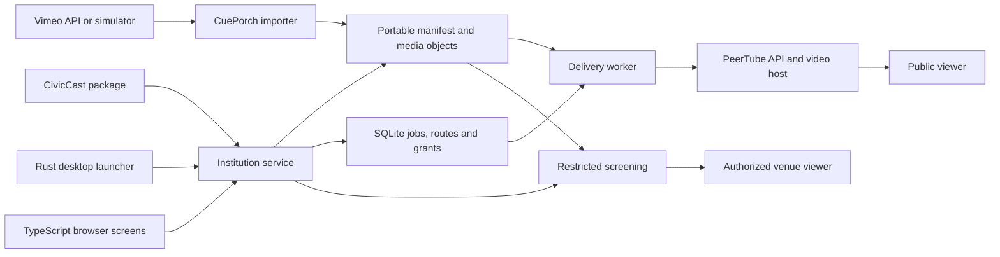
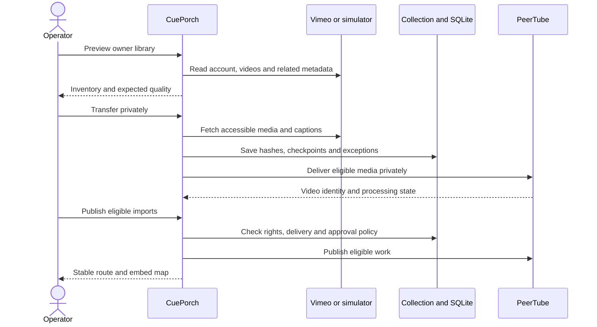
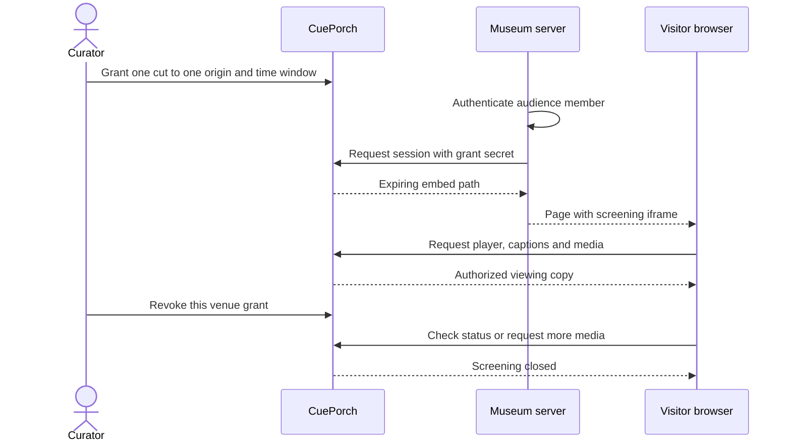

# CuePorch user manual

**Development version 0.3.0 · ForkCommons**

[Project home](README.md) · [README](README.md) · [Operations](OPERATIONS.md) · [Acceptance record](evidence/ACCEPTANCE.md)

## New user guide

If your institution already runs CuePorch, ask its operator for the site address and the credential for your role. An artist starts at `/submit`. An operator starts at `/operator`. A visitor can open the public catalog at `/`. A museum visitor starts on the museum’s authorized screening page. Only the person setting up the institution needs the installation instructions.

### Install and open CuePorch

For a signed Windows release, double-click **CuePorch-0.3.0-Windows-x64-Setup.exe**. Windows should identify Scott Converse as the verified publisher. Keep the suggested library folder for a new institution. To restore a library, close CuePorch, back up the data and select the restored folder containing both operator.json and institution.sqlite. Open **ForkCommons → CuePorch** from Start. The installer bundles the runtime and FFmpeg.

Open the macOS arm64 package on an Apple Silicon Mac or install the amd64 Debian package on Ubuntu 24.04. The Mac app has an ad-hoc signature and the installer has no Apple notarization. On these platforms use the launcher's `--data PATH` option to open an existing library outside its default location.

Enter your institution name, select **Save setup**, then open the operator console. To publish video, connect a PeerTube host using its address and publishing account, or use **Set up a local video host** with a running Docker-compatible engine. The local desktop console opens on this computer. The operations guide describes the separate deployment for a public institutional site.

### Use the operator Home

Select **Open workspace overview** to see recent uploads and imports alongside the last 30 days of observed playback. Choose **Upload** or drop a file onto Home, then select a destination in the upload dialog. Use **Create** to start a project from an existing video or open the upload, import, recording, event or showcase workflows. **Search videos** can look through your authorized Library or public Watch. Use **Workspace navigation** to reach the Library, Recently deleted, Analytics and other operator screens. The menu remembers whether you collapsed it in this browser.

Open **Activity** in Workspace navigation or on your signed-in Team page. It shows the last 30 days of support messages and status changes, direct video shares to your account, and new live events if you manage the workspace. Choose an item's title to open the support request, video or event editor. Use **Mark as read** to save your read status across browsers, and **Show older activity** to see more items within the same 30-day window.

Choose **Take a tour** in Video details, an open review, or Live Studio to highlight the main controls for that page. Use **Next** and **Back** to move, or select **Dismiss tour** or press **Escape** from the tour to return to the page. Reopen it from **Take a tour** whenever you need it.

### Browse public videos and curate Staff Picks

Open **Watch** at `/watch` or the site home page. Use **Explore** to browse public videos and move through the featured picks. Use **Categories** to narrow the list or enter a title, description keyword, category or tag in **Search public videos**. **Channels** lists local channels and linked channels published by the institution.

Choose **Groups** to browse community groups. Sign in with a viewer account to join a public group or create one. The group owner sets the name, link and **Group access**, and can add public videos from Watch. Switching to **Members only** keeps existing members and hides the group from other visitors. Members can leave from the group page.

Open **Manage group membership** on a group you own. Enter an email address and choose **Invite**, then share the **Group link**. With a configured email relay, **Send invite email** can deliver that link. The recipient signs in, verifies the invited email address and accepts from the group page. Invitations expire after seven days. Group owners can revoke invitations, remove members and transfer ownership to a current member.

Choose **Make moderator** next to a current member to let them add and remove group videos. The owner manages the group settings, invitations, member removal and ownership. **Revoke moderator** ends the member’s curation access.

Members can submit eligible videos and they appear automatically. The group owner can turn off **Allow members to submit videos** or turn on **Require review for member submissions**. With review on, the owner and moderators can approve or reject items in **Pending submissions**. Members can withdraw their own pending submissions. Switching back to automatic publishing releases the pending items whose videos and contributors still qualify.

Owners and moderators can use **Create an album** to organize approved group videos. Choose **Manual** and use **Move up** or **Move down** to set the order, or sort by title or most recently added to the group. Each album can contain up to 100 videos. Group access and individual video privacy still apply to playback.

Choose **Follow group** to see eligible group videos in your Feed. **Manage your feed** lets you unfollow a group and keep your membership. If you lose access to a members-only group, its videos stop appearing through that follow.

In the operator Library, open **Staff Picks**. Add public videos, use **Move up** and **Move down** to arrange them, then select **Save Staff Picks**. The first picks appear in Explore, and the full list has its own page. Making a pick private or deleting it hides it from Watch and closes its public cover link. The selection stays in the editor so it can be removed or shown again if the video becomes public.

Open **Viewer account** from Watch to create an account or sign in. Use **Save to Watch Later** on a public video, then open **Watch Later** from the Watch navigation. Your list follows your account across browsers. A saved item is visible while its video is public. To remove an item, use the list or the video's **Remove from Watch Later** button.

In **Viewer account**, you can change your display name, pronouns or sign-in email, update your password, sign out, and delete the account and its list. Use your current password to change email, change password or delete the account. Changing your password signs out your other browsers. Browsing and public playback are available to signed-out visitors.

**Account security** in Viewer account and Team lets you turn on authenticator sign-in. Enter your current password, add the setup key to your authenticator app, and confirm with its six-digit code. Save the recovery codes shown after activation. When you sign in, use a current app code or an unused recovery code. Turning the authenticator on or off signs out your other sessions for that account.

When account mail is configured, choose **Send verification code** in Account security. Enter the eight-digit code from your email within ten minutes. Changing a viewer account's email clears verification so you can verify the new address.

After verification, you can choose **Turn on email sign-in codes** in Account security. CuePorch sends an eight-digit security code after checking your password. Use **Send another code** if you need a fresh one, or use a saved single-use recovery code. Turn off email sign-in before changing your email or switching to the authenticator app. Turning this option on or off signs out your other sessions.

Use **Forgot your password?** on the Viewer or Team sign-in page. CuePorch sends a short-lived reset link to a verified address. An account with an authenticator also requires a current app code or an unused recovery code. Changing the password through the link signs out every session for that account.

Use **Viewing preferences** to show everything, hide mature videos, or hide selected descriptors and unrated videos. The setting follows your account and applies to Explore, search, Staff Picks and your Feed. A direct link to a filtered public video gives you the option to show it. The video's publishing and registration rules still apply.

Under **Viewing preferences**, choose **Use video setting**, **Play automatically** to start muted, or **Wait for me** on CuePorch Watch pages. Embeds keep their own settings.

Follow a creator or a channel, or choose **Follow category** under **Watch → Categories** to add matching public videos to your Feed. Open **Manage your feed** from your account or the Feed to remove follows.

On a public video, use **Like video** to save it to **Liked videos**. The public count shows how many viewers liked it. Your Liked videos list is private. Use **Add to collection** to create or choose a personal collection and add the current video. Open **Collections** to play saved videos, edit a collection, remove entries or delete the collection. Video access still follows the publisher’s privacy settings. Deleting a collection leaves the videos in CuePorch.

In the Library’s video details, clear **Allow viewers to add to collections** and save to block new additions to personal collections and community groups. The setting starts on. Viewers can still remove a previously added video, and playback follows the video’s existing privacy settings.

On a public watch page, read the discussion under **Comments**. Search by text or author and sort newest or oldest first. Sign in to post under your display name or delete one of your own comments. If the operator requires approval, see the comment’s status under **Your unpublished comments**.

New public comments publish automatically by default. In the operator console, select **Load settings and review queue**, then turn on **Require approval for public comments** to review new posts. Read each comment in the queue and choose **approve** or **reject**. Turning the setting off releases comments that are still waiting. Use **Public comments** on the same screen to find and remove published comments.

### Invite people to your team

Open **Team members** from the Operator console. Enter the person’s email and role and select **Create invitation**. If your workspace has a mail relay, **Email the invitation** is selected by default and you can include a message. Clear the checkbox to share the private link yourself. The link is also available to copy after creating the invitation if email delivery fails. The link expires after seven days and can be used once. Use **Replace link** or **Email replacement link** to issue a new one, or **Cancel invitation** to withdraw it. The recipient opens the link and chooses a password. They can sign in again from **Team sign-in** using the invited email address and that password.

Administrators can open the Library and manage invitations, roles, and video access. Contributors can upload private videos to **My Library** and view videos shared with them. Viewers can play the videos you share with them. Choose **Manage media access** next to a member to share a video or a folder for viewing. A folder share includes playable videos in its subfolders. Moving a video out of that branch or revoking the folder share removes that path to it. A direct video share still applies. **Remove access** ends the member’s team sessions. Their retained uploads remain available to administrators. The installation’s operator credential remains available for owner access. Viewer accounts for public Watch are independent of team membership.

Shares start with **Can view**. Select **Can edit** on a video or folder share to let a Contributor update its video details and editorial status. Contributors can also edit their own uploads. They open **Edit video details** from the team player. Viewers can play a video shared with them, including one shared with a group that has edit access. Administrators manage privacy and public sharing.

From the Team page, select **Team Library** to find videos by title among the videos your membership can open. Select **Public Watch** in the same box to search publicly listed videos. Use **Clear search** to return to all videos your team account can open.

**Contributor Plus** includes Contributor access and adds **Edit video interactivity** on videos the member owns or can edit. The team editor can update chapters, timed cards and end screens using artwork already assigned to that video. Administrators can upload new artwork and manage video rating and registration.

Open **Video analytics** from the team player to see the video's playback totals, daily activity and retention. Use the date and playback surface filters, or choose **Download CSV**. Contributors can open this report on their own uploads. Owners and Administrators can open it on any video in their workspace.

Owners and Administrators can open **Team analytics** from **Team members**. Named viewing activity starts off. Turn on **Record named viewing activity** to report signed-in playback from the team player. The player shows that recording is enabled and honors browser Do Not Track and Global Privacy Control. Group the report by video or member. Select a video or member to see its details, or download the matching CSV. Net progress counts each part of a video cut once per member for the selected dates. Completion counts views that covered more than 95% of a cut. Turning named viewing activity off stops collection and hides the report. Turning it back on makes earlier recorded activity available again.

Use **Edit creator profile** in your team workspace to save a creator name, handle, biography and links. Select a cover video and order the featured section from your own uploads. Turn on **Publish profile** when you want to share the profile link. Only your videos currently available in public Watch appear. If an administrator withdraws a video or makes it private, it disappears from the profile too.

Sign in with a viewer account to **Follow creator** from a public profile or one of the creator's public videos. Open **Feed** in Watch to see their new public videos. **Unfollow creator** removes that creator's videos from your feed. Private videos and unpublished profiles stay out of the feed.

Under **Manage your feed**, choose **Videos**, **Appearances**, and **Likes** for each followed creator and select **Save activity preferences**. In the Library, an editor can link a creator to a video through **Creator appearances** in the video details. Enter one public creator profile handle per line. Appearances respect the video's current visibility.

In **Viewer account**, choose a **Language** under **Viewing preferences** to change the Watch catalog, Feed and their navigation. Choose **Use browser language** to reset the preference. The custom archive player uses the saved language on Watch and the browser language in an embed. Video titles, captions and user-written categories remain in their original language.

In **Team workspace → Edit creator profile → Viewer blocks**, you can block a viewer who follows your profile or has commented on one of your videos. Blocking removes their follow, likes and comments across your own videos and prevents them from following, liking or commenting again. Public videos remain playable. Unblocking lets the viewer interact again. Previous follows, likes and comments stay removed.

To share likes with followers, sign in to your viewer account and to Team with a published creator profile in the same browser. Open **Viewer account** and select **Share new likes**. Only likes added after you turn on sharing can appear, and only while the videos are public. Select **Stop sharing likes** in your viewer account to remove those likes from followers' feeds.

In **Groups**, select **New group**, enter a name, and choose the members and each folder's access. Folder shares include subfolders. Choose **No access** to remove a folder from the group. You can also remove a member or delete the group. Separate video, folder and group shares still apply. If another administrator saved changes first, use **Reload groups** before editing again.

Set a **Default group role** to apply that role to group members. CuePorch uses the highest assigned group role when a member belongs to several groups. Use **Use this member's direct role** on an individual roster entry to keep their assigned role instead. Folder permissions remain available separately in the group editor.

Use **Manage workspace links** in **Team members** to add a CuePorch workspace by name and HTTPS origin. Choose the groups that can find it under **Workspaces** in their team library. Set up the member's role in the destination workspace. After they sign in there, the same browser can keep both sessions. Remove access to a workspace from its own **Team members** screen.

Open **Team settings** in **Team members** to set the workspace's display name, accent and JPEG or PNG logo. The name takes up to 32 characters and the logo up to 5 MB. Changes appear on team screens, creator intake and the public catalog. The local data directory and institution identity stay bound to the original installation.

The Owner or installation credential can open **Sharing restrictions** in **Team settings**. Choose which visibility modes, embed settings, third-party publishing actions and direct file link actions Administrators and Contributors can use. Private stays available. Contributors start with workspace-only access. Allow additional modes to let Contributors use **Video sharing** when they can edit the video. Removing a visibility mode for Administrators also removes it for Contributors. Saving the change makes affected Library videos private, updates defaults in that mode and cancels pending shares in that mode. Designated public records retain their settings. Existing delivery jobs and third-party copies have separate controls.

Use the installation credential to assign an active member as **Owner**. The Owner can transfer ownership to another active member from **Team members**. The previous Owner becomes an Administrator. The installation credential can recover ownership if the Owner loses access. Team administrators can choose **Download team roster** for a CSV of members and invitations, including roles, dates and membership status.

The Owner or installation credential can open **Single sign-on** from **Team members** on a workspace with a public HTTPS address. Copy the service provider entity ID and assertion consumer URL into your SAML identity provider. Set HTTP Redirect for requests and HTTP POST for responses, sign assertions with SHA-256 or stronger, and include a stable NameID and your selected email attribute. In CuePorch, enter the provider's entity ID, HTTPS sign-in URL and PEM certificate. List the exact email domains your workspace trusts. Invited members on those domains can choose **Sign in with your organization** after accepting their invitation. CuePorch keeps their assigned team roles. The Owner uses their local account. Changing the connection ends sessions created through it.

To let your identity provider create accounts on first sign-in, enable **Create accounts for new members** and select a default team role. A current invitation takes precedence over the default role. Removing a member blocks automatic recreation of their account. You can also require SAML for workspace members on the authorized domains. This ends their current sessions and requires SAML for future sign-ins, including after accepting an invitation. The Owner keeps access through their local credentials and the installation credential remains available for recovery.

Enable **Allow members to start sign-in from the identity provider** if your organization starts CuePorch from an app dashboard. The provider must post its signed response from the same HTTPS origin as the configured sign-in URL. CuePorch opens the team workspace after a successful sign-in.

Enable **Synchronize groups from signed SAML assertions** when the provider sends groups in a signed attribute. Enter its attribute name, which defaults to `groups`. CuePorch accepts individual values or comma-separated names. Membership refreshes on SAML sign-in. CuePorch keeps an existing local or SCIM group separate if its name matches a group in the assertion. Turning off signed group synchronization removes those memberships.

To connect a provisioning service, use **Create provisioning token** in **Single sign-on** after saving the SAML connection. Copy the base URL and the one-time token into the identity provider's SCIM 2.0 settings. The provider can create members on authorized domains, update their names and email addresses, deactivate or reactivate them, and manage groups. CuePorch applies the configured default role to a new SCIM member. Assign Library folders to those groups in **Team members → Groups**. Removing a group assignment withdraws the related playback access. Deactivating a member ends their sessions and removes their group and direct shares. Use **Rotate provisioning token** to replace the current token or **Revoke provisioning token** to disconnect the provider.

Enable **Match SCIM users to existing team accounts** to transfer existing memberships to your directory. The provider must send the member's exact email on an authorized domain and its directory identifier (`externalId`). Members keep their IDs, roles, work and current shares. CuePorch signs them out and removes their local sign-in credentials. They return through the configured SAML provider. The Owner always retains local sign-in.

Owners and Administrators can use **Team settings → Session controls**. Select a fixed time after sign-in or a period of inactivity and choose minutes, hours or days. The initial setting is 12 hours after sign-in. An inactivity policy uses a browser-session cookie, and a provider's earlier expiration continues to apply to a SAML session. Saving a changed setting ends all team sessions in the workspace. Choose **Sign out all team members now** to end them without changing the policy. Viewer accounts and the installation credential continue to work.

The workspace Owner or installation operator can open **Team settings → AI settings** to enable caption generation, subtitle translation, video details, chapters and Studio scripts independently. These workflows and Administrator access start enabled. Turning a workflow off prevents new jobs and blocks unpublished results for that workflow. Language settings, manual tracks and published results remain available. Use the operator's workflow approval switches separately when you want a human to review jobs before they run.

Use **Subtitle dictionary** to correct names or preferred terms in newly generated tracks. Enter the output language code, the phrase to replace and the preferred phrase on each line, separated by tabs. Use `*` for all languages. A language-specific entry takes precedence for the same phrase. CuePorch applies the dictionary after generation without changing cue timing. **Download 90-day usage CSV** reports jobs, requesters, status and published cue counts for the current workspace.

When a local Ollama model is configured, the Owner or installation operator can enable **Allow authorized viewers to ask questions about videos**. It starts off. Eligible watch pages and embeds offer questions based on the saved subtitle track, with quotations and links to the cited moments when seeking is allowed. Use **Player and page appearance → Video questions** to hide this feature on either surface for a video. Changing playback access also removes access to questions through the old player. CuePorch sends the question and transcript to the local model and does not store the question or answer.

### First migration

1. Choose **Move from Vimeo**, enter the operator credential, leave the Vimeo token blank for the practice source and select **Preview transfer**. Expect three rows. Read each source ID, quality and viewing permission. Inventory completes before media transfer.
2. Choose **Transfer privately**. Wait for **transferred**, then go to **Manage library and embeds** and **Load library**. The library worker may still be preparing playback. The practice source yields two playable works and one item with no downloadable file.
3. Choose **Publish eligible Vimeo imports**. In the fixture, one staged work qualifies. A restricted work stays private. If a review step is enabled, use the review queue. Reload the library to see the current state.
4. Follow **Watch**. Start the video and check the picture, sound and available caption track. In **Move from Vimeo** or the Library, **Download embed map** gives site owners the old URL, new watch and embed URLs, source and work IDs, recovery disposition and known external page. Blank destination URLs mean the work has no public route. Keep the CSV private because it can contain restricted links.

For an actual account, start a separate installation without `--simulate`. Use the owner’s Vimeo token with the required scopes and access to the account’s files and captions. Preview before transferring. **Original recovered** means a source designated as an original was retrieved. **Playback copy only** means the preserved file is a rendition. **Owner file needed** means the item still needs media. Keep those items on the reconciliation list. A new website embed cannot redirect a link controlled by Vimeo. Keep the old site mapping available while testing replacements. [Vimeo file access](https://help.vimeo.com/hc/en-us/articles/12427806914577) · [Vimeo caption access](https://help.vimeo.com/hc/en-us/articles/17480150130833)

When CuePorch restarts, **Move from Vimeo** shows the saved inventory or result to an authorized operator. If the service stopped during a transfer, re-enter the same Vimeo account token and choose **Transfer privately**. CuePorch reuses verified files from that job. The token stays in process memory.

The transfer shows how many videos have been processed. After a preview or transfer, use the inventory pages and **Source issues** column to find missing media, incomplete downloads, checksum mismatches and metadata Vimeo did not return. The summary counts cover the entire inventory. CuePorch checks the source checksum when Vimeo provides one, and stores a SHA-256 checksum for each recovered file. Retry **Transfer privately** after correcting source access or a network problem. When a transfer returns incomplete media for a previously imported video, CuePorch keeps the earlier playable cut in the Library.

Choose **Download reconciliation CSV** for a private inventory of the entire completed transfer, including videos on other pages. Each row pairs the source ID with its CuePorch work ID and shows the transfer result, whether CuePorch has a playable copy, the public catalog status where applicable, and media or metadata issues. Use **Download embed map** separately when you need replacement links.

When the private transfer is complete, use **Public catalog** to select ready videos on the current inventory page. Choose **Restore selected public listings** to restore their public watch access and available Vimeo embed and download settings. Publication and Catalog steps run automatically unless the operator requires approval. Existing Library sharing decisions and hosted routes stay as saved. If Vimeo's embed permissions could not be read, the row shows the issue and embedding stays off. Check the resulting watch and embed links before updating websites.

The preview's **Source folder** column shows each video's location in Vimeo. Expand the source folder list to see empty folders as well. **Transfer privately** creates the accessible folder hierarchy and places the videos in it. A later transfer preserves local folder edits and moves, including moves to the Library root. If Vimeo omits a folder or permission, review the warning and reconcile the affected items in the Library. Source folder sharing stays private during transfer so you can set the new access rules in CuePorch.

**Live event recordings** in **Move from Vimeo** groups completed recordings by source event. After a private transfer, operators can open matching playable videos in the Library. CuePorch also transfers recordings outside the ordinary video list when Vimeo returns the exact video and confirms it belongs to the source account. The inventory flags recordings that still need a file or access. **Originally streamed** shows the time Vimeo recorded in the operator’s local time zone. Vimeo Live API access requires an eligible Enterprise account with Events. Ordinary video transfer can continue when Vimeo denies the event list. [Vimeo Live API access](https://help.vimeo.com/hc/en-us/articles/12427830091921-How-to-access-the-Live-API)

Choose **Set up in Live Events** to load a compatible Vimeo event’s title, dates, time zone, recurrence and supported production settings into the regular event editor. The draft starts private with embeds disabled. Use **Save event** to create it. CuePorch can preserve daily, weekly and monthly schedules with an occurrence count or UTC recurrence cutoff. Unsupported calendar rules require reconstruction in the editor. Enter new sharing and encoder settings before going live. [Vimeo event schedule fields](https://developer.vimeo.com/api/reference/response/event-schedule)

The event draft carries over the audience chat setting, DVR-off status and automatic captions in supported languages. If Vimeo had DVR enabled, check the destination host’s window in the event editor. When Vimeo reports required registration, recreate the form and its consent language before opening the event to viewers. [Vimeo Event fields](https://developer.vimeo.com/api/reference/response/event)

If the source account has a creator profile, **Set up creator profile** loads its display name, biography and up to five website links into a new team profile draft. Sign in as a workspace Owner or Administrator, choose a local handle and save the draft when ready. The profile starts hidden. An existing CuePorch profile keeps its saved settings. [Vimeo User fields](https://developer.vimeo.com/api/reference/response/user)

Expand **Previous cuts** in the migration inventory to see which Vimeo versions can transfer and which need an owner-supplied file. Accessible progressive copies transfer into the video's Library version history. Review links can show those cuts when you enable **Allow previous versions**. Restoring a cut selects it in CuePorch, and a later transfer keeps that selection. CuePorch retains earlier playable copies through a partial transfer. The Previous cuts details list downloadable captions and subtitles for each cut and identify tracks that need an owner file. Repeat transfers preserve changes made in CuePorch.

Expand **Alternate audio** in the migration inventory to see the downloadable tracks and any results that need attention. CuePorch retains the original audio file and makes a playback copy for its Vimeo cut. Restoring that cut brings its tracks back to the player. If Vimeo does not provide a source file, use **Languages and subtitles** to add an owner-supplied file after moving the cut into the Library. A later transfer keeps changes and removals made to tracks in CuePorch.

During migration, Vimeo's current review status is applied to the matching cut. A later sync can refresh the imported state until someone sets an editorial decision in CuePorch, and no approval notification is sent during the transfer.

During Vimeo migration, documented video viewer discussions are preserved with author display names and reply threads when Vimeo provides them. Migrated discussions appear on a published CuePorch video only when the source was publicly viewable; discussions from private sources remain in the staff migration inventory. Existing optional public-comment moderation applies. Staff can remove a migrated comment from public discussion, and a repeat transfer leaves it removed. Collaborator review feedback is separate.

**Vimeo review links.** The migration inventory shows the source review status and link count when Vimeo returns those fields. After transfer, open the video’s **Review link** action in the Library. Under **Vimeo review settings**, create a replacement for an enabled link with a future expiry. CuePorch carries over its name, expiry, permissions, and appearance settings. Enter a new password if the original was protected or Vimeo did not report its password setting. Upload a logo in CuePorch if the original used one. Copy the newly issued link from **Review links** and share it with your reviewers. Use the regular review-link editor to set a new expiry for an expired link or one with no usable expiry. Vimeo access URLs and passwords stay on Vimeo.

Download the collaborator CSV from Vimeo’s review link. In CuePorch, open the video’s **Review link** action, choose **Comments** on the destination link, and select the matching **Video version**. Choose the file under **Vimeo review CSV**, then select **Import Vimeo review notes**. If the CSV contains several cuts and CuePorch cannot match one, select the source cut and import again. CuePorch retains the notes’ timecodes, authors, replies, and resolved state on that review link and cut. Dates without a timezone are read as UTC. Importing the same file again keeps existing notes and does not send new notifications.

To record where a video is already embedded, open **Edit video details** and enter each page URL under **Pages that embed this video**. Save the details before downloading the embed map. Each recorded page gets its own row, and the entries stay with the work when you transfer the Vimeo account again.

After transfer, choose **Restore Vimeo privacy** from the imported video’s actions to prepare viewer links from its recorded visibility, embed allowlist and download permission. Use a replacement password for a password-protected transfer. Unlisted videos receive a CuePorch key. If the source embed allowlist is unavailable, CuePorch keeps embedding off. For a public work previously delivered by CuePorch, the service verifies its PeerTube copy has become private before it switches the existing CuePorch work addresses to the new player. The operator can see the handoff status from the same action. Designated public records continue to use their protected routes. [Vimeo’s documented privacy settings](https://developer.vimeo.com/api/guides/videos/interact)

### Organize imported works

Open **Manage library and embeds**, then **Load library**. The root lists works without a folder. Choose **New folder** and select its parent and color. Open an existing folder to edit its name, parent or color. Select works, choose a destination and select **Move selected**. Work IDs and delivery history are retained. Search titles and filter by privacy within the current folder. Choose a list or grid and sort by title, added date, modification date or duration. Filter by creator when the source provides a name. Use Star work or Star folder to keep frequently used items in your personal Starred view. Dates and attribution depend on the available import and library history. For Vimeo imports, the privacy column displays the source record.

### Import a video from cloud storage

Open **Integrations** and connect Google Drive. The workspace administrator needs to configure the Google OAuth application first. After granting read access at Google, open **Browse videos**, select a Library destination and choose the video to import. You can search Drive by video name or use **More videos** to continue through the results. CuePorch verifies the copy and prepares it for playback as a private Library video, including when your default for local uploads is public. If an import fails, check Drive download access and click the import button again. Importing the same Drive file revision again returns the existing work.

For Dropbox or Box, connect it in **Integrations**, open **Browse videos**, and navigate to the folder with your file. Choose a CuePorch Library destination and select the video. CuePorch verifies the copy against the provider's recorded version and checksum. Open **Connected** to disconnect a provider. The imported copies stay in CuePorch. If the provider declines revocation, use its account settings to remove CuePorch access.

To copy several videos from the same provider, select them and choose **Import selected videos**. Each copy receives its own result. Failed copies stay selected for retry.

To import new Dropbox videos automatically, open the folder in the Dropbox picker, select a Library destination and choose **Watch this folder**. CuePorch checks for new revisions in that folder while the service is running. Videos already present when you start the watch and videos inside its subfolders can be imported manually. Choose **Refresh watch status** to see copies and errors. A failed copy has a **Retry** button. **Stop watching** clears the watch and keeps completed Library copies.

To copy a Google Meet recording, connect Google Meet and choose **Browse recordings**. Open the meeting by date and time, select a Library destination, and choose a recording. A recording appears after Google has generated its MP4 file and grants you access. Each occurrence of a recurring meeting has its own recording list. To copy recordings automatically, choose a destination and **Enable automatic archive**. CuePorch checks meetings that end after you enable archiving. **Refresh watch status** shows completed imports and errors. Stopping or disconnecting the archive keeps previously imported Library files.

For Zoom, connect an account with cloud recording access. **Browse recordings** lists recent recordings and **Enable automatic archive** copies new cloud recordings into the selected destination. When Zoom provides multiple camera or sharing views, CuePorch chooses shared screen with speaker, shared screen with gallery, active speaker, gallery, then shared screen in that order. Each occurrence of a recurring meeting is imported separately.

For Webex, connect an account with cloud recordings. You can copy accessible MP4 recordings from **Browse recordings** or enable the archive for new recordings you own. A recording needs a direct download grant from Webex. Disconnection deletes the workspace’s stored Webex tokens and stops the archive. Manage the provider-side grant in Webex if you also want to withdraw it there.

For any of the meeting archives, select a different **Library destination** and choose **Change archive destination**. Future and pending copies go to the new folder. Previously imported copies stay in their original folders, and their receipts stay in the archive history.

When workspace mail is configured, CuePorch emails a completion link after it prepares the private copy. Team administrators receive the notice at their verified workspace address. The link opens the regular signed-in video workspace and follows that video's access rules.

Open a Library folder and choose **Folder review links** to send reviewers one link for the folder and its subfolders. Set a password, expiration, downloads and earlier-version access as needed. A reviewer opens the folder link, then chooses a video to play or discuss. Videos moved into the folder become available through the link. Moving a video out removes that access. Choose **Disable** to revoke the folder link and its open review sessions.

Open a Library folder and choose **Slack notifications**. Select uploads, review comments or approvals. With the workspace Slack app configured, choose **Choose channel in Slack**, select a channel and allow access. You can also paste a channel’s incoming webhook and save. Posts link to the video in CuePorch and its team access rules still apply. The folder dialog shows recent delivery results. Choose **Disconnect Slack** to clear this folder’s connection and queued deliveries. Manage the app installation in Slack. [Create a Slack incoming webhook](https://docs.slack.dev/messaging/sending-messages-using-incoming-webhooks/)

Contributors and Contributors Plus can choose an editable folder on the **Team Library** page and select **Slack notifications**. Direct and group edit access includes the folder's visible subfolders. CuePorch checks the current grant again when you return from Slack.

The same dialog can include subfolders, change the message language between English and Spanish and send notices for title, thumbnail, removal, privacy and showcase changes. Clear **Send Slack notifications** and save to pause delivery and keep the channel for later.

For a configured Marketo tenant, open the webinar occurrence and expand **Attendees for this occurrence**. Under **Send consented registrations to Marketo**, choose **Load programs and fields**, select the program, and map any custom answers you want to share. Save delivery for that occurrence. CuePorch sends only from registrations that opt in to sharing with Marketo and skips contacts whose provider record disallows it. Delivery is automatic by default. Enable **Event registration delivery** approval to hold jobs. Use **Refresh delivery status** to check results and **Stop Marketo delivery** to cancel pending jobs.

Under **Import attendees from Marketo**, choose **Load static lists and fields**. Use **More lists** to see the next page. Select a static list and match its fields to any required custom questions before choosing **Import selected list**. CuePorch skips incomplete rows and preserves existing roster entries. Imported attendees still sign in with their email to join.

Choose **Enable automatic import** to refresh the list starting at midnight in the webinar’s time zone, one hour before the start, and every 15 minutes during the webinar. Imports end when the occurrence ends or reaches two hours. Use **Refresh import status** to see the last result and reload the roster. **Stop automatic import** cancels future runs and keeps attendees already imported.

To send attendee activity, first enable the choice to share watch time in the webinar’s registration settings. Select **Send consented attendee activity after the webinar** and save the Marketo settings for the occurrence. Attendees choose separately whether to share their registration and their activity. Once CuePorch observes the end of the broadcast, it sends consented live watch percentage, named questions and poll responses. Attendees who played the live stream advance to **Attended Live**. Turn on **Event engagement delivery** approval to hold these updates. Attendees can withdraw permission using **Stop sharing my watch time and activity** before delivery.

From the team workspace, open **My connected apps** to link your own social account when your workspace allows outbound publishing. Open a video and choose a destination from its Share controls. Check **Destination account** before submitting. It shows **Your connected account** when you have linked that provider and **Workspace account** when you are using the shared connection. If you reconnect or disconnect an account while the publishing form is open, reopen the form to confirm the destination. Disconnecting a personal account cancels its pending uploads. On the destination service, check any transfer that was already accepted.

To send a native video to YouTube, connect its channel in **Integrations**, then choose **Publish to YouTube** from a video’s Share controls. Choose the destination title, description, visibility and audience. Visibility starts at Private. If the workspace enables Publication approval, the upload waits there. The upload history shows confirmed bytes, the destination link and the visibility returned by YouTube. Choose **Cancel upload** before the last part is sent. Once YouTube has received the full copy, manage it on the destination channel. [Vimeo’s social publishing workflow](https://help.vimeo.com/hc/en-us/articles/12427472505873-How-to-publish-my-video-on-social-media)

To publish an MP4 on your LinkedIn Company Page, connect that integration and choose **Publish to LinkedIn** from the video’s Share controls. Review the Page ID and choose **Publish a public post on this Company Page** before submitting. CuePorch keeps the post waiting while LinkedIn processes the video, and applies the workspace’s Publication policy before sending it. If the history says the result is unconfirmed, check the Page before submitting again.

Connect **TikTok for Business**, then open a video and choose **Publish to TikTok for Business**. Enter the asset title, select an authorized **Advertiser ID**, confirm the Asset Library and choose **Send to TikTok Ads Manager**. Look for the returned video ID under **Assets > Videos** in that advertiser account. If the upload result is unconfirmed, check that advertiser's library before sending the video again. [Vimeo TikTok workflow](https://help.vimeo.com/hc/en-us/articles/12427501575057-How-to-publish-to-TikTok-for-Business)

Connect your store under **Shopify** in **Integrations**, then open the Library video and choose **Add to Shopify product**. Search by product name, select the product and confirm the destination. The workspace's Publication setting determines whether CuePorch sends the video automatically or waits for approval. CuePorch uploads a copy to Shopify Files, waits for processing and adds it to the product's existing media. Check **Open on Shopify** in the upload history for the product's admin page. If Shopify's response is unconfirmed, check Shopify Files and the product's media before sending another copy. [Shopify product media](https://help.shopify.com/en/manual/products/product-media/product-media-types)

For Facebook, connect **Facebook Pages** and choose **Publish to Facebook** from the video’s Share controls. Select a Page and confirm the public video post. Only Pages where the connected person can create content appear. The upload history shows the received byte count and the Facebook video link. The Page receives the video file, with its destination title and post text. [Vimeo's Facebook Page publishing requirements](https://help.vimeo.com/hc/en-us/articles/12427445401361-About-restrictions-and-requirements-for-publishing-to-social)

For X, connect your public X account in **Integrations**, then choose **Publish to X** from the video’s Share controls. Confirm the account and enter the text for the post. CuePorch sends the MP4 in sections, waits for X to process it, and checks that the account is still public before posting. The history shows the link when X confirms the post.

Workspace Owners can enable **Publish to third-party destinations** for Contributors and Contributors Plus in **Sharing restrictions**. Team members with an edit grant then see the publishing links on the video’s details page. Choose a destination privacy mode permitted by the workspace. The worker checks the current edit grant and sharing policy before sending the copy. Administrators can see every upload for the video. Contributors see their own uploads.

### Work actions

To add local files, open a library folder and choose **Upload**, or drop files anywhere on the library page. Confirm the folder and choose **Upload selected files**. CuePorch preserves the original and shows when each file is uploading, preparing or ready. You can retry failed files from the same dialog. New uploads start private until you change **Upload defaults** for your operator account. Open **Customize privacy for these videos** to override your defaults for the current upload. Audio, images and documents stay private.

Accepted video is MP4, MOV, WebM or MKV. Image uploads accept JPEG, PNG and WebP, and audio accepts MP3, WAV, FLAC, Ogg and M4A. Open **File info** to preview a stored image or play audio. PDF, DOCX and TXT are available for download. Use **Type** to show videos or other files in the current folder.

For videos uploaded directly to the library, select the privacy badge and choose **Private**, **Password**, **Unlisted**, **Public** or **Embed only**. Unlisted links include an access key. Public videos appear in the institution’s video catalog. For embeds, choose **Anywhere** or enter the allowed domains, one per line, and copy the player code from **Share**. Use **Allow viewers to download** if they should see a download link. If the institution turns on publication approval, CuePorch shows changes waiting for that approval. Setting a video to Private closes its viewer and embed links. Review links and licensed venue screenings have their own controls.

Select multiple directly uploaded videos and choose **Privacy for selected** to apply the same link mode, embed restrictions and download permission to the selection.

Use **Type** to browse videos, folders or supporting files. Hover over a video's **Preview** control to play it silently. Press the same control to start or stop the preview with the keyboard or on a touch screen.

Select up to 50 videos and choose **Add to showcases** to add them to one or more existing showcases in order. Showcase visitors still need access to the individual videos. Choose **Set video rating** to add the same thumbs or stars prompt, choose its start time, or turn the widget off. Earlier votes stay in the reports. The same actions are available in each video’s **Actions** menu.

Choose **Folder privacy** to apply an override to directly uploaded videos in the selected folder and its subfolders. Subfolders with their own override keep their settings. New uploads and videos moved in use the nearest folder override. Removing an override keeps each existing video’s current settings. Future uploads inherit the closest remaining override or the uploader’s account defaults.

Open **Actions** beside a work. **Share**, **Copy link** and **Copy embed code** use the published CuePorch address. For a restricted work, use **Manage private screening grants** to assign access. **Watch later** saves a work to your personal queue. The queue is available from the folder navigation.

**Rename** updates the displayed title and synchronizes the name on a connected video host when CuePorch manages the hosted copy. Existing CuePorch watch and embed URLs stay the same. **Create a copy** starts a separate private work in the library root, with its own ID and the same retained media. **Video info** shows source and file details and can preview a stored video. **Download** saves a retained original or viewing copy. A download link expires after ten minutes or when the work is deleted.

**Change thumbnail** accepts JPEG, PNG or WebP, or a frame from the archived video. Use the **Frame time** slider to inspect the frame before saving. CuePorch keeps the selected image with the institution's collection and updates a managed PeerTube video in place.

Choose **Edit video details** to update the title, description, tags, categories, credits, Creative Commons license, content rating or disclosures. The form also shows the stored file’s size, resolution, frame rate and audio format when available. These edits stay with the work when you replace the media. The CuePorch viewer page shows the saved details after the viewer is authorized to play it.

Use **Playback projection** for equirectangular 180° or 360° videos. Pick monoscopic, top-and-bottom stereo or side-by-side stereo. Existing videos stay flat until you choose a projection. **Use imported projection** uses a recognized Vimeo projection flag. Authorized viewers can drag, use the arrow keys, reset the view or return to flat playback. In a conventional browser, a stereo master plays as a single-eye preview. Flat playback stays available if the browser cannot render the panorama. Watch and embed links keep the video's existing privacy rules and the stored master stays intact.

The video workspace previews the retained copy and opens the version, review, download and other library actions for that work. Set **Editorial status** for the current version. A reviewer with permission to change status can update the same version’s status. The editorial label does not change viewer access or turn on an approval requirement.

For a CuePorch viewer link, use **Start at** to enter a playback time or take it from the preview. A **Custom link name** creates a separate watch address that uses the same privacy rules as the video. Choose whether it expires after one day, one week or 30 days. Changing, removing or expiring a custom address also closes its media links. The video’s original watch address still follows its own privacy settings.

For a video that permits embedding, choose fixed dimensions or responsive sizing, and whether the player should autoplay, start muted or loop. Copy the generated iframe to your website. Allowed domains apply to the generated code. Browsers can require muted playback or a viewer gesture before autoplay.

Connect HubSpot in **Integrations**. For a public video with **Anywhere** embedding, open **Share** in the Library and select **Add video to HubSpot** under **HubSpot Media Bridge**. Use the same controls to update the record, refresh its status, or remove it. Publication runs automatically by default. Turn on **Publication** in **Approvals** to review each addition or update. If the video stops qualifying for public oEmbed, CuePorch blocks the embed immediately and queues removal of the HubSpot record.

A workspace owner can open a named Library folder and choose **HubSpot Media Bridge**, then **Sync this folder to HubSpot**. CuePorch syncs playable public videos placed directly in that folder with **Anywhere** embedding. Individually published records stay independent. New entries follow the **Publication** approval setting, which defaults to automatic. Moving a video out or restricting its embed queues its removal. Choose **Stop HubSpot folder sync** to withdraw the folder-managed records. Let those removals finish before disconnecting HubSpot. Each workspace can sync one folder at a time.

Open **Embed on a website** beneath the embed code for WordPress, WooCommerce, Wix, and GoDaddy instructions. On a WordPress site that supports oEmbed discovery, paste the ordinary viewer URL for a public CuePorch video with **Anywhere** embedding into an Embed block. For other permitted embeds, paste the iframe into a WordPress Custom HTML block, WooCommerce product description, Wix Embed HTML element or GoDaddy HTML section. Preview the page using its published origin. If the site builder adds another frame, CuePorch's published embed rules still apply to the frame origins. Registration, password and domain rules also apply when the iframe is copied to another site. [WordPress oEmbed discovery](https://developer.wordpress.org/advanced-administration/wordpress/oembed/) · [Wix embed elements](https://support.wix.com/en/article/wix-editor-embedding-a-site-or-a-widget) · [GoDaddy HTML sections](https://www.godaddy.com/help/add-html-or-custom-code-to-my-site-27252)

For a Videos tab or placement among classic WooCommerce product gallery images, use the [CuePorch Video companion](integrations/wordpress/README.md).

CuePorch’s own embedded player offers an optional JavaScript API. Select **Include player API script** to turn it on for the generated iframe. Import the `Player` class from your CuePorch host and pass the iframe element. The API supports playback, pause, seek, elapsed time, duration, volume, mute, loop and playback events.

```javascript
import { Player } from "https://video.example.org/player.js";

const player = new Player(document.querySelector("#film-player"));
await player.ready();
player.on("pause", ({ seconds }) => console.log(seconds));
await player.setCurrentTime(12);
```

Set the iframe’s HTML ID to `film-player` in this example. For an embed still delivered by PeerTube, use its documented API. [PeerTube Embed API](https://docs.joinpeertube.org/api/embed-player)

Open **Player and page appearance** from the workspace to change the CuePorch watch player or embed separately. Pick colors, upload a logo, set the page theme, choose visible controls and save settings as a named preset. The preview updates as you edit the theme. **Apply this theme to all existing videos** changes the watch page theme while keeping those videos’ player controls. For a video delivered by an external host, customize its player on that host.

An imported video can carry its Vimeo embed colors, title visibility, and compatible playback controls. With a Vimeo token that can read private video settings, CuePorch can also transfer the watch page background, selected details, and compatible player controls. Each surface uses its imported settings until you save a local appearance. Resetting the appearance restores the latest imported settings. Apply your publishing and embed privacy settings separately. CuePorch can transfer an active logo from Vimeo’s image CDN and show it on the embed. Upload a replacement in CuePorch when the source image is unavailable. A Vimeo embed can also carry its empty, loop, share, or thumbnail end screen. Set an end screen under **Interactivity** to override the imported behavior.

Open **Manage brand kits** from appearance or the timeline editor. Save a named palette and title font, add a logo or use the existing workspace logo, and optionally select archived intro and outro videos. **Use brand kit** in appearance fills the visual settings for the current surface. Save appearance to apply them to the viewer page or embed. In the timeline, the kit sets the canvas background and adds the retained intro and outro to the rendered output. Applying a kit again replaces those two slots. Existing player settings and saved timelines retain their applied settings when a kit is edited or removed.

In **Record Studio**, choose a **Recording brand kit** before starting a take to use its background and draw its logo into the picture. In **Live Studio**, open **Scenes and graphics** and choose **Use brand kit** to set the event's graphic colors, title font and logo. Take a scene to show those settings in the program. Event scenes keep the applied logo when the kit is edited or removed. Use the timeline to place retained intro and outro clips around a recording.

Open **Languages and subtitles** to set the recording’s original language or upload a WebVTT or SRT subtitle file. Use a language code such as `en` or `fr-CA`. Search the transcript, edit cue text and timestamps, or jump to a cue in the preview. CuePorch exports the edited track as WebVTT and retains it with that cut. Existing review comments and status stay on the same cut after subtitle changes.

Under **Alternate audio**, upload a synchronized dubbed, audio-description, or commentary track and enter its language code. CuePorch accepts WAV, M4A, AAC, MP3, FLAC, Ogg, or audio from MP4. It keeps the upload and prepares a playback copy for that cut. Playback aligns audio to the start of the video and pads or trims its end to match the cut. Use the track’s controls to download, replace, or remove it. Viewers can switch using **Audio track** on CuePorch-hosted watch pages and allowed embeds. The player keeps the current time and captions. When viewer downloads are enabled, **Download video** includes the selected audio. **Appearance** can hide the picker independently for the watch page and embed.

With local TextFlowKit installed, CuePorch can generate subtitles as soon as you set the original language. Clear the generation checkbox if you plan to upload a track yourself. **Generate subtitles with TextFlowKit** requests another pass. If the institution enables caption approval, the job waits in the operator queue. It proceeds automatically when that approval switch is off. Generated tracks can be reviewed and edited in the same cue editor.

To translate a saved caption or subtitle track, configure a local Ollama model with `TEXTFLOWKIT_TRANSLATE_MODEL`. The default model address is `http://127.0.0.1:11434`. Set `TEXTFLOWKIT_OLLAMA_HOST` for a different loopback listener and `CUEPORCH_TEXTFLOWKIT_PYTHON` if CuePorch cannot find the TextFlowKit Python runtime. In **Languages and subtitles**, choose the source track, enter a different target language code, and select **Translate subtitles**. CuePorch sends the saved cue text to the local model and keeps the source timing. The new track is marked machine-translated. It can replace an existing target track when that track is unchanged since submission. Use the separate **Require approval for translation** switch to hold new translations for operator approval. It starts off.

In **Library**, choose **Translate selected subtitles** or open a folder and choose **Translate this folder**. The folder action includes nested folders. Enter source and target language codes and queue up to 500 items per batch. CuePorch reports items without a source track or with a failed translation separately. Open **Subtitle translation batches** to return to recent results. **Retry failed or skipped** leaves successful translations in place and uses the latest saved source tracks for items you retry.

In **Video details → Generate from subtitles**, choose a saved text track and generate a title, description and tags or chapter markers. Set `CUEPORCH_OLLAMA_MODEL` to an installed local model and optionally set `CUEPORCH_OLLAMA_HOST` to another loopback address. Before sending text for generation or translation, CuePorch checks that the model appears in the configured server's local inventory and refuses aliases that forward to a cloud model. Chapter times come from the selected cues. Use **Save generated results automatically** to apply the result on completion, or clear the checkbox to edit and save a draft. CuePorch protects intervening edits to the same fields, changes to the source subtitle track and replacement cuts. Separate approval switches for **AI video details** and **AI chapters** start off.

Describe which moments to include and choose **Create private highlight reel**. CuePorch uses the selected subtitle track to find ranges and renders a separate Library video with subtitles retimed to the new cut. Preview it privately or open it in the Timeline editor. The source video stays intact. Use **AI highlights** in the operator console to require approval before generation and rendering. It starts off.

Use **Interactivity** to add or edit chapters. Play the preview and select **Add chapter** to use the current position, or enter a different start time in hours, minutes and seconds. **Preview time** jumps to the selected row. Choose **Save chapters** to update the viewer’s chapter menu on the watch page and embed. Each surface has a **Chapters** toggle under **Player and page appearance**. If Vimeo temporarily denies access to chapters during a repeat transfer, CuePorch keeps its previous import for the same video cut. When Vimeo makes an active chapter thumbnail available, CuePorch stores the image and shows it with the current chapter on the watch page or embed. The image follows the same viewing permissions as the video. Your local chapter edits take precedence. Hosted PeerTube copies use PeerTube’s player controls.

For a CuePorch-hosted player, **Timed cards** lets you place a title, image and link over the video. Each card starts at the time you choose and stays up for six seconds. The **End screen** can show a link, image, message or up to three public videos, or change how the player finishes. Choose **Save cards and end screen** to apply these choices to the current cut. Videos hidden after you select them are omitted from the end screen.

Use **Video rating** to collect thumbs or star ratings from viewers. Choose when to show the prompt. Each viewing session can respond once. **Video Rating report** displays the totals and exports a CSV grouped by cut. Turning the widget off preserves earlier ratings.

In a video's **Registration** settings, choose when to show the form. **Before playback** requires registration to watch and is the default. **During playback** pauses at the selected number of seconds. **After playback** shows the form when the video ends. Viewers can dismiss either timed prompt. You can ask for names, add text fields, dropdowns and checkboxes, and link to your privacy policy. Choose one or two steps and save the settings as a preset to reuse on another video. Campaign fields are recorded only when **Save UTM campaign fields** is enabled. View **Recent registrants** or download the complete list as a CSV. Registration works together with the video’s password and embed permissions. Designated public records remain open.

To keep registration history for an imported Vimeo video, export its registrant CSV from Vimeo. In CuePorch, open the same video’s **Registration** settings and choose **Upload Vimeo registrants**. Use **Download Vimeo registration history** to reopen the archive. Imported history stays in the operator archive and does not give former registrants playback access, change the form, or subscribe anyone to a mailing list.

Under **Registration appearance**, choose the form alignment, organizer logo, background image or color, and overlay color and opacity. Select **Preview registration** to view the draft at desktop or mobile width, then choose **Save registration** to apply it. The same controls and presets are available for a video, showcase or live event.

Use a **Hidden** field to record a value such as a campaign code alongside a registration. For example, set the URL parameter to `campaign` and share a link with `?reg_campaign=fall-screenings`. Direct visitors produce the configured default answer.

Under **Form translations**, enable each audience language and enter translations for the heading, description, questions and choices. **Preview language** shows the selected version before you save. The form matches enabled languages against the viewer’s browser preferences. Viewers can choose a language and keep their answers while switching.

Add a checkbox with a **Terms link** to present screening terms. Use **Required field** when viewers need to agree before playback, and **Privacy policy URL** for the form’s separate privacy link.

Preview **Already registered** to see the returning visitor screen. A workspace with a public HTTPS address and a configured mail relay can send a one-time code to the address used for registration. That code opens the original video, showcase or event occurrence. Existing password, embed and visibility rules still apply. If the organizer added required questions after you registered, use the current form.

Open **Analytics** from the workspace to see impressions, views, view rate, finishes and time watched on CuePorch watch pages and embeds. One loaded player counts as an impression. Its first play counts as a view, and time watched includes repeat playback. Filter by dates in UTC and by playback surface. The retention graph and its accessible table show which portions of the current cut were played. Select a position to seek in the operator preview. The daily CSV follows your date and surface filters.

To bring over historical totals, export a Vimeo **Video**, **Date**, **Region**, **Source URL**, or **Device** analytics report and open **Analytics → Vimeo analytics history**. Select the report type, enter the same UTC dates you used to export it, select the CSV, and choose **Import report**. **Preview report** checks the file without saving it. Reports match rows by Vimeo video ID when available, preserve any source total and leave unreported values blank. With non-video reports, rows without video IDs appear as aggregate rows. Views and unique viewers in these reports stay separate from playback observed by CuePorch. Source URL rows retain their domain. **Engagement** CSV imports preserve the original counts at 1%, 25%, 50%, 75%, and 100% alongside any reported totals. [Vimeo engagement reports](https://help.vimeo.com/hc/en-us/articles/44934439084561-About-engagement-analytics)

If your Vimeo application has approved Enterprise Analytics API access, **Import from Vimeo API** collects the selected UTC window directly, including the account-wide total when Vimeo returns one. Supply a token with the `stats` scope or use the server's configured `VIMEO_ACCESS_TOKEN`. CuePorch stores the report and clears the token field. Vimeo CSV and API reports are labeled separately. [Vimeo Analytics API access](https://help.vimeo.com/hc/en-us/articles/21426264125969-How-to-access-the-Analytics-API)

Open **Analytics** from the library to compare videos. Pick specific works or report across the library, then group by video, date, device, referring site or playback surface. Add a second breakdown or choose day, week, month or year for the trend. **Advanced report** from a video's analytics preselects that video. Downloads use the selected filters and breakdown. Referral data records the site's origin when the browser supplies it, and earlier observations without device or referral information appear as **Unknown**.

The **Date** report lists periods in UTC order and exports the same order to CSV. **Engagement** aligns videos by percentage played. Replaying a section can add a second milestone hit to a single view. Earlier observations show coverage for each view.

Open the content selector and browse a Library folder and its subfolders to see the item count. Use **Select folder videos** to include the chosen folder or use the existing search to choose individual videos and events. Deselect a folder without dropping selections outside it. Choose **Apply filters**. The selection limit is 10,000 items.

In the **Video**, **Region**, **Source URL**, and **Device** reports, use **Compare** in the breakdown table to plot the selected metric for up to 10 rows. The table beneath the chart shows the exact values by UTC period and uses a dash for missing values. Toggle **Report total** to show or hide the aggregate line. The totals and CSV download follow the active filters. Applying new filters clears the comparison selection.

In the **Video** report, **Top by views** ranks up to five videos, regions, device types and referring sites under your current filters. Select a video title to open its analytics. The rankings appear when the selection has playback views.

**Downloads** counts authorized viewer download requests that begin at the start of the file on CuePorch's watch pages and embeds. It includes a full-file request or a range beginning at byte zero. The report records requests, including retries from the start, and cannot confirm how much a visitor saved. Ordinary playback, later ranges, file checks and operator downloads do not count. Viewer analytics opt-outs also apply to downloads.

**Likes** and **Comments** in the video and date reports count active likes and published public comments on library videos by UTC date. Comments count on the date they become public. Unlikes, comment removals and viewer account deletion remove the corresponding activity from the report. Browser analytics opt-outs keep a like or comment visible publicly and exclude it from these reports. The report starts counting when this feature is installed. Earlier likes and comments stay on their watch pages. Device, region, referring site and text-track filters or breakdowns leave these metrics blank.

In the video, region, referring site, device and date reports, narrow results by **Text track language** or **Text track type**. Add **Captions and subtitles** as a breakdown to see when viewers use each available language. Watch time is split by the track shown during playback, so a session that switches tracks appears in each applicable row and counts once in the report totals. **Off** means playback was observed with captions disabled. **Unknown** includes older sessions and sessions without a measured track. Operator uploads can be marked as subtitles or captions, and TextFlowKit tracks appear as automated captions.

Use **Audio track language**, **Audio track type**, or the **Audio track** breakdown to see how viewers use original, dubbed, described, commentary, or alternate audio in the CuePorch player. The report includes video pages, live events, replays, and embeds using that player. Event interpretation is reported as **Alternate audio**. Set a library video's original language in **Languages and subtitles**. The report uses `und` when the track language is unspecified. Combine audio and text track controls to measure playback time with both selections together. Event captions count as automated captions when shown and **Off** when hidden. **Unknown** includes older sessions and playback where the player could not observe the track.

Select videos and events together, or filter or break down the report by **Streaming type**. **On demand** covers library videos, **Live** covers active broadcasts, and **Replay** covers event recordings. Direct playback in an external player has no event viewing record here. Event sessions recorded before the shared report captured first-view dates remain available in the event's occurrence analytics. Viewers can opt out of CuePorch's native event measurement with their browser privacy settings or by adding `dnt=1` to an event URL. Average percent watched for event replays uses the recording duration when the video host supplies it.

Choose **Engagement** to compare retention across the selected videos. CuePorch aligns each cut by percentage of its duration and counts each playback session once at a point it played. Completion includes sessions that reached the last two seconds or ended. The table lists average watched, completion rate and views at five milestones. Choose **Video ratings** for thumbs up and down or star votes, with totals, score breakdowns and averages. Date and video filters apply to both reports and their CSV downloads.

Choose **Region**, **Source URL**, **Device**, or **Date** for a dedicated breakdown with the same viewing metrics. You can add a second dimension and download the filtered table. Source URL shows the referring origin when the viewer's browser makes it available. Region shows the geographic code supplied by your configured proxy, or **Unknown**. The region filter accepts codes such as `US` and `US-CO`, or `Unknown`.

**Unique impressions** and **Unique viewers** count identifiable browser profiles within the selected date and report filters. Repeat plays in the same browser count as separate views and one unique viewer. Data from different browsers, devices and isolated embed storage can represent separate profiles. Older observations and views with unavailable browser storage still contribute to ordinary impression and view totals. The report shows identity coverage and uses a random browser value stored on the player origin. CuePorch only retains a deployment-specific digest in analytics. **Average percent watched** divides each view's observed watch time by that version's duration and averages the resulting percentages. Views without a known duration are omitted from that metric.

To enable region reporting, set `CUEPORCH_ANALYTICS_PROXIES` to the comma-separated IP addresses of the reverse proxies that connect directly to CuePorch. Configure those proxies to remove any incoming `X-CuePorch-Region` header and set it from the deployment's geographic lookup. The header accepts a two-letter country code or a subdivision code such as `US-CO`. Leave the variable unset for deployments without a trusted lookup. The regional report stores the code with the playback observation. CuePorch does not store the viewer's IP address in this report.

In the native embed builder, select **Disable playback analytics for this embed** to add `dnt=1` to the iframe URL. The player still plays and skips CuePorch playback measurement. Native watch pages and embeds also honor the browser's Do Not Track and Global Privacy Control request headers.

Choose **Bandwidth** to see media payload served by CuePorch, grouped by UTC month or content and split into live and on-demand delivery. The selector includes live events. The page shows decimal gigabytes and exports exact byte totals in CSV. The service measures video playback and downloads, review and showcase video, screening media, and live or replay media served by its HLS gateway. Bandwidth is an aggregate delivery counter, so disabling playback analytics still leaves delivered bytes in this report. Requests directly to PeerTube or a CDN do not pass through this counter.

Open **Edit video** from the workspace. Set the start and end in seconds, move the timeline and take the preview time, or choose boundaries from a subtitle cue. Play the selection before saving if you want to check its boundaries. **Save as new version** replaces the current viewing cut and adjusts its captions and chapters. Earlier cuts and their original media can be restored from **Versions**. **Download GIF** exports up to six seconds from the selection without replacing the video.

Open **Timeline editor** to combine clips from the library. Use **Upload and add clip** or **Record a clip** to bring in new footage without leaving the editor. CuePorch saves these sources to the library and adds them to the draft. Record Studio opens in the editor and uses the selected folder’s privacy settings or your upload defaults. Select a source, change the bounds, split at the preview time or omit a subtitle cue. Move clips earlier or later, adjust the canvas and mix a library audio work beneath the video. Undo and redo edit actions before rendering. CuePorch saves a draft while you work and opens it again when you return. **Render as a new version** queues the edit and keeps the original cuts available through **Versions**.

In **Library**, enter a project title and choose **Create video**. The timeline starts empty. Choose a preset in **Templates**, add Library footage, upload a clip, or record one in the editor. Reopen an unfinished timeline from **Draft video projects** in the Library. **Render video** saves the first version as a private Library video. Use **Render as a new version** for later edits.
Use **Zoom in** or **Zoom out** to change the scale of the video track. **Fit timeline** shows all clips, including any brand intro and outro. Select a segment to open its source or scene. The playhead shows the preview position within the timeline.
In **Timeline editor**, browse 35 original presets by category, search, or shape and preview a template before using it. Insert a single scene after the selected clip, or insert the template both before and after existing clips. Edit the title, subtitle, and duration, and use **Undo** to reverse an edit. CuePorch saves your draft automatically. When ready, choose **Render as a new version**.

Select a timeline clip, then open **Graphics** to search or filter the built-in options. Choose a graphic and set its color, position and text where supported. Apply or clear the graphic and check the preview. A clip can have one optional graphic. CuePorch autosaves the draft, and you can use **Undo** before choosing **Render as a new version**. The portable export records the built-in graphics used in each rendered version.

Select a clip or scene, then open **Photo or animated sticker**. Choose a library image, set its placement and size, and apply the sticker. You can use a sticker and a built-in graphic on the same clip. CuePorch accepts GIF, PNG, JPEG and WebP, including animated GIF, PNG and WebP. Animations repeat for the length of the clip. Each sticker can contain up to 120 frames and 16 million pixels per frame.

**Text layers** in the **Timeline editor** apply to a selected clip or title scene. Add up to four layers and choose Title, Headline, Subheadline, or Caption sizing. Adjust the font, size, alignment, vertical placement, text color, fill, highlight, and shadow. Apply a motion or shape effect, then select any existing layer to edit or remove it. **Replay text effect** restarts the preview. Motion plays once at the start of the clip in the rendered video, and the layer stays visible for the rest of the clip.

**Licensed stock intake** in **Timeline editor** lets you search by category, type, mood, or genre and upload video, audio, or images privately to your shelf. Add a stock item with its license details such as CC0 1.0, CC BY 4.0 with a source link, or recorded permission with a note. A video adds a clip to the timeline, an audio item sets the background source, and an image adds a sticker to the selected clip. CuePorch retains the source and credit in the render and export and displays viewer credits where available.

In the **Timeline editor**, open **Browse the stock catalog**. Filter the seven starter tracks from Scott Buckley's CC BY 4.0 library by category, mood, genre, and track type. Choose **Image** or **Video** to search Wikimedia Commons by category for CC BY 4.0 and CC0 assets. Each result shows the credit and source. Choose **Add to stock shelf**, then **Use stock media** to insert it. Commons searches contact Wikimedia, and imports download from the source into your private shelf. CuePorch keeps the credit with your render and export.

### Record Studio

Open **Record Studio** from the library. Choose a camera and microphone, connect them in the browser, or share a screen, window or tab. The studio can combine camera and screen side by side or as an inset. Pick the canvas ratio, output size and background.

In Record Studio or Live Studio, enter a script in **Teleprompter**. Set the font size and scroll speed, or choose **Off** to scroll by hand. Use **Play script**, **Pause script** and **Reset script** to rehearse. Starting a take opens the script and starts scrolling if enabled. CuePorch hides the script preview while sharing your screen.

With the local Ollama model configured, open **Generate a script**, select a template or write a brief, and choose the duration and tone. The result goes into the existing editable teleprompter. Use **Make longer** or **Make shorter** on the current script, or generate again from the brief. If you type while a request runs, your edits stay in place and **Use generated script** is available. Your last generated script is available when you reopen the same Studio. The separate **AI scripts** approval switch starts off.

Choose **Float script window** to position it over your browser. Drag **Move script** or focus that button and use the arrow keys. Drag the lower corner of the script to resize it. Clear the checkbox to return the script to the Studio controls.

Choose **Auto (follow my voice)** to keep an English script in step with a connected microphone. Auto uses your installation's local TextFlowKit runtime. Voice recognition does not retain the microphone buffers or recognized text. The normal recording keeps the audio routed to your program mix. If Auto is unavailable, select a fixed scroll speed or scroll by hand.

An admitted guest speaker can open **Teleprompter** in the speaker room and use their own script and microphone. The script stays in the guest's browser. Leaving the room or losing admission cuts off access.

Start, pause, resume and stop the take from the preview. Play or download the result, or choose a library folder and save. CuePorch uses the same folder privacy and upload defaults as an ordinary upload. A browser draft can be recovered when you return to Studio on that browser and app address. Browser storage and device access depend on your browser and its permissions. Desktop loopback and HTTPS installations support media capture.

**Replace** saves another MP4, MOV, WebM or MKV as the current version. CuePorch retains the original of each version and prepares a separate viewing copy. Choose **Restore previous version** in the same dialog to make that cut current again. Timed captions and chapters stay with their cut. Existing exhibition grants continue to play the version selected when the grant was made. A managed public video updates through the existing publication policy and uses the same watch and embed addresses.

**Review link** opens the list of external review links for the work. Enter an internal name and expiration, which defaults to 30 days. Add a password or enable downloads and earlier versions as needed. Give reviewers the link and, if set, its password. Reviewers can play the permitted cuts in a browser. Use **Disable** to suspend the link and revoke its active review sessions, **Manage** to change its settings, or **Make a copy** to create a separate link.

The link settings also control posting comments, changing the review status, and seeing resolved threads. Select **Use current time** in the review player to pin feedback to the frame you are viewing. Select a posted timecode to jump there. Use **Reply** to keep a discussion in the same thread. In the operator’s link list, **Comments** opens the selected version’s feedback with options to resolve or reopen threads and export a CSV.

Choose a cut in **Comments** and select **Download Premiere markers** to export its open comment threads. In the CuePorch Review panel for Premiere, activate the sequence that matches the export from its first frame and select **Import review markers**. Importing the same file twice leaves existing markers in place. The export contains reviewer names and comment text. Share it with the editors who need the feedback. [CuePorch Review panel](integrations/premiere/README.md)

Customize each review with a logo, dark mode, and optional suggestions for other public works after playback. The default end card offers **Play again**. **Save as default settings** applies your choices, expiration length, and permissions to future links. Turn on **Automatically create review links for new uploads** in those defaults to generate a review link for new videos from the operator library, artists and station intake. Use the link list to share it with the intended recipients.

**Preview as reviewer** opens an operator preview with the review link’s current permissions and settings. The review player offers loop, playback speed, and **Next frame** and **Previous frame** on videos with a readable frame rate. Frame stepping uses the selected copy’s presentation timestamps when available, including unevenly spaced frames. If CuePorch cannot read the timestamps, the buttons indicate that stepping is approximate. When the archive contains both a playable original and screening copy, use **Playback quality** to switch between them.

Comment text supports clickable HTTP and HTTPS links. Select an emoji below a comment to add your reaction and select it again to remove it. **Upload new version** is available in the operator preview. Recipients can keep using the original review link after the update. Previous feedback stays with its original cut.

Type `@` and the beginning of a reviewer’s name, then select their name from the suggestions. **Notifications** on the review page lists new mentions and replies for that browser. A notification opens the comment that prompted it. You can choose all comments, mentions and replies, or off.

When the host enables device notifications, open **Notifications** and select **Enable device notifications**. Your browser will ask whether it can show alerts even after you close the review. Use **Turn off device notifications** to stop alerts from that review on this browser. Your comment notification preference also applies to device alerts.

For HTTPS installations, set `CUEPORCH_PUSH_CONTACT` to a `mailto:` address or HTTPS contact URL controlled by the operator and restart the CuePorch service. CuePorch stores its Web Push application key in the institution database. Keep that database available across upgrades to preserve subscriptions. An operator who runs a compatible push service can allow its HTTPS origin with `CUEPORCH_PUSH_SERVICE_ORIGINS`.

### Showcases

Open **Showcases** from the library. **New showcase** creates a private gallery. Give it a title and link name, add videos, and use **Move up** or **Move down** to set playback order. Choose a gallery grid or a player with a playlist, add a logo and featured information, and pick a card size. Preview the saved gallery at desktop or mobile width before sharing.

To publish a curated channel, choose **Enable channel**. Set **Channel audience** to **Anyone** and the showcase visibility to **Public** to include the channel in Watch. You can add a category for search and upload a **Channel thumbnail** for the directory. Share the **Channel link** to open the ordered gallery directly.

Open **Channel curation** from the team workspace or the showcase editor. Owners and administrators can assign active Contributors and Contributors Plus to a channel under **Channel moderators**. An assigned moderator can change the order of public videos, remove them, or add public videos they can edit. Use **Save channel videos** to apply the changes. Removing the assignment takes effect on the moderator’s next request.

For a restricted channel, set showcase visibility to **Private** and choose **Moderators only** or **Moderators and invited viewers** as the channel audience. Use **Channel curation** to enter verified viewer account addresses, one per line, under **Invited viewers**. Share the **Channel link** with the people you added. They sign in with their viewer accounts. Removing an address revokes channel viewing and old playback links for that viewer.

Vimeo migration lists moderated channels under **Showcases and channels**. It brings over the playlist order, available account videos, and any channel thumbnail and header supplied in the source inventory. The report lists video IDs outside the transfer inventory. Use **Open channel** to preview the private draft and set its publication settings.

Use **Brand and layout** to add a featured background, align the text and choose whether the grid shows thumbnails or a player for each video. **Playback and discovery** controls Watch navigation, search, copying the gallery link and advancing the playlist. The active video shows its title and description.

Enable **Offer downloads where the video allows them** to show the download link on permitted videos. **Copy link to this video** opens the selected title in the same showcase. Visitors still pass the gallery's passwords and registration.

Enable **Offer Ask AI where the video allows it** to let viewers ask about the current video's captions. The workspace must allow viewer questions and have a local model configured. The video’s appearance settings govern availability and whether viewers can jump to a cited moment.

The showcase can display likes and public comments on eligible videos. Signed-in viewers use the same likes and discussion as on the public video page.

Select **Analytics** to see player impressions, starts, finishes and watched time for that showcase. Enter a date range and use **Download analytics CSV** for daily totals. The report uses anonymous observations on first-party and embedded showcase pages and honors browser opt-out.

Choose **Public**, **Password** or **Embed only** to create viewer links. The optional list of allowed sites restricts embeds. A public showcase lists publicly visible videos. A password-protected showcase can play other restricted videos when their embed settings permit it. Private videos stay in the operator preview. Timed registration can appear during or after a video, and either prompt can be dismissed. When the form appears after a video, the next video waits until the viewer registers or dismisses the form. A video that requires registration before playback stays visible in the gallery. Select **Register to watch** and complete the video’s form to unlock playback. If the showcase has its own registration form, complete that first. Use **Registration** to require a form for the whole showcase and export the answers as CSV. Use **Make a copy** to start a private gallery with the same presentation and video order.

Under **Playback and discovery**, use **Search result preview** to see the draft title, address and description. Blank search fields use the gallery title and description. Save a public showcase with indexing enabled to publish its metadata and optional keywords.

Under **TV apps**, enable the Roku catalog and enter the channel provider, language and genres. Save and copy **Roku catalog feed** into your SceneGraph app. Use a public HTTPS address for the app. The feed lists retained playback copies of public showcase videos that allow embeds anywhere and have no registration gate. Showcase registration or an embed-site restriction disables the feed.

**Move from Vimeo** lists showcases and their source visibility during inventory. The transfer creates private galleries with ordered members found in the account inventory and reports the source video IDs that were unavailable. Repeated transfers keep the gallery and operator edits. Set the appropriate visibility, password and embed domains in CuePorch when the transferred gallery is ready. The transfer preserves names, descriptions, available video order, supported layout and theme, compatible accent, playback and sharing switches, and search preview text. A new private showcase also receives a validated logo when Vimeo uses the same logo on its page and embedded playlist. Review the imported settings and add any remaining artwork before publishing. Choose embed permissions, set any new password, and recreate registration in CuePorch. [Vimeo showcase fields](https://developer.vimeo.com/api/reference/response/album)

### Event series

From **Live events**, select **Event series** and create a private draft. Enter the title, description, and link name, then select the events to include.

You can also open **Event series** from the Library. Select a collection or **Workspace root** to filter the list. New series are placed in the selected folder. To move a series, choose a destination and select **Move series**. Its address and audience settings stay in effect.

In **Your event series**, search by title or link name, sort by title or creation date, and switch between list and grid. Open a series to edit, preview, or delete it. Once published, use **Copy link** to share its viewer address.

Under **Presentation**, choose a theme and accent color, upload a logo or hero image, and add the date and time zone text you want viewers to see. Enable and reorder the blocks you need. Add navigation links and FAQ entries in their lists. Choose **Save Event Series**, then **Preview** and **Open preview** to review the page.

To publish, choose **Public**, **Team only**, or **Password protected**, then save. The workspace’s optional **Publication** approval applies. Team viewers must sign in with an active account. For a password-protected series, set a viewer password and share it separately from the link. Leave the field blank on later edits to keep the existing password.

**Upcoming events** and **On demand** show selected events and released recordings available to the series audience. Team-only series can include private team events. Password-protected series can include password-protected events. Viewers open the original event page, where the event’s own password and registration rules still apply.

Choose **All scheduled dates**, **Next date per event**, or **Group dates by event** for **Upcoming events**. **Agenda** always shows the full schedule. Use **Hide recording** beside an entry under **Hidden recordings** to remove it from this series. The original event page and other series keep their existing access and playback.

Under **Localization**, choose the series’ base language and add up to six translations. Enter translated titles, descriptions, date labels, navigation, and FAQ text. Blank fields use the base text. Editing a base navigation label or FAQ field makes that field use the new base text until you translate it. Save without publishing a translation to see it only through a signed preview. Select **Publish this translation** and save to make it available from the viewer’s language menu. Viewers can switch languages within a password-protected series after unlocking it.

With a local TextFlowKit translation model configured, choose a target language and select **Generate translation** to translate the saved base text. **Publish automatically** is selected by default. Clear it to keep the generated text as a draft, then use **Load generated draft** to edit or publish it. The workspace’s optional **Translation** approval applies before generation. **Refresh translation status** displays progress, and **Reload saved series** opens the automatically saved result.

For any Event Series, including team-only series, you can choose a separate **Custom hostname**. Set `CUEPORCH_PUBLIC_URL` to the main HTTPS address and `CUEPORCH_EVENT_SERIES_HOSTS` to a comma-separated list of hostnames your organization controls. Point those names to your HTTPS reverse proxy and forward the original Host header to CuePorch. See [the Caddy example](deploy/Caddyfile.example). After restarting CuePorch, choose the hostname in the series editor and save. Public and password-protected series open at the hostname root, and previews and individual event links use the workspace address. For team-only series, team members sign in via the canonical workspace and then use **Return to Event Series** to switch back to the custom hostname. Provisioning external DNS and HTTPS certificates for the custom hostname remains a deployment responsibility.

### Live events

Open **Live events** from the library and choose **New event**. Set up from scratch, choose an event type for editable defaults, or reuse an earlier event's settings. Live broadcast starts with an external encoder, chat and captions. Webinar starts with the browser, registration, chat, captions and Q&A. Team event starts with the browser, low latency, chat and captions. Online learning starts with the browser, registration, captions and Q&A. Custom starts with audience options off. All start private. Set the preferred production method and change any of the suggested options before saving.

Reusing settings fills in the title, description and time zone. It also copies production choices, registration form design, player appearance and the most recent saved chat, captions and Q&A settings. Enter a new link name and schedule. The prior event's attendee responses, chat messages, questions, media, encoder credentials and destinations stay with that event. Edit any inherited audience options before saving. Change them later in the selected occurrence's production controls. Private encoder preview and question review are optional controls and start off in the built-in presets.

Enter the start and end in the chosen time zone. For repeat programs, select daily, weekly or monthly and choose the interval. A weekly event can use several weekdays. End the schedule on a date, after a specified number of occurrences, or leave it open. The calendar flags overlapping times. Use **Edit event** to change an unprepared event and keep its viewer link.

To prepare an external encoder, connect a live-enabled PeerTube host. In the calendar open production for the intended occurrence and choose **Prepare encoder**. Paste the private server address and stream key into your encoder. **Refresh stream status** checks whether the host is receiving the stream. The watch page and iframe use the calendar occurrence for live playback and its replay when recording is enabled. Public events are available automatically unless the publication approval switch is enabled.

Choose **Private** for events you want to share with the workspace team. Team members sign in to CuePorch before opening the **Watch** link or using an embed on the same site. Every media request requires an active team session. If you enable **Replay** approval, the recording becomes available to the team after approval.

Use **Where may this event be embedded?** to allow any site, turn embedding off, or list specific domains. Enter domain names without a scheme or path. A domain also allows its subdomains. For a test site with a nonstandard port, include the port to allow only that port. The public watch link remains available when embedding is restricted. An allowed venue must send its referrer when loading the iframe.

Choose **Unlisted** to give viewers a secret link, **Password** to ask for a single viewing password, or **Embed only** to play within an iframe without a separate watch page. Registration, when enabled, follows the password. A saved change to a password or visibility revokes previous viewing access. Reusing an event starts a private draft with separate access settings. Share an unlisted link only with its audience and send a protected event's password separately.

Use **Regional availability** to allow or block listed countries, subdivisions, U.S. cities or ZIP codes. Enter one location per line, such as `CA`, `US-CO`, `US-CO | Longmont` or `80501`. Import a Vimeo-format CSV to fill in the fields or download the saved CSV from the event editor. Events default to **Anywhere**. With a rule active, CuePorch rechecks the location on the watch page, embeds, media, captions and audience requests. The event remains private on PeerTube and cannot be sent to a third-party simulcast destination while regional rules apply.

Regional rules use the trusted proxy configured for region reporting. Configure it to remove any viewer-supplied `X-CuePorch-Region`, `X-CuePorch-City` and `X-CuePorch-Postal-Code` headers and set the appropriate values from its lookup. City and postal code are required only when the event rule needs them to decide access. A request with no trusted information or an indeterminate block is denied.

Open **Content and disclosures** to rate the event for all audiences or mature audiences. Choose the descriptors that apply and mark advertising or realistic AI-generated material where appropriate. Viewers see the disclosures on the event page and embed. Reusing the event carries those settings into its private draft.

The viewer's waiting room checks for a stream automatically. New event links play through CuePorch while the connected PeerTube copy stays private. After recording, the same link plays the finished replay. Turn on **Replay** under approvals to hold the finished recording privately for a decision. Choose **Cancel this occurrence** to cancel an unprepared session in a repeating schedule. For a prepared or active session, choose **Withdraw this occurrence** to close the watch page and embed. End an external encoder's signal from the encoder. For older occurrences published directly on PeerTube, end that signal before retrying a host privacy change.

When the connected HLS stream or replay supplies multiple audio tracks, use **Audio track** in the CuePorch player to change languages without restarting the video.

To add interpreter audio to a **Low-latency RTMP** or **Low-latency direct SRT** program, including single-encoder and primary/backup configurations, turn live captions off and open **Interpreter input** for the selected occurrence. Enter a name and language code, then share the separate RTMPS server and stream key privately with the interpreter. Use **Refresh interpreter status** to confirm CuePorch is receiving audio. Once both feeds overlap, viewers can choose the original program or the named language under **Audio track** in the built-in player. The selection carries over when the interpreter reconnects with the same key or the program switches between its primary and backup encoders. Choose **Remove** to revoke the key and return viewers to the original program.

For a **Low-latency RTMP** or **Low-latency direct SRT** program, enable **Save replay** before preparing the input to retain the interpreter track in the replay and the private Library recording. The original program fills gaps in interpreter audio. When CuePorch finishes its local recording, it can release the replay even while the connected host is offline or still preparing a copy. Audience access follows your **Replay** approval setting. The replay and Library recording include any encoder switches.

New events that record a replay also keep a private copy in the Library by default. Clear **Keep a private copy in the Library** in the event editor to turn that off. For an existing recorded event, open **Library recording** on the occurrence and choose **Save to Library**. Use **Refresh Library recording** to check progress and **Open Library recording** to play or organize the finished MP4. CuePorch retains the video host's playback copy and gives it the date of the event in its scheduled time zone. The copy starts private and stays in the Library if you withdraw the occurrence. To give the Library copy its own link, open **Video privacy and embed rules**. The Library link follows the institution's Publication approval setting.

For a repeating public event, open **Replay playlist** and enable **Show past broadcasts in the player**. Choose whether playback should advance automatically or loop. The watch page and embed list released recordings in schedule order. Attendees who register can select other released recordings in that player without signing up again. A replay leaves the playlist when you withdraw its occurrence.

In **Live Events**, open production for a past occurrence and choose **Imported replay**. Select the imported Vimeo recording and click **Attach replay**. The occurrence must have ended, have replay enabled, and have no existing delivery. The recording follows the event’s audience and the Library’s sharing rules. CuePorch releases it automatically unless **Replay** approval is enabled. Withdrawing the occurrence closes event playback and leaves the Library copy available under its existing permissions.

Choose **Registration** before preparing the encoder if viewers must sign up. Reuse a saved form or create a new one. The event link still opens the waiting room. A registered viewer can stay on that page for the stream to start. CuePorch keeps the PeerTube copy private and serves the video through the event page. Saving a form change asks existing viewers to register again. Download responses from **Registration** with an operator credential.

Choose **Open browser studio** for the occurrence to broadcast from this browser. Connect a camera and microphone or share your screen, then preview the composition and start the stream. Keep Studio open while broadcasting. Choose **Recording only** on the occurrence to open Studio ready to record while the event stays off air. When you stop, you can download the local take or save it to a Library folder under the workspace's upload policy. Browser broadcasting requires localhost or HTTPS and WebM media capture support.

Expand **Scenes and graphics** in Live Studio. Add a template and edit its layout, colors, title and lower-third text. Choose **Event logo** from the library and save the brand settings to apply it across the event. For a full-screen image, choose the title layout and select a library image. Preview a scene and choose **Save scene** before taking it to air. **Take scene** changes the live output and resets its lower third to hidden until you choose **Show lower third**. Scene order and brand settings are saved for the event. Selecting a scene for editing keeps the current live output on air.

To present slides, choose a PDF or PowerPoint `.pptx` of up to 100 MB and 500 slides under **Presentation file**, then select **Import slides**. Choose the deck under **Slide presentation**, select the **Camera inset** layout if you want your camera on screen, and save and take the scene. Use **Previous slide** and **Next slide** to change the slide in the broadcast. The uploaded deck is private to the operator workspace. Viewers see the composed video. Slides are rendered as still images, so embedded video, audio, and animations do not play.

CuePorch renders PDF presentations with bundled PDFium. PowerPoint import uses LibreOffice Impress on the computer running CuePorch. Install Impress in its standard location or set `CUEPORCH_SOFFICE` to the full path to its command-line executable before starting CuePorch. You can also export a PowerPoint presentation to PDF before uploading it.

Choose **Scene video** to use a retained library cut. Taking the scene starts the clip and adds its audio to the live and local recording mixes. Use **Pause clip**, **Play clip** and **Restart clip** to control it without ending the broadcast. The saved scene keeps the selected cut if a new library version is later uploaded.

Open **Audio mixer** to check the input level of the microphone, shared screen audio, active scene clip and each connected guest. Adjust **Program volume** or select **Mute in program** before or during the broadcast. The level meter continues to show that source's signal while muted, and connected guests can check in backstage while their audio is still off air. Mixer controls apply in the current Studio tab.

Open **Q&A and polls** in Live Studio to manage audience questions and polls. Take a scene, then choose **Show question on scene** for a published question or **Show poll on scene** for an open poll. The current scene displays one audience graphic at a time in the lower part of the program. **Publish results** adds vote percentages and the marked answer to an on-air poll. Hiding or archiving the item removes the graphic. Returning to a scene restores its selected graphic during the current Studio session.

Open **Speakers** in Live Studio to invite a guest. Enter their name and send them the complete invitation link. They can join from a browser with a camera and a microphone. The link can be used once, and expires at the end of the occurrence. Reissue an invitation by removing the old entry and creating another. Up to seven guests can be invited to an occurrence.

Guests join the speaker room automatically unless you turn on **Approve invited speakers before they connect**. Use **Admit** for a waiting guest, or turn off approval to admit everyone already waiting. Preview the guest's feed before placing it on air. Incoming speaker audio joins the program when that speaker is on air. Use **Take off air** to move the speaker backstage, or **Remove** to end their access. An admitted guest can post in **Speaker chat**. The audience never receives the speaker messages.

An admitted guest can open **Presentation** and use **Share slides with producer** to send a PDF or PowerPoint deck into the event's slide picker. The producer chooses the deck, saves the scene and takes it to air. Speakers on air can see the current slide in their guest browser and use **Previous slide** or **Next slide**. The producer and guest share the same slide position. Taking a speaker off air removes their preview and slide controls.

The speaker roster shows incoming video frame rate, bitrate and round-trip time when the browser reports them. Round-trip time measures the link between the producer and the speaker.

Guest links need a reachable HTTPS CuePorch address outside localhost. For guest networks that require a relay, the self-hosted service accepts `CUEPORCH_STUN_URL`, `CUEPORCH_TURN_URL` and `CUEPORCH_TURN_SECRET` for a configured STUN or coturn deployment. Set `CUEPORCH_TURN_SECRET` on the service to your TURN server's shared authentication secret. CuePorch issues temporary credentials for the guest session.

Set **Live DVR window in seconds** before preparing the encoder. Leave it blank for the connected PeerTube host's default. Enter 0 to turn off extended live rewind, or choose a window within the host's maximum. With DVR enabled, the audience can go back to a portion of the stream the host has already buffered. DVR and the finished replay are separate settings.

To check an external feed privately, select **Preview external encoder privately** before preparing the RTMP or RTMPS encoder or starting the SRT listener. The switch applies to future streams in this event, including recurring dates. Start sending from the encoder and play **Private encoder preview** in the production panel. Choose **Go live** when the signal is ready. CuePorch starts a separate audience feed for playback, recordings and simulcast when the occurrence is scheduled to start. Leave the switch off for automatic delivery on the normal event schedule. Previewing and releasing a live broadcast uses two simultaneous live inputs on the connected PeerTube host.

Use **Refresh stream status** to see the connected host's current delivery state, viewer count, latency mode and DVR window. During a browser, low-latency RTMP, SRT or scheduled program transmission that CuePorch relays, the status also shows recent encoder frame rate, bitrate and dropped frames. Live Studio updates its relay measurements while on air. An RTMP encoder connected directly to PeerTube reports through the host, so CuePorch may have only the delivery state. A viewer's measured delay can vary with the network and playback buffer.

Open **Event player** in production settings to preview and save a poster, the next broadcast time, and the recurring schedule. The same settings apply to the event page and its existing embed. A published event's poster is visible in the waiting view, including when viewers must register before playback. The live player replaces the waiting view when the stream is ready. Choose **Remove poster** and save to withdraw the old artwork.

Open **Event landing page** in production to enable branding and choose a theme, layout and accent color. The landing page can use the logo and poster from **Event player** and uses the event’s existing registration and playback settings. Embedded players use their own appearance settings.

Use Speaker lineup on the Event landing page to create or edit speaker profiles, add speakers to the lineup, reorder or remove them, and save the landing page. Profiles are shared with other events, and editing a profile updates every lineup that uses it.

In **Event page languages**, choose the base language, select a translation language, and enter the translated title and description. Save and select **Preview** to see the draft, then select **Published** and save so viewers can see it. Missing translated fields use the original event text, and to change the base language clear and save all translations first.

For each language, enter translated roles and bios for the speakers on the lineup. Speaker names come from the shared profile. If an original role or bio changes, CuePorch flags the translation. Edit it or select **Mark current** to keep the existing wording, then save.

With TextFlowKit configured, select a language and choose **Generate translation**. **Publish when ready** is on by default, subject to the workspace’s Translation approval setting. Clear it to generate a draft, then use **Refresh translation status** and **Load generated draft** to edit and save. Generation includes the selected speakers’ roles and bios.

Add a **Player logo** and **Player byline** to identify the event during live playback and replay. **Show live badge** and **Show current viewer count** are optional and appear during the live broadcast. The count represents CuePorch players currently watching, with privacy opt-outs excluded. To remove the logo from open players and revoke its address, choose **Remove logo** and save.

Turn on **Customize viewer controls** to choose the play button position, primary, accent and icon colors, and whether viewers see the event title, progress, volume, picture-in-picture and fullscreen controls. Viewers can seek through the available live DVR window or a replay when progress is shown. Browser support determines whether picture-in-picture and fullscreen appear. The same settings apply to the watch page and its embeds. Turn the switch off to restore the standard player.

Select **Show the latest released replay before going live** to let viewers watch the most recent available recording while waiting for the next stream. A replay awaiting approval stays unavailable. Viewers still register if the event requires registration. When the live stream is ready, the same player switches from the recording to the live broadcast.

Expand **Audience analytics** to see current and peak playback sessions, player loads, plays and time watched, with separate rows for live playback and replay. A player load counts when CuePorch makes a stream available in that browser. A play counts once the viewer starts playback. The current count drops when a viewer pauses or leaves, and an interrupted viewer expires after 30 seconds. These counts cover the CuePorch watch page and embed. Each page opening has its own playback session. **Unique viewers** counts anonymous browser IDs among plays with an ID, and **Identified plays** shows how many plays supplied one. For replays, the report includes finishes and average percentage watched when the player has a duration. Use **Download audience analytics CSV** to export the occurrence totals. For a connected PeerTube copy, choose **Load PeerTube analytics** and optionally enter a UTC date range. This loads the host’s viewer counts and watch time for that copy. **Download PeerTube analytics** exports the selected date window. CuePorch honors browser tracking preferences and reports these aggregates without exposing viewer identities.

For SRT, expand **SRT encoder** in the occurrence's production controls and start the listener. The default interface, 127.0.0.1, accepts a sender on the same computer. For a remote sender, select the station's intended receiving interface and route that UDP port. Use caller mode with MPEG-TS, the displayed endpoint and passphrase, and a 128-bit key. Stop the listener when the contribution ends.

Open **Simulcast destinations** to send the event to a cable receiver or another service that accepts RTMP or RTMPS. Enter its server and stream key separately. Leave **Send when this event goes live** checked to start automatically, or turn the destination on during the broadcast. Each destination can be turned off independently. Custom destinations carry across occurrences of a recurring event. **Skip this date** and **Use this date** change only the selected occurrence. **Turn off** and **Turn on** control the shared custom destination across the series. CuePorch only sends programs open to the public without registration. RTMPS validates the receiver's certificate. For an internal certificate authority, set `SSL_CERT_FILE` to a trusted PEM bundle on the CuePorch service.

CuePorch accepts up to 20 custom destinations per event and up to 10 connected destinations per occurrence. While one connected destination is being prepared, an additional request for that occurrence may ask you to retry. Other dates can be prepared at the same time. If you send simultaneous events to the same RTMP service, use a separate stream key for each event.

Connect **YouTube Live** in **Integrations** to send an occurrence to YouTube. In **Simulcast destinations**, choose **Load YouTube broadcasts** to select a ready broadcast whose stream has automatic start and stop enabled. To schedule a new broadcast, open production for a future occurrence and choose **Create YouTube broadcast**. Connect a single YouTube channel for creation. YouTube privacy starts at Private. When the workspace enables Publication approval, approve the event before creating its YouTube broadcast. If YouTube's response is delayed, use **Check creation status** with the same privacy setting. CuePorch checks for the original broadcast and stream before proceeding. On a recurring event, newly created broadcasts carry this setting forward by default. When attaching an existing broadcast, you can choose to carry its channel and privacy forward.

During a live event, **Turn off** ends the current YouTube broadcast. **Turn on** prepares a fresh broadcast with the same privacy setting and leaves future dates on the schedule. If YouTube has not confirmed preparation, choose **Turn on** again to check the same replacement. Skipping the date while CuePorch is preparing the replacement keeps delivery off. A later **Turn on** clears the skip for that date once the replacement is ready.

Connect **Facebook Live** for a Page or **Facebook Profile Live** for an eligible profile in **Integrations**, then open production for a public occurrence. Under **Simulcast destinations**, load and select your account, then choose **Prepare Facebook Live**. By default CuePorch starts the Facebook broadcast when the occurrence is ready. Clear **Start automatically when CuePorch is live** to prepare an unpublished future broadcast for preview and publishing in Facebook Live Producer. If Facebook leaves the request unconfirmed, check Live Producer for the broadcast. When the workspace enables Publication approval, approve the event before preparing it for Facebook. After canceling an inherited Facebook date, click **Restore Facebook on this date** to resume the recurring series audience and settings for just that date.

During a live event, **Turn off** ends the current Facebook Page or Profile broadcast while CuePorch continues streaming. **Turn on** starts a separate Facebook broadcast with the same audience and recurring settings. If Facebook leaves the stop unconfirmed, the destination stays off. Check the broadcast in Live Producer. If manual preview mode was chosen, CuePorch prepares the replacement for preview and publishing in Live Producer.

For recurring YouTube and LinkedIn streams, use **Skip … on this date** to omit a single occurrence. **Restore … on this date** puts a future occurrence back on the schedule. If CuePorch already sent a YouTube creation request, it checks for the existing broadcast before continuing. Restoring a future LinkedIn date keeps its existing announcement. If LinkedIn has confirmed the draft, CuePorch uses that draft when the announcement is due.

For **Patreon Live**, create the Live on Patreon and choose **Other streaming source**. In CuePorch, open production for the matching occurrence and select **Patreon Live** as the destination type. Paste the RTMPS server and separate key from Patreon. CuePorch uses those credentials for that occurrence only. Check the signal in Patreon's preview, select the audience there and start the Live from Patreon. Patreon issues another server and key for the next Live. Its own membership rules apply on Patreon. [Patreon Live setup](https://support.patreon.com/hc/en-us/articles/35597591801997-Going-Live-on-Patreon-through-OBS)

For **Instagram Live**, **TikTok LIVE** or **X Live**, copy the server URL and stream key from the service’s live producer or streaming software setup. Select the matching destination type on the CuePorch occurrence and add the two values separately. Use the producer on that service to preview the incoming signal and publish the broadcast. CuePorch saves these destinations for the selected date by default. [TikTok streaming setup](https://seller-uk.tiktok.com/university/essay?knowledge_id=7738055662569218) · [X Producer](https://help.x.com/en/using-x/how-to-use-live-producer)

For a recurring event, select **Reuse this stream key for future dates** only when the streaming service provides a key that works across broadcasts. The destination appears on the selected date and later dates. **Turn off** skips the selected date, **Turn on** restores it, and **Stop reusing key** removes the shared destination from the event. For a service that issues a new key for every broadcast, add the new server and key on each date.

In production controls, expand **Live captions** for the occurrence. On Windows, install TextFlowKit with its local streaming model before enabling captions. Select the spoken language and save before starting your stream. The panel shows the engine status and the number of generated lines. Caption approval starts off. When the operator turns it on, CuePorch keeps the generated lines private until the action is approved or the switch is turned off. Viewers can choose **Show live captions** in the player and open **Live transcript**. Selecting a line seeks to that point when it is still inside the DVR window.

Under **Team settings → AI settings**, the Owner can control **Generate live and replay captions** and whether Administrators can enable generation for events. The language-specific subtitle dictionary replaces terms that appear together within a newly generated live or replay cue. Turning off generation leaves already released captions available under the event's existing access rules. An operator can still upload a corrected replay track.

When an event allows rewinding, **Return to live** moves CuePorch's event player from the current point in the DVR window to the live playback position. Viewers can stay at an earlier point by continuing to play from there.

For Low mode with a 4- to 120-second DVR window, CuePorch can serve browser, encrypted SRT and low-latency RTMP broadcasts directly from the station while relaying the same signal to PeerTube. The direct path uses a two-minute window when no window is specified. If the direct feed stops, the player checks for a signal on PeerTube. Live captions use the PeerTube signal to keep caption timing aligned. Encoder previews, replays and other DVR settings use the connected host.

If the station configured the [low-latency RTMP relay](OPERATIONS.md#live-and-replay), choose **Prepare low-latency RTMP** on a Low-mode occurrence. Enter the displayed server and complete stream key in your encoder. Keep the key private, including the part after the question mark. Start the encoder within five minutes. Use **Stop low-latency RTMP** to disconnect the encoder or withdraw the whole occurrence to end audience access. Choose the regular **Prepare encoder** button when using a private preview.

For automatic failover, select **Use an independent backup encoder** and choose an output resolution before preparing the relay. Start the primary encoder, then connect the backup encoder to the same server with its own key. Use **Refresh stream status** to confirm both inputs and see which is on air. The backup takes over automatically if the primary stops. After the primary resumes, stop the backup encoder to switch the audience back to the primary. Both feeds end when you stop the CuePorch relay.

To use encrypted SRT for both feeds, open **SRT encoder**, select **Use an independent SRT backup encoder**, and enter a different listening port for the backup. Connect each encoder in caller mode to its displayed endpoint with its own passphrase. Prepare and monitor both feeds in the same production panel.

For a scheduled external Fail-safe contribution, choose **Fail-safe or hosted high buffer**, select a DVR window from 4 to 120 seconds, and open **Prepare MPEG-DASH contribution**. Use the displayed manifest endpoint and upload token with the transmitter running next to your encoder. CuePorch holds approximately a minute of media before viewers start playing. Let the transmitter finish sending when the encoder ends so viewers receive the last minute of the program. If you saved a replay, CuePorch shows it on the same watch and embed links when processing and any approval you enabled are complete. Withdraw the occurrence to close both playback and its contribution credentials. [Transmitter setup](OPERATIONS.md#live-and-replay)

Workspace Owners can open **Developer access** on the **Live events** page to connect a calendar, encoder or attendance application. Give the token a name, select its permissions and expiry, then copy it from the creation panel. Keep the token in the connected application's secret storage. To replace a token, create the replacement, update the application, then revoke the old token in the same panel. [Event API routes and scopes](OPERATIONS.md#live-event-api)

To receive event and registration updates in a connected application, ask the host administrator to configure the application's HTTPS origin, then create a webhook subscription using the workspace Owner credential. [Live event webhook setup and signature verification](OPERATIONS.md#live-event-webhooks)

Open an event's production controls and expand **Webinar emails** to set automatic registration confirmations, reminders and a follow-up. Enable the event's registration form first. All email types start off. A reminder is a whole number of minutes before the start. Use up to ten distinct reminders between one minute and 90 days. The follow-up delay is in hours after the end. Leave it blank to turn it off or set it to zero for the scheduled end time. Confirmations and reminders include a first-party personal link for the occurrence. The event password still applies, and the link expires at the scheduled end. A follow-up includes the ordinary watch link when a replay is already available. [Set up the webinar email relay](OPERATIONS.md#webinar-email-relay)

To add an existing attendee list, open production for the intended event occurrence and expand **Import attendee CSV**. Choose a UTF-8, comma-separated file with a header and up to 1,000 attendee rows. Match the Email column and any required form fields, then select **Import attendees**. The last row for a repeated email address supplies its answers. If a row fails validation, correct the line CuePorch reports and retry the whole file. Imported attendees can receive configured reminders and follow-ups. They do not receive a confirmation email.

For a HubSpot contact segment, connect HubSpot in **Integrations**. Open production for the intended date, expand **Attendees for this occurrence**, and select **Load contact segments**. Choose a segment of people who registered or expect communications about this event, then select **Import selected segment**. CuePorch reads email and name fields for up to 1,000 contacts per import. It keeps existing entries for that occurrence and skips contacts without a usable email. It schedules configured reminders or follow-ups for new attendees without sending an immediate confirmation. When your form requires other answers, use the CSV mapping to supply them.

To keep importing new registrants before and during the occurrence, choose a segment and select **Enable automatic refresh**. CuePorch makes the first pass when enabled and checks again at local midnight, an hour before the start, and every 15 minutes during the occurrence, up to its end or two hours after its start. **Refresh sync status** shows the last result and the next scheduled check. **Stop automatic refresh** ends the schedule and keeps previously imported attendees. Changing the event or registration form can require setting up the schedule again. Disconnecting HubSpot ends its active schedules.

When you refresh from an active HubSpot segment, CuePorch filters out attendees added by that schedule when they leave the segment. Their personal join links and reminders are suspended. The same attendee entry and join link become available again if the contact rejoins while the occurrence is open. A direct registration or explicit operator enrollment takes precedence over the segment. The sync status shows how many attendees were filtered out or restored. [Vimeo’s HubSpot integration](https://help.vimeo.com/hc/en-us/articles/12426963279249-About-the-Vimeo-HubSpot-CRM-integration)

To send new self-registrations to HubSpot, choose a static contact segment for the occurrence, select **Load email subscriptions**, and pick the subscription whose opt-outs you want CuePorch to honor. Then select **Enable registration delivery**. Attendees can share their email address and name with the organizer through an optional checkbox. CuePorch checks HubSpot’s email preferences before adding a contact to the segment. This action adds segment membership and leaves subscription management in HubSpot. Open **Approvals** and enable **Event registration delivery** if you want to review deliveries before they run. The default is automatic. **Refresh delivery status** shows waiting, sent, skipped and failed deliveries. **Stop registration delivery** cancels queued deliveries for the occurrence.

An optional HubSpot custom event can deliver watch-time engagement for this occurrence. Watch-time sharing is a separate opt-in from registration data consent. CuePorch respects Global Privacy Control and Do Not Track and sends event details only from an opted-in session to existing matching HubSpot records after the scheduled end plus one hour. The event includes the event title, registration time, measured live ms and measured replay ms. Delivery runs automatically by default. Open **Approvals** and enable **Event engagement delivery** if you want to review deliveries before they run. **Refresh delivery status** shows accepted by HubSpot (204) and skipped. **Stop registration delivery** or attendee **Stop sharing my watch time and activity** before the request cancels queued work. [HubSpot custom events](https://developers.hubspot.com/docs/api-reference/latest/events/guide)

Open **Attendees for this occurrence** to filter by email and download the selected occurrence's full list, including registration answers and source. On a recurring series, each occurrence keeps its own answers for the same address. Use the series-wide export under **Registration** to retrieve older registrations with no recorded occurrence.

To offer attendee watch-time reporting, turn on **Offer attendees a choice to share watch time** in the event's **Registration** settings. The registration form then offers an unchecked choice to share the current viewing session. Viewers can watch without sharing their names alongside playback measurements. An opted-in viewer can select **Stop sharing my watch time and activity** during playback. This removes the named measurements from that session and leaves playback available. CuePorch excludes browsers sending Global Privacy Control or Do Not Track. In the occurrence roster, **Replay watched** shows the fraction of the retained replay covered across consented native playbacks. Repeated parts count once and skipped parts do not count. Unknown duration and earlier records without coverage appear blank, including in the occurrence CSV.

When replay recording and live captions are enabled, CuePorch uses local TextFlowKit to caption the finished recording. Open **Replay captions** in the production controls and refresh its status. You can download the WebVTT while the release is held, correct the file and upload it again. The Caption approval controls the subtitle track independently of the Replay approval for the video. After release, viewers can turn on replay captions, open the replay transcript and select a line to seek to that part of the video.

To schedule unattended playback, open a future occurrence and expand **Prerecorded event**. Add library videos, put them in playback order and choose **Schedule playback**. Each entry uses the retained cut that was current when you selected it. A public program uses videos permitted for public viewing. Leave the CuePorch service and its video host running. The browser can close. CuePorch prepares the program, begins sending it at the scheduled time when ready, plays the videos through in order and ends the signal after the last video. Publication and replay use the event's existing approval controls. Use **Refresh program** to check preparation and completion. **Switch to manual production** clears the program before its scheduled start.

In production controls, expand **Audience chat** and enable it for the selected occurrence. An audience member opens the event page or embed, registers if required, and can post under a display name. Messages appear automatically. Operators can set how long each viewer must wait between messages, remove a message, block its sender for the occurrence, download the visible conversation as CSV, or turn chat off. A viewer can remove their own messages.

Expand **Q&A and polls** in production controls. After you enable Q&A, audience questions appear automatically. Enable **Approve questions before publishing** only when you want to review them. Disable it to publish pending questions. Viewers can upvote and sort questions. Operators can pin a question, reply, archive and restore it, or download the question log.

Add two to four options to a poll and optionally choose one correct answer for a quiz. Save a draft and open it when the audience is ready. Only one poll accepts votes at a time. **Publish results** closes voting and shows the totals, percentages and the correct answer if one is set. Archive the poll to remove it from the audience panel. **Download polls** includes the aggregate results for the occurrence.

### Direct video file links

In a video's **File actions**, open **Video file links** and select **Prepare file links**. CuePorch offers HLS and DASH streaming links and progressive MP4 links at resolutions up to 1080p. The highest available resolution depends on the stored video. When downloads are enabled, the separate **Download MP4** links prompt the browser to save the file.

Direct links are available for locally retained public videos that allow embedding anywhere. Anyone with a link can access its media bytes. Share the watch page or CuePorch embed to enforce a password, registration or domain restriction. Direct links stay valid for the linked cut and sharing settings until you choose **Revoke file links** or the cut or access changes.

### Delete and restore

Select works and choose **Delete selected**, or open a folder and choose **Delete folder**. Deleting a folder includes its subfolders and works. Open **Recently deleted** to filter by type or operator and restore within 30 days. A deleted screening stops accepting video requests. Previously issued screening sessions expire on their original schedule. CuePorch withdraws its managed video on the original PeerTube host and reports a pending state if it cannot reach that host. Restoring a work reuses its previous link when the source still permits public viewing. Designated public records stay available. Separately managed routes must be withdrawn through their owner before deleting the work. Expired works stay withdrawn and leave the recovery list. Archival media stays in local storage.

### Artists and exhibitors

1. An artist opens **Submit a work**, enters the creator credential, gives the work a title and selects the master. The preview is local to the browser. Add credits, description, an English WebVTT caption file or a poster as needed.
2. Choose the viewing terms for the film. **Private screening** preserves the master and prepares a separate viewing copy. To make a trailer public, attach it and explicitly select the trailer’s public-viewing checkbox. A publication time is optional and uses local time. Save the work ID returned by the form.
3. The operator opens **Exhibitions** and loads the available screening copies. Choose the work and exact cut, then enter the exhibitor’s web origin, audience, agreement reference and opening and closing times. Check the displayed time zone. Create a separate grant for each venue.
4. Send the grant ID and secret privately to the exhibitor’s **server operator**. The museum authenticates each visitor, then requests a session from CuePorch. Its web page embeds the returned session path. The server retains the grant secret. See the exchange below.
5. To end one exhibition, use **View grants** and revoke the selected venue’s grant. A curator can inspect its status, agreement, origin, cut and dates. The pilot exercised closure of an already open player, continued access for the second venue and continued availability of the separately authorized trailer.

### Reviews, complaints and appeals

Open **Help** from the operator navigation or **Help center** from your team workspace. Search by task or open **Requests** to start a private support conversation, see replies and track its status. Workspace administrators and owners can choose **Workspace inbox** to reply and resolve requests. Replying to a resolved request reopens it. For reports about a specific video or rights appeals, use **Report an issue or appeal** on the video page.

Open **What's New** to browse released and upcoming announcements. Search or filter by product area and category. Signed-in workspace members can leave or remove a thumbs vote or send a support request from **Send feedback**. Administrators and owners can manage dated announcements. Moving an entry from **Up next** to **Released** keeps its link. A **Draft** is visible in the announcement editor.

All approval switches start **off**. In the operator console, select **Load settings and review queue**. Enable **Require approval** for any of intake, caption, translation, AI video details, AI chapters, AI scripts, AI highlights, publication, replay, migration, grant, catalog, moderation, public comments and restoration. Each choice applies to this institution and this step. Reload to inspect waiting actions. Approve or reject the intended action. Turning a switch off releases eligible waiting work. A recorded rejection stands. Privacy, grant windows and source permissions still apply in automatic mode.

For a work-specific problem, open **Support and appeals** with the work ID, describe the issue and save the returned case ID and private case key. Use them to add context, read the decision or submit an appeal. The operator monitors the inbox, records reasons and can suspend or restore the affected screenings. Set real support hours and contacts before inviting public reports.

## Technical user guide

### Deployment choices

| Arrangement | Setup | Evidence for 0.1.0 |
|---|---|---|
| Existing PeerTube | Set `PEERTUBE_USERNAME` and `PEERTUBE_PASSWORD` privately for its publishing account. Run `python launch.py ../station --institution station --existing-peer https://video.example.org`, substituting the actual origin. | Windows application, remote API and browser playback exercised against a local running PeerTube host. |
| Provisioned PeerTube | Run `python launch.py ../station --institution station`. The launcher uses Compose and provisions a limited publisher. | Fresh Ubuntu under WSL with cached images and installed system prerequisites. |
| Institution domains | Set `--public-url` for the canonical watch origin and `--video-url` for a newly provisioned video host. Terminate HTTPS at the reverse proxy. | Example configuration is supplied. Production DNS and field cutover remain unverified. |

The defaults are **19001** for the app, **19000** for PeerTube HTTP and **11935** for RTMP. Use `--port`, `--peer-port` and `--rtmp-port` when running additional institutions. Give each an isolated installation and video destination. Set the upload limit with `CUEPORCH_MAX_UPLOAD_BYTES` and align proxy size and timeout settings. Name individual reviewers with `CUEPORCH_OPERATOR_KEYS`. Configure contacts and operating hours as described in the [runbook](OPERATIONS.md). These command-line flags apply to the source deployment. The desktop installer starts the Python service through its native Rust launcher. The screens are compiled from TypeScript.

### Station publication

In CivicCast, use the existing **Cable file package** output with its caption sidecar. Configure `CUEPORCH_STATION_KEY` in the connector’s environment and run the connector with the product dependencies installed. Example once an approved station has a CuePorch host:

```sh
python civiccast_destination.py ./station-packages --institution-url https://watch.example.org --watch --kind meeting
```

The directory watcher hands packages to CuePorch. Use a ZIP path without `--watch` for a single package. Add `--public` only for a work cleared for public viewing and embedding. A receipt identifies the local job. Corrections to the same station work can retain its remote identity. CivicCast continues to own the schedule, playout and local recording.

For live use, `live_destination.py ORIGIN TITLE PRIVATE_SETTINGS_FILE` creates a PeerTube destination and writes encoder settings. Keep the stream key private. Stable channel and meeting routes can point to the captioned CivicCast player or a PeerTube embed. The rehearsal demonstrated synchronized live captions on the CivicCast web path and separate RTMP playback on PeerTube. Choose the path whose caption behavior your station has verified. [Live configuration and replay handoff](OPERATIONS.md#live-and-replay)

### HTTP integrations

For automatic editor exports, set `CUEPORCH_EDITOR_EXPORT_FOLDER` to a dedicated absolute folder the CuePorch service can read. Restart the service, open **Integrations > Editor exports > Manage editor exports**, choose a Library destination, and select **Watch for exports**. Set Premiere or Media Encoder to export completed videos into that folder. In Media Encoder's watch-folder mode, use the encoder's **Output** directory. CuePorch waits for new MP4, MOV, WebM, and MKV files to settle before copying them to the private Library. Files already present when watching begins stay in place. Open the intake panel to see the result, retry a failed copy, change the destination, or select **Stop watching**. [Media Encoder export and watch folders](https://helpx.adobe.com/media-encoder/desktop/encoding-and-exporting/encode-export-video-audio.html)

To enable Drive import, enable the Drive API in your Google Cloud project and register a web OAuth client. Add the full CuePorch callback URL ending in `/integration/oauth/google-drive/callback` as an authorized redirect URI. Set `CUEPORCH_GOOGLE_DRIVE_CLIENT_ID` and `CUEPORCH_GOOGLE_DRIVE_CLIENT_SECRET` in the CuePorch service environment and restart. Use the same CuePorch address to open Integrations and complete consent. The integration needs `https://www.googleapis.com/auth/drive.readonly` to browse downloadable video files. Google treats this as a restricted scope and may require verification depending on who uses the app. The operator credential protects the encrypted OAuth tokens in the workspace database. [Google OAuth setup](https://developers.google.com/identity/protocols/oauth2/web-server) · [Google Drive authorization scopes](https://developers.google.com/workspace/drive/api/guides/api-specific-auth)

For Dropbox, create a scoped Dropbox app with `files.metadata.read` and `files.content.read`. Choose access to the app folder or to the full Dropbox as appropriate for your deployment. Register the CuePorch URL ending in `/integration/oauth/dropbox/callback` and set `CUEPORCH_DROPBOX_CLIENT_ID` and `CUEPORCH_DROPBOX_CLIENT_SECRET` before restarting. [Dropbox OAuth setup](https://docs.dropboxapi.com/dropbox-api/docs/oauth)

For Box, create a Platform App with user OAuth 2.0, register the CuePorch URL ending in `/integration/oauth/box/callback`, and set `CUEPORCH_BOX_CLIENT_ID` and `CUEPORCH_BOX_CLIENT_SECRET` before restarting. Box requires its `root_readwrite` scope to download a file. CuePorch uses the connection to list folders, read file metadata and download the selected version. The original Box files stay in Box. [Box OAuth setup](https://developer.box.com/guides/authentication/oauth2/without-sdk) · [Box application scopes](https://developer.box.com/guides/api-calls/permissions-and-errors/scopes)

For Google Meet, enable the Meet and Drive APIs in a Google Cloud project and register a web OAuth client with the CuePorch callback URL ending in `/integration/oauth/google-meet/callback`. Set `CUEPORCH_GOOGLE_MEET_CLIENT_ID` and `CUEPORCH_GOOGLE_MEET_CLIENT_SECRET`. The connector asks for `meetings.space.readonly` and `drive.meet.readonly`. Use a separate OAuth client from the general Drive connector so each app can be disconnected independently. [Google Meet scopes](https://developers.google.com/workspace/meet/api/guides/authenticate-authorize)

For Zoom, register a user-authorized General App with public client OAuth enabled. Add `cloud_recording:read:list_user_recordings` and `cloud_recording:read:list_recording_files`, register the callback ending in `/integration/oauth/zoom/callback`, and set `CUEPORCH_ZOOM_CLIENT_ID` to the public client ID. CuePorch uses PKCE for this connection. For media copies, CuePorch checks the byte length reported by Zoom and retains its own SHA-256 checksum. [Zoom public client OAuth](https://developers.zoom.us/docs/integrations/PKCE/) · [Zoom recordings API](https://developers.zoom.us/docs/api/meetings/)

For Webex, create a user integration with `meeting:recordings_read`. Register the callback ending in `/integration/oauth/webex/callback` and set `CUEPORCH_WEBEX_CLIENT_ID` and `CUEPORCH_WEBEX_CLIENT_SECRET`. CuePorch takes each direct download link from the current recording detail response, checks the listed file size and records its own SHA-256 checksum. Webex’s administrative token-revocation API requires separate admin scopes. [Webex integrations](https://developer.webex.com/admin/docs/integrations) · [Webex recording scopes](https://developer.webex.com/meeting/docs/meetings) · [Webex authorization management](https://developer.webex.com/admin/docs/api/v1/authorizations)

Meeting completion notices reuse the [workspace SMTP relay](OPERATIONS.md#webinar-email-relay). Set `CUEPORCH_MEETING_ARCHIVE_EMAIL` if you also want notices for archives configured with the bootstrap operator credential. If relay delivery fails, CuePorch retries the email independently of the saved recording. The archive history shows whether the relay accepted the message.

For Slack's channel chooser, register an app with the `incoming-webhook` bot scope. Add the workspace HTTPS callback ending in `/integration/oauth/slack/callback`. Set `CUEPORCH_SLACK_CLIENT_ID` and `CUEPORCH_SLACK_CLIENT_SECRET`. CuePorch keeps each selected channel's encrypted webhook for folder delivery. [Slack OAuth installation](https://docs.slack.dev/authentication/installing-with-oauth/) · [Slack webhook scope](https://docs.slack.dev/reference/scopes/incoming-webhook/)

For TikTok for Business, set `CUEPORCH_TIKTOK_CLIENT_ID` to your TikTok Business App ID and `CUEPORCH_TIKTOK_CLIENT_SECRET` to its secret. Register the app callback ending in `/integration/oauth/tiktok/callback` and enable advertiser authorization and video asset upload permissions. The connector supports retained MP4 and MOV up to 500 MB. Disconnect removes the local grant and cancels pending uploads. Use TikTok app authorization settings to withdraw the provider grant. [TikTok advertiser authorization](https://business-api.tiktok.com/portal/docs/obtain-an-advertiser-access-token/v2.0) · [TikTok video upload API](https://github.com/tiktok/tiktok-business-api-sdk/blob/main/python_sdk/docs/FileApi.md#ad_video_upload)

For Shopify, configure a standalone Shopify app with `read_products`, `write_products` and `write_files`. Register the CuePorch HTTPS callback ending in `/integration/oauth/shopify/callback`, then set `CUEPORCH_SHOPIFY_CLIENT_ID` and `CUEPORCH_SHOPIFY_CLIENT_SECRET` before restarting. A workspace manager connects one store using its `myshopify.com` domain. Editors with outbound and public sharing permissions can use that store. CuePorch keeps the store's expiring offline grant encrypted and refreshes it as needed. Shopify accepts MP4, MOV and WebM up to 1 GB and 10 minutes within its resolution limits. Disconnect removes the local grant and cancels pending jobs. Use Shopify admin to uninstall the app and remove its provider access. [Shopify standalone app setup](https://shopify.dev/docs/apps/build/authentication-authorization/authenticate-standalone-apps) · [Shopify media workflow](https://shopify.dev/docs/apps/build/product-merchandising/products-and-collections/manage-media)

For HubSpot, configure an OAuth app with `crm.lists.read` and `crm.objects.contacts.read`. Register the CuePorch HTTPS callback on your DNS name at `/integration/oauth/hubspot/callback`, then set `CUEPORCH_HUBSPOT_CLIENT_ID` and `CUEPORCH_HUBSPOT_CLIENT_SECRET` before restarting. The Integrations page stores the workspace grant encrypted. Disconnect clears the local grant and requests revocation from HubSpot. The contact-import path uses HubSpot's read APIs. [HubSpot OAuth setup](https://developers.hubspot.com/docs/apps/developer-platform/build-apps/authentication/oauth/working-with-oauth) · [HubSpot Segments API](https://developers.hubspot.com/docs/api-reference/latest/crm/lists/guide)

For Constant Contact, register a server-side OAuth app with the CuePorch HTTPS callback at `/integration/oauth/constant-contact/callback`. Set `CUEPORCH_CONSTANT_CONTACT_CLIENT_ID` and `CUEPORCH_CONSTANT_CONTACT_CLIENT_SECRET` in the service environment and restart. Open **Integrations**, choose **Connect Constant Contact**, and authorize access to email lists. The workspace grant is encrypted. **Disconnect Constant Contact** removes the local grant. Use your Constant Contact account to revoke the provider grant. Registration delivery remains in development. [Constant Contact authorization setup](https://developer.constantcontact.com/api_guide/oauth2-authorization/server-flow)

For Mailchimp, register an OAuth app with your CuePorch HTTPS callback at `/integration/oauth/mailchimp/callback`. Set `CUEPORCH_MAILCHIMP_CLIENT_ID` and `CUEPORCH_MAILCHIMP_CLIENT_SECRET` in the service environment and restart. Open **Integrations**, choose **Connect Mailchimp**, and authorize the workspace. For each webinar occurrence, open **Attendees for this occurrence** in the production console and choose **Load Mailchimp audiences**. Use **More Mailchimp audiences** to find additional lists. Select an audience, map the form answers you want to share, then choose **Save Mailchimp delivery**. CuePorch checks that the selected form can supply all required fields in that audience. Use **Refresh Mailchimp delivery status** to read delivery counts or **Stop Mailchimp delivery** to stop the occurrence. Staff can also use the API. Send a PUT to `/api/live-events/<event>/<occurrence>/registration/mailchimp/outbound` with the selected `audience` ID and a `mapping` from registration field IDs to Mailchimp merge tags. Include the staff credential and `X-CuePorch-Integration: 1`. The same URL returns delivery counts on GET and stops delivery on DELETE. Viewers can opt in on the webinar registration form. When the audience requires double opt-in, Mailchimp sends its own confirmation. CuePorch preserves existing opt-outs. Delivery runs automatically unless **Event registration delivery** is set to require approval. **Disconnect Mailchimp** deletes the saved workspace credential. Remove the app from your Mailchimp account to revoke the provider grant. [Mailchimp OAuth app setup](https://mailchimp.com/developer/marketing/build/start-developing/set-up-an-oauth-app)

To send webinar activity to Mailchimp, enable watch-time sharing in the webinar registration settings. Select **Send consented attendee activity after the webinar** and save the occurrence’s Mailchimp delivery settings. The API uses `"engagement": true` in the same PUT. Attendees opt in separately to registration and activity sharing. CuePorch waits for a subscribed contact and sends a `cueporch_webinar_engagement` event with attendance, recorded watch time through completion, named questions, questions the attendee upvoted, and poll responses. **Event engagement delivery** approval is optional. Attendees can withdraw sharing before delivery. Use **Refresh Mailchimp delivery status** to check engagement counts. **Unconfirmed** means CuePorch could not verify a write after an uncertain provider response. It checks for the original event before closing that delivery to avoid a duplicate. Stopping delivery cancels queued jobs for the occurrence.

To send registrations from a video or showcase to Mailchimp, connect Mailchimp and save an enabled registration form. Open **Mailchimp delivery** in the video’s Interactivity editor or the showcase’s Registration editor. Load the audiences, add each destination, and map the form answers each audience needs. Save the destinations, reload delivery to see per-audience counts, or stop delivery for this form.

The staff API also supports these settings. Use `/api/library/work/<id>/registration/mailchimp/outbound` for a video or `/api/showcases/<id>/registration/mailchimp/outbound` for a showcase. Send a PUT with a `destinations` array. Each entry contains an `audience` ID and a `mapping` from registration field IDs to Mailchimp merge tags. Include the staff credential and `X-CuePorch-Integration: 1`. GET returns delivery counts for each audience. DELETE stops that form’s delivery and cancels pending jobs. Saving a changed registration form invalidates its prior delivery settings so staff can review the mappings again. Viewers can register and watch whether or not they opt into Mailchimp sharing. **Event registration delivery** also controls approval for these jobs.

For Media Bridge, also allow the optional scopes `media_bridge.read` and `media_bridge.write`. Provision a HubSpot Video object for the integration, register the HTTPS oEmbed domain, and set `CUEPORCH_HUBSPOT_MEDIA_TYPE` to its fully qualified name, such as `a123_Videos`. Set `CUEPORCH_PUBLIC_URL` to that public CuePorch HTTPS origin. The Library publishes one video per action. The workflow has been verified against a simulated HubSpot API. [HubSpot Media Bridge guide](https://developers.hubspot.com/docs/api-reference/latest/cms/media-bridge/guide)

For outbound registration delivery, declare `crm.lists.write`, `crm.objects.contacts.write`, and `communication_preferences.read_write` as optional scopes in the HubSpot app. Set `CUEPORCH_HUBSPOT_OUTBOUND=1`, restart CuePorch, and reconnect HubSpot to request the additional scopes. The connected account needs access to the selected email subscription and contact segment. CuePorch uses the communication-preferences scope to read opt-outs. [HubSpot communication preferences API](https://developers.hubspot.com/docs/api-reference/latest/communication-preferences/guide)

Optional HubSpot engagement delivery sends a custom event and uses the `analytics.behavioral_events.send` OAuth scope. Declare that scope in the HubSpot app and enable `CUEPORCH_HUBSPOT_ENGAGEMENT=1` alongside `CUEPORCH_HUBSPOT_OUTBOUND=1`. Restart CuePorch and reconnect HubSpot before placing the fully qualified custom event name, for example `pe123_cueporch_webinar`, in the occurrence UI. Contact-linked event internal properties are `cueporch_event_title` and `cueporch_registered_at` as textual values, with the latter in ISO UTC, plus `cueporch_live_ms` and `cueporch_replay_ms` as numeric values. If HubSpot rate-limits the request, CuePorch honors Retry-After and sends the same event ID and measurements on retry. [HubSpot event send endpoint](https://developers.hubspot.com/docs/api-reference/latest/events/send-event-data/send-event-occurrence)

For Marketo registration delivery in the development build, set `CUEPORCH_MARKETO_ORIGIN` to the tenant’s HTTPS REST origin, omitting the `/rest` path. Set `CUEPORCH_MARKETO_CLIENT_ID` and `CUEPORCH_MARKETO_CLIENT_SECRET` from the tenant’s API-only custom service. Use an API-only role with permissions to read program assets and lead fields and to write leads and program membership. Choose an Event or Event with Webinar program whose channel has a visible Registered status. CuePorch rehearsed delivery against a simulated Marketo tenant. [Adobe Marketo authentication](https://experienceleague.adobe.com/en/docs/marketo-developer/marketo/rest/authentication)

For post-webinar activity, the channel also needs a visible **Attended Live** status. The API-only role needs access to read and create custom program member fields. CuePorch uses `cuePorchWatchPercentage`, `cuePorchQuestions`, and `cuePorchPolls`, creates missing fields when needed, and keeps the member-field write and attendance update in separate delivery stages. Watch percentage uses the replay duration when available and the scheduled window up to the observed end otherwise. [Adobe Marketo program members](https://experienceleague.adobe.com/en/docs/marketo-developer/marketo/rest/lead-database/program-members)

For Salesforce Sales Cloud, configure a Salesforce External Client App for the web server flow with PKCE and the `api` and `refresh_token` scopes. Register the public CuePorch HTTPS callback ending in `/integration/oauth/salesforce/callback`. Set `CUEPORCH_SALESFORCE_ORIGIN` to your org’s HTTPS My Domain, such as `https://example.my.salesforce.com`, and set `CUEPORCH_SALESFORCE_CLIENT_ID` and `CUEPORCH_SALESFORCE_CLIENT_SECRET` in the service environment. Restart the service and use **Connect Salesforce Sales Cloud** in **Integrations** as the workspace Owner. Staff can discover active campaigns with `GET /api/integrations/salesforce/campaigns` and pass the returned `next_cursor` as the next request’s `cursor`. The workspace grant is encrypted. **Disconnect Salesforce Sales Cloud** clears the local grant and requests revocation. [Salesforce OAuth setup](https://help.salesforce.com/s/articleView?id=xcloud.configure_external_client_app_oauth_settings.htm&language=en_US&type=5)

To import Salesforce campaign members, enable registration for the webinar and open **Attendees for this occurrence** in the production console. Choose **Load Salesforce campaigns** and use **More Salesforce campaigns** to find additional campaigns. Select a campaign and choose **Import selected campaign** to import now, or **Enable automatic import** to set up recurring imports for this occurrence. CuePorch reports new, existing, duplicate and skipped attendees. It skips members who opted out of email and members whose data cannot satisfy the form’s required fields. Use **Refresh import status** to see the most recent result. **Stop automatic import** cancels future runs and keeps the saved roster. [Vimeo Salesforce import and timing reference](https://help.vimeo.com/hc/en-us/articles/32200480938001-About-the-Salesforce-Sales-Cloud-integration-with-Vimeo)

For YouTube publishing, enable YouTube Data API v3 for your Google project and register the callback ending in `/integration/oauth/youtube/callback`. Set `CUEPORCH_YOUTUBE_CLIENT_ID` and `CUEPORCH_YOUTUBE_CLIENT_SECRET` for its OAuth client. CuePorch requests the `youtube.upload` scope, keeps the resumable session encrypted, and checks the server’s accepted byte range after an interrupted upload. If YouTube loses the session after the final request, check the channel before starting another copy. [YouTube upload API](https://developers.google.com/youtube/v3/docs/videos/insert) · [Resumable upload contract](https://developers.google.com/youtube/v3/guides/using_resumable_upload_protocol)

To connect an account for the YouTube Live preview, enable YouTube Data API v3 and register an OAuth client with the CuePorch HTTPS callback ending in `/integration/oauth/youtube-live/callback`. Set `CUEPORCH_YOUTUBE_LIVE_CLIENT_ID` and `CUEPORCH_YOUTUBE_LIVE_CLIENT_SECRET`. CuePorch requests the `youtube.force-ssl` scope. In **Integrations**, choose **Connect YouTube Live**, then **Show YouTube channels** to verify the connected channel. **Disconnect YouTube Live** clears the grant and requests revocation. In YouTube Studio, schedule a broadcast and bind it to a stream with automatic start and stop enabled. Open the CuePorch occurrence and choose **Simulcast destinations**, **Load YouTube broadcasts**, then **Add YouTube destination**. CuePorch sends the released program to the chosen destination and keeps the stream key encrypted. Removing the destination frees the broadcast and its stream for another occurrence. Disconnecting YouTube Live stops sending and leaves the old destination marked **Disconnected**. [YouTube Live authorization](https://developers.google.com/youtube/data/live/authentication) · [YouTube channel lookup](https://developers.google.com/youtube/data/reference/rest/v3/channels/list)

For LinkedIn, register the HTTPS callback ending in `/integration/oauth/linkedin/callback` with an application eligible for the `w_organization_social` scope. Set `CUEPORCH_LINKEDIN_CLIENT_ID`, `CUEPORCH_LINKEDIN_CLIENT_SECRET` and the numeric `CUEPORCH_LINKEDIN_COMPANY_ID` for the Company Page. Sign in as a member who can upload video and publish on that Page. The Videos API accepts retained MP4s from 75 KB to 500 MB and documents a duration of three seconds to 30 minutes. If the grant expires, reconnect in CuePorch. To withdraw the grant at LinkedIn, remove the application from your LinkedIn account settings. [LinkedIn Videos](https://learn.microsoft.com/en-us/linkedin/marketing/community-management/shares/videos-api?view=li-lms-2026-11) · [LinkedIn Posts](https://learn.microsoft.com/en-us/linkedin/marketing/community-management/shares/posts-api?view=li-lms-2026-11)

In a recurring event, **Create YouTube broadcast** remembers the selected privacy and connected channel for later dates by default. Clear **Create YouTube broadcasts for future dates** to create just the selected broadcast. CuePorch schedules each later date separately within the hour before it starts. If CuePorch restarts after a date begins, it can finish connecting a broadcast whose create request was already sent. If CuePorch missed creating a broadcast for a remembered YouTube channel before the occurrence opened, it can still create it once that occurrence is ready and has time left, while keeping the saved channel, privacy setting, and date skip. Use **Skip YouTube on this date** to omit one occurrence or turn off its delivery if the broadcast is already prepared. **Stop YouTube for future dates** stops creating further broadcasts. Existing YouTube broadcasts remain in YouTube Studio. Changing the event title or description keeps the series and its date overrides. Changing the schedule or access settings, or changing the OAuth grant, may require reconfiguring the series. [YouTube broadcast and stream creation](https://developers.google.com/youtube/data/live/guides/implementation/broadcasts-and-streams)

When adding an existing scheduled YouTube broadcast, select **Create future YouTube broadcasts from this channel** to enable later dates. This requires a connection that resolves to a single YouTube channel. Later broadcasts inherit the selected broadcast's YouTube privacy setting and use their own stream keys.

For Facebook Pages, register the HTTPS callback ending in `/integration/oauth/facebook/callback`. Set `CUEPORCH_FACEBOOK_CLIENT_ID` and `CUEPORCH_FACEBOOK_CLIENT_SECRET` for a Facebook Login application with `pages_show_list`, `pages_read_engagement` and `pages_manage_posts`. CuePorch retains encrypted Page grants for up to 25 eligible Pages from the connected account. Disconnect removes those grants from CuePorch. Remove the application in Facebook to withdraw its provider authorization. [Long-lived Page tokens](https://developers.facebook.com/documentation/facebook-login/guides/access-tokens/get-long-lived) · [Page Videos API](https://developers.facebook.com/docs/graph-api/reference/page/videos/)

For **LinkedIn Live** Company Page access, use a LinkedIn application with Live Events access and register the HTTPS callback ending in `/integration/oauth/linkedin-live/callback`. Set `CUEPORCH_LINKEDIN_LIVE_CLIENT_ID`, `CUEPORCH_LINKEDIN_LIVE_CLIENT_SECRET` and the numeric `CUEPORCH_LINKEDIN_LIVE_COMPANY_ID`. Set `CUEPORCH_LINKEDIN_LIVE_REGION` to choose a LinkedIn ingest region. CuePorch defaults to `WEST_US`. Sign in as an approved Page administrator and select **Show LinkedIn Company Page** to check the grant. This connection is independent of LinkedIn video uploads. For an eligible public event, open **Simulcast destinations**, load the Company Page, and select **Schedule and announce on LinkedIn** to create a public announcement for the selected date. Use **Load existing LinkedIn events** to link an available event on the same Page with the same start time. Follow the announcement link when LinkedIn provides a post reference. New LinkedIn schedules and selections prepare delivery automatically when the CuePorch occurrence is ready to stream at its scheduled start. Clear **Prepare LinkedIn delivery automatically** before scheduling or linking an event if you want to prepare it yourself. **Prepare LinkedIn delivery** is available from 15 minutes before the selected date to two hours after its start. LinkedIn schedules created before this option was available continue to use manual preparation unless you enable it. When CuePorch is transmitting and LinkedIn confirms the signal, CuePorch links it to the scheduled announcement. Ending the occurrence or turning the destination off stops delivery and ends the LinkedIn asset after the stream drains. If LinkedIn cannot confirm the end, check Live Studio. To transmit a scheduled event through LinkedIn Live Studio, follow LinkedIn's custom stream setup, then select the **LinkedIn Live** destination preset in CuePorch and enter the supplied RTMPS URL and key for that date. This preset encodes video at 720p30 with H.264 Baseline and converts incoming audio to AAC at 48 kHz. Start and end the LinkedIn broadcast in Live Studio. [LinkedIn Live Events](https://learn.microsoft.com/en-us/linkedin/consumer/integrations/live-video/) · [LinkedIn custom stream setup](https://www.linkedin.com/help/linkedin/answer/a564446)

To connect a personal profile, register the HTTPS callback ending in `/integration/oauth/linkedin-member-live/callback` for a LinkedIn application with Live Events access. Set `CUEPORCH_LINKEDIN_MEMBER_LIVE_CLIENT_ID` and `CUEPORCH_LINKEDIN_MEMBER_LIVE_CLIENT_SECRET`. Use **Connect LinkedIn Profile Live** and **Show LinkedIn Live profile** in Integrations to verify the profile authorized by that grant. In **Simulcast destinations**, set **LinkedIn account** to **Personal profile**. Load the profile to schedule and announce a new broadcast, or load an existing profile event with the same start time. The same automatic and manual preparation controls apply. Disconnecting the profile keeps any Company Page grant connected. [LinkedIn Member Live Events permissions](https://learn.microsoft.com/en-us/linkedin/consumer/integrations/live-video/#member-live-events)

During an active occurrence, **Turn off** stops LinkedIn delivery. **Turn on** creates a fresh broadcast and announcement for the connected Page or profile after LinkedIn confirms the previous broadcast has ended. If CuePorch is still confirming delivery, select **Turn on** again to check. The previous announcement stays on LinkedIn, and future CuePorch dates keep their existing settings. [LinkedIn immediate-live setup](https://learn.microsoft.com/en-us/linkedin/consumer/integrations/live-video/live-video-spontaneous-migration)

For recurring events, **Schedule and announce on LinkedIn** and **Use existing LinkedIn event** remember the selected Company Page or profile and the delivery preparation choice by default. Clear **Create LinkedIn broadcasts for future dates** to set up one occurrence. CuePorch creates a separate announcement for each eligible date within the hour before its start. Use **Skip LinkedIn on this date** to suppress future setup or stop automatic delivery for that occurrence. If an occurrence temporarily loses eligibility before CuePorch sends the LinkedIn ingest request, automatic delivery stays queued and can resume when the occurrence is eligible again within its delivery window. If LinkedIn explicitly rate-limits automatic ingest registration, CuePorch retries when the wait expires if the selected occurrence is still eligible, leaving the existing announcement intact. **Stop LinkedIn for future dates** stops creating new announcements. Manage existing announcements on LinkedIn. [Scheduled LinkedIn Live events](https://learn.microsoft.com/en-us/linkedin/consumer/integrations/live-video/live-video-scheduled-live)

For the separate **Facebook Live** connection, register the callback ending in `/integration/oauth/facebook-live/callback` and set `CUEPORCH_FACEBOOK_LIVE_CLIENT_ID` and `CUEPORCH_FACEBOOK_LIVE_CLIENT_SECRET`. The application also needs Meta’s `publish_video` permission. **Show Facebook Live Pages** lists connected Pages where the account can create content. In **Simulcast destinations**, select a Page and choose **Prepare Facebook Live**. With **Start automatically when CuePorch is live** checked, CuePorch creates the Facebook broadcast when that occurrence is ready to stream at or after its start. Use **Cancel automatic start** to cancel before the broadcast begins. Clear the checkbox before preparing to create an unpublished future broadcast that you preview and publish in Facebook Live Producer. For streams set up directly in Live Producer, use **Custom RTMP or RTMPS** with the server URL and key from Facebook. [Meta Page Live Video API](https://developers.facebook.com/docs/graph-api/reference/page/live_videos/) · [Facebook simulcasting setup](https://help.vimeo.com/hc/en-us/articles/12426986149009-How-to-simulcast-my-Vimeo-event-to-Facebook)

When you prepare Facebook Live automatically for a recurring event, **Also start future dates automatically** starts checked. Clear it to queue just the selected occurrence. An automatic start stays queued while all ten connected destination slots are occupied. CuePorch starts it when a slot opens and the occurrence is still ready. When Facebook returns an explicit rate limit for an automatic Page or profile start, CuePorch keeps it queued and retries after the provider’s advertised delay if the occurrence is still ready and eligible, using 60 seconds when no delay is provided. Use **Cancel automatic start** on a date to skip just that occurrence. **Stop automatic starts for future dates** removes the recurring setting. Broadcasts already prepared or awaiting confirmation from Facebook for the active date can still stream. Changing the event title or description keeps the recurring setting and skipped dates. Changing the schedule or access settings, or reconnecting the Page or profile, may require reconfiguring the recurring setting. When you re-enable a recurring series after a reconnection or event edit, eligible later dates inherit its new setup. Dates you explicitly skipped stay skipped until restored, and previous prepared or unconfirmed broadcasts are not automatically recreated.

For an eligible personal profile, register the HTTPS callback ending in `/integration/oauth/facebook-profile-live/callback`. Set `CUEPORCH_FACEBOOK_PROFILE_LIVE_CLIENT_ID` and `CUEPORCH_FACEBOOK_PROFILE_LIVE_CLIENT_SECRET` for a Meta application with `publish_video` access. In **Integrations**, choose **Connect Facebook Profile Live** and verify the signed-in profile with **Show Facebook profiles**. In **Simulcast destinations**, choose **Profile** as the Facebook destination, load the profile and use the same automatic start, manual preview and recurring controls. The profile has its own authorization. Disconnecting it leaves Facebook Live Pages and native uploads connected. Meta requires a Facebook account at least 60 days old and at least 100 followers on a professional mode profile. [Meta User Live Videos API](https://developers.facebook.com/docs/graph-api/reference/user/live_videos/)
Profile audience affects Facebook only and is inherited when scheduling future starts.

If you already have a live-enabled Vimeo OTT site, create the live event in its dashboard and copy its RTMP or RTMPS server URL and stream key. In CuePorch, open **Simulcast destinations** for the corresponding occurrence, choose **Vimeo OTT**, and paste the two values. Start sending the stream from CuePorch and use **End Event** in the OTT dashboard to finish the OTT broadcast. [Vimeo OTT encoder setup](https://help.vimeo.com/hc/en-us/articles/31722598759057-How-to-set-up-a-live-event-on-Vimeo-OTT) · [Vimeo OTT start and end](https://help.vimeo.com/hc/en-us/articles/31722773652113-How-do-I-start-and-end-a-live-stream-on-OTT)

For X, configure a public OAuth 2.0 client in the X Developer Console with the HTTPS callback ending in `/integration/oauth/x/callback`. Set `CUEPORCH_X_CLIENT_ID`. CuePorch uses PKCE and requests `users.read`, `tweet.read`, `tweet.write`, `media.write` and `offline.access`. The X developer account supplies any API credits required by its plan. CuePorch accepts MP4 clips up to 512 MiB for this path. X applies the connected account’s entitlement when it accepts the post. [X OAuth](https://docs.x.com/fundamentals/authentication/oauth-2-0/authorization-code) · [X media upload](https://docs.x.com/x-api/media/quickstart/media-upload-chunked)

Use `Authorization: Bearer <credential>` with the credential for the operation. Send mutation bodies as JSON except for file uploads. The institution origin and the video-host origin serve different APIs.

| Operation | CuePorch interface | Who uses it |
|---|---|---|
| Preview or transfer, poll status | `POST /api/migration` with `dry_run` and optional owner `token`, then `GET /api/migration` | Operator |
| Reconcile and publish | `GET /api/library`, `GET /api/delivery`, `POST /api/migration/publish-eligible`, `GET /api/embed-map.csv` | Operator |
| Request delivery of one work | `POST /api/delivery/<work_id>` with `public`, optional `scheduled` and `kind` | Operator |
| Submit media | `POST /api/submissions` or `POST /api/station-packages` | Creator or station, respectively |
| Configure approvals and decide | `GET /api/policy`, `PUT /api/policy/<step>` with `required`, `GET /api/actions`, `POST /api/actions/<uid>/decision` with `decision` | Operator |
| Create or revoke an exhibition | `GET /api/screening-copies`, `POST /api/grants`, `DELETE /api/grants/<uid>` | Operator |
| Request a screening session | `POST /api/grants/<uid>/session` | Exhibitor server with its grant secret |
| Configure public routes | `PUT /api/routes/<kind>/<slug>` | Operator |
| Report or respond | `POST /api/works/<work>/complaints`, `GET` or `POST /api/cases/<uid>` | Reporter opens case, case holder or operator follows up |

The exhibitor session response contains `embed` (a relative path) and `expires` (Unix time). Resolve the path against the CuePorch origin. Set the iframe’s `referrerpolicy="origin"` on the authorized site. A grant specifies the allowed origin including scheme and port. A bare session URL opened in a new tab can be denied because it lacks the expected exhibitor context. The institution’s public watch URL and a venue’s expiring screening URL serve different audiences.

### Storage, recovery and troubleshooting

The installation directory holds the collection manifest and hashed objects, institution SQLite database, receipts, private credentials and runtime. A provisioned host adds a Compose project with persistent database and media volumes. Vimeo checkpoints bind a migration to its source account and institution. Keep private storage separate from the unpacked software.

| Symptom | What to check |
|---|---|
| Console is reachable but reports access denied | Use the operator value for this installation. The creator and station keys have narrower scopes. |
| Preview succeeds but a work lacks a master | Read its recovery disposition and source permissions. Preserve any available rendition and obtain an owner copy if archival quality is required. |
| Transfer shows complete but the player is unavailable | Reload **Manage library and embeds**. Check the delivery job, due time, review queue, processing and destination warning. A private delivery has no public watch route. |
| A caption is preserved locally but absent from PeerTube | Inspect its language and any duplicate tracks for that language. Use a supported, distinct track and submit the correction. Generated captions depend on the optional TextFlowKit runtime. |
| A venue receives access denied | Check grant status, selected cut, agreement window, venue origin, session expiration, referrer and work-specific holds. Issue a fresh session through the venue server. |
| A transfer or upload was interrupted | Restart with the same private directory, source account and institution. Retry the intended delivery in the library so CuePorch can reconcile the saved receipt. |

Run `python cueporch.py verify COLLECTION` to verify stored files. For a portable exit, quiesce writes and run `python export_institution.py COLLECTION DATABASE NEW_DIRECTORY`. To resume the complete service elsewhere, take an offline host snapshot including the institution database, credentials, receipts and video-host data. Restore into fresh volumes and check public **and** restricted viewing before redirecting an institution-owned domain. [Backup and restore commands](OPERATIONS.md#recover-and-exit)

## Architecture

### Components and ownership



Flask and Waitress serve the institutional UI and API. The delivery worker reads retained objects, applies operator policy and records PeerTube receipts. PeerTube owns transcoding and hosted playback. CuePorch serves grant-protected viewing copies directly so it can check access during delivery. Keeping a separate master lets the institution preserve the work when a publisher or exhibition changes.

### Migration and publication



An item can be preserved even when hosting is incomplete. Source IDs keep cuts distinct. Checkpoints avoid unnecessary retransfers. A receipt binds a work and destination to the hosted video. Publication updates the stable institutional route after destination processing.

### One film in two museums



A second museum has its own grant and session. Revocation is scoped to the selected grant. A decision suspending screenings for the **work** has broader effect. The separately authorized public trailer is a related work with its own publication.

## Evidence and release boundaries

The 0.2.0 packages passed fresh and upgraded migration, restricted exhibition playback and real hosted publishing on Windows x64, macOS arm64 and Ubuntu amd64. The following field and recovery observations belong to the 0.1.0 baseline.

The acceptance record distinguishes live software behavior, simulated source responses and field observations. The tested Vimeo source was synthetic. Tests played actual LPM viewing copies on PeerTube, exercised an artist and two venues, followed an appeal, and restored access and publishing records on separate volumes. Production Vimeo authentication, physical cable reception, public DNS cutover and staffed support were unobserved. Historical analytics now supports owner-supplied Video report CSV snapshots. The Enterprise Video Analytics import was exercised against a simulated API. Commerce and subscriptions, full showcase reconstruction and Vimeo-specific player scripts remain gaps. [Acceptance record](evidence/ACCEPTANCE.md) · [Historical feature comparison](evidence/vimeo-comparison.md)

