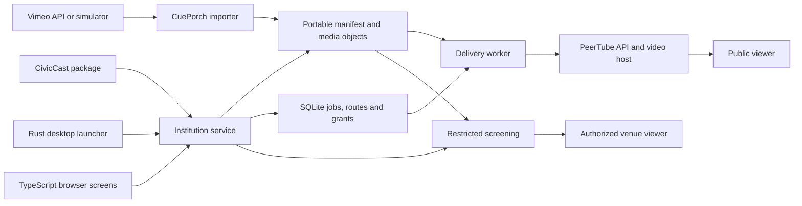
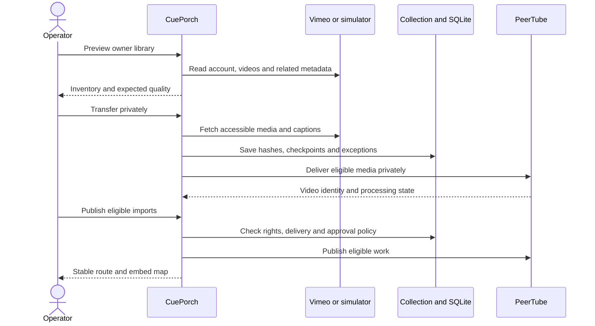
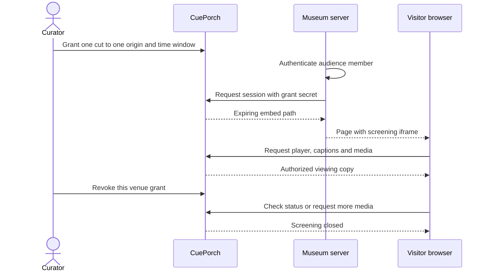

# CuePorch user manual

**Version 0.2.0 · ForkCommons**

[Project home](README.md) · [README](README.md) · [Operations](OPERATIONS.md) · [Acceptance record](evidence/ACCEPTANCE.md)

## New user guide

If your institution already runs CuePorch, ask its operator for the site address and the credential for your role. An artist starts at `/submit`. An operator starts at `/operator`. A visitor can open the public catalog at `/`. A museum visitor starts on the museum’s authorized screening page. Only the person setting up the institution needs the installation instructions.

### Install and open CuePorch

On Windows, double-click **CuePorch-0.2.0-Windows-x64-Setup.exe**. Windows should identify Scott Converse as the verified publisher. Keep the suggested library folder for a new institution. To upgrade, close 0.1.0, back up its library and select the existing folder containing both operator.json and institution.sqlite. Open **ForkCommons → CuePorch** from Start. The installer bundles the runtime and FFmpeg.

Open the macOS arm64 package on an Apple Silicon Mac or install the amd64 Debian package on Ubuntu 24.04. The Mac app has an ad-hoc signature and the installer has no Apple notarization. On these platforms use the launcher's `--data PATH` option to open an existing library outside its default location.

Enter your institution name, select **Save setup**, then open the operator console. To publish video, connect a PeerTube host using its address and publishing account, or use **Set up a local video host** with a running Docker-compatible engine. The local desktop console opens on this computer. The operations guide describes the separate deployment for a public institutional site.

### First migration

1. Choose **Move from Vimeo**, enter the operator credential, leave the Vimeo token blank for the practice source and select **Preview transfer**. Expect three rows. Read each source ID, quality and viewing permission. Inventory completes before media transfer.
2. Choose **Transfer privately**. Wait for **transferred**, then go to **Manage library and embeds** and **Load library**. The library worker may still be preparing playback. The practice source yields two playable works and one item with no downloadable file.
3. Choose **Publish eligible Vimeo imports**. In the fixture, one staged work qualifies. A restricted work stays private. If a review step is enabled, use the review queue. Reload the library to see the current state.
4. Follow **Watch**. Start the video and check the picture, sound and available caption track. **Download embed map** gives site owners the old URL, new watch and embed URLs, source and work IDs, recovery disposition and known external page. Blank destination URLs mean the work has no public route.

For an actual account, start a separate installation without `--simulate`. Use the owner’s Vimeo token with the required scopes and access to the account’s files and captions. Preview before transferring. **Original recovered** means a source designated as an original was retrieved. **Playback copy only** means the preserved file is a rendition. **Owner file needed** means the item still needs media. Keep those items on the reconciliation list. A new website embed cannot redirect a link controlled by Vimeo. Keep the old site mapping available while testing replacements. [Vimeo file access](https://help.vimeo.com/hc/en-us/articles/12427806914577) · [Vimeo caption access](https://help.vimeo.com/hc/en-us/articles/17480150130833)

### Organize imported works

Open **Manage library and embeds**, then **Load library**. The root lists works without a folder. Choose **New folder** and select its parent and color. Open an existing folder to edit its name, parent or color. Select works, choose a destination and select **Move selected**. The work IDs, delivery jobs and watch links stay the same. Search titles and filter by recorded source privacy within the current folder. Choose a list or grid and sort by title, added date, modification date or duration. Filter by creator when the source provides a name. Use Star work or Star folder to keep frequently used items in your personal Starred view. Dates and attribution depend on the available import and library history. The source privacy column displays the imported record. Folder placement leaves the work’s access settings as they were.

### Artists and exhibitors

1. An artist opens **Submit a work**, enters the creator credential, gives the work a title and selects the master. The preview is local to the browser. Add credits, description, an English WebVTT caption file or a poster as needed.
2. Choose the viewing terms for the film. **Private screening** preserves the master and prepares a separate viewing copy. To make a trailer public, attach it and explicitly select the trailer’s public-viewing checkbox. A publication time is optional and uses local time. Save the work ID returned by the form.
3. The operator opens **Exhibitions** and loads the available screening copies. Choose the work and exact cut, then enter the exhibitor’s web origin, audience, agreement reference and opening and closing times. Check the displayed time zone. Create a separate grant for each venue.
4. Send the grant ID and secret privately to the exhibitor’s **server operator**. The museum authenticates each visitor, then requests a session from CuePorch. Its web page embeds the returned session path. The server retains the grant secret. See the exchange below.
5. To end one exhibition, use **View grants** and revoke the selected venue’s grant. A curator can inspect its status, agreement, origin, cut and dates. The pilot exercised closure of an already open player, continued access for the second venue and continued availability of the separately authorized trailer.

### Reviews, complaints and appeals

All nine approval switches start **off**. In the operator console, select **Load settings and review queue**. Enable **Require approval** for any of intake, caption, publication, replay, migration, grant, catalog, moderation and restoration. Each choice applies to this institution and this step. Reload to inspect waiting actions. Approve or reject the intended action. Turning a switch off releases eligible waiting work. A recorded rejection stands. Privacy, grant windows and source permissions still apply in automatic mode.

For a work-specific problem, open **Support and appeals** with the work ID, describe the issue and save the returned case ID and private case key. Use them to add context, read the decision or submit an appeal. The operator monitors the inbox, records reasons and can suspend or restore the affected screenings. Set real support hours and contacts before inviting public reports.

## Technical user guide

### Deployment choices

| Arrangement | Setup | Evidence for 0.1.0 |
|---|---|---|
| Existing PeerTube | Set `PEERTUBE_USERNAME` and `PEERTUBE_PASSWORD` privately for its publishing account. Run `python launch.py ../station --institution station --existing-peer https://video.example.org`, substituting the actual origin. | Windows application, remote API and browser playback exercised against a local running PeerTube host. |
| Provisioned PeerTube | Run `python launch.py ../station --institution station`. The launcher uses Compose and provisions a limited publisher. | Fresh Ubuntu under WSL with cached images and installed system prerequisites. |
| Institution domains | Set `--public-url` for the canonical watch origin and `--video-url` for a newly provisioned video host. Terminate HTTPS at the reverse proxy. | Example configuration is supplied. Production DNS and field cutover remain unverified. |

The defaults are **19001** for the app, **19000** for PeerTube HTTP and **11935** for RTMP. Use `--port`, `--peer-port` and `--rtmp-port` when running additional institutions. Give each an isolated installation and video destination. Set the upload limit with `CUEPORCH_MAX_UPLOAD_BYTES` and align proxy size and timeout settings. Name individual reviewers with `CUEPORCH_OPERATOR_KEYS`. Configure contacts and operating hours as described in the [runbook](OPERATIONS.md). These command-line flags apply to the source deployment. The desktop installer starts the Python service through its native Rust launcher. The screens are compiled from TypeScript.

### Station publication

In CivicCast, use the existing **Cable file package** output with its caption sidecar. Configure `CUEPORCH_STATION_KEY` in the connector’s environment and run the connector with the product dependencies installed. Example once an approved station has a CuePorch host:

```sh
python civiccast_destination.py ./station-packages --institution-url https://watch.example.org --watch --kind meeting
```

The directory watcher hands packages to CuePorch. Use a ZIP path without `--watch` for a single package. Add `--public` only for a work cleared for public viewing and embedding. A receipt identifies the local job. Corrections to the same station work can retain its remote identity. CivicCast continues to own the schedule, playout and local recording.

For live use, `live_destination.py ORIGIN TITLE PRIVATE_SETTINGS_FILE` creates a PeerTube destination and writes encoder settings. Keep the stream key private. Stable channel and meeting routes can point to the captioned CivicCast player or a PeerTube embed. The rehearsal demonstrated synchronized live captions on the CivicCast web path and separate RTMP playback on PeerTube. Choose the path whose caption behavior your station has verified. [Live configuration and replay handoff](OPERATIONS.md#live-and-replay)

### HTTP integrations

Use `Authorization: Bearer <credential>` with the credential for the operation. Send mutation bodies as JSON except for file uploads. The institution origin and the video-host origin serve different APIs.

| Operation | CuePorch interface | Who uses it |
|---|---|---|
| Preview or transfer, poll status | `POST /api/migration` with `dry_run` and optional owner `token`, then `GET /api/migration` | Operator |
| Reconcile and publish | `GET /api/library`, `GET /api/delivery`, `POST /api/migration/publish-eligible`, `GET /api/embed-map.csv` | Operator |
| Request delivery of one work | `POST /api/delivery/<work_id>` with `public`, optional `scheduled` and `kind` | Operator |
| Submit media | `POST /api/submissions` or `POST /api/station-packages` | Creator or station, respectively |
| Configure approvals and decide | `GET /api/policy`, `PUT /api/policy/<step>` with `required`, `GET /api/actions`, `POST /api/actions/<uid>/decision` with `decision` | Operator |
| Create or revoke an exhibition | `GET /api/screening-copies`, `POST /api/grants`, `DELETE /api/grants/<uid>` | Operator |
| Request a screening session | `POST /api/grants/<uid>/session` | Exhibitor server with its grant secret |
| Configure public routes | `PUT /api/routes/<kind>/<slug>` | Operator |
| Report or respond | `POST /api/works/<work>/complaints`, `GET` or `POST /api/cases/<uid>` | Reporter opens case, case holder or operator follows up |

The exhibitor session response contains `embed` (a relative path) and `expires` (Unix time). Resolve the path against the CuePorch origin. Set the iframe’s `referrerpolicy="origin"` on the authorized site. A grant specifies the allowed origin including scheme and port. A bare session URL opened in a new tab can be denied because it lacks the expected exhibitor context. The institution’s public watch URL and a venue’s expiring screening URL serve different audiences.

### Storage, recovery and troubleshooting

The installation directory holds the collection manifest and hashed objects, institution SQLite database, receipts, private credentials and runtime. A provisioned host adds a Compose project with persistent database and media volumes. Vimeo checkpoints bind a migration to its source account and institution. Keep private storage separate from the unpacked software.

| Symptom | What to check |
|---|---|
| Console is reachable but reports access denied | Use the operator value for this installation. The creator and station keys have narrower scopes. |
| Preview succeeds but a work lacks a master | Read its recovery disposition and source permissions. Preserve any available rendition and obtain an owner copy if archival quality is required. |
| Transfer shows complete but the player is unavailable | Reload **Manage library and embeds**. Check the delivery job, due time, review queue, processing and destination warning. A private delivery has no public watch route. |
| A caption is preserved locally but absent from PeerTube | Inspect its language and any duplicate tracks for that language. Use a supported, distinct track and submit the correction. Generated captions depend on the optional TextFlowKit runtime. |
| A venue receives access denied | Check grant status, selected cut, agreement window, venue origin, session expiration, referrer and work-specific holds. Issue a fresh session through the venue server. |
| A transfer or upload was interrupted | Restart with the same private directory, source account and institution. Retry the intended delivery in the library so CuePorch can reconcile the saved receipt. |

Run `python cueporch.py verify COLLECTION` to verify stored files. For a portable exit, quiesce writes and run `python export_institution.py COLLECTION DATABASE NEW_DIRECTORY`. To resume the complete service elsewhere, take an offline host snapshot including the institution database, credentials, receipts and video-host data. Restore into fresh volumes and check public **and** restricted viewing before redirecting an institution-owned domain. [Backup and restore commands](OPERATIONS.md#recover-and-exit)

## Architecture

### Components and ownership



Flask and Waitress serve the institutional UI and API. The delivery worker reads retained objects, applies operator policy and records PeerTube receipts. PeerTube owns transcoding and hosted playback. CuePorch serves grant-protected viewing copies directly so it can check access during delivery. Keeping a separate master lets the institution preserve the work when a publisher or exhibition changes.

### Migration and publication



An item can be preserved even when hosting is incomplete. Source IDs keep cuts distinct. Checkpoints avoid unnecessary retransfers. A receipt binds a work and destination to the hosted video. Publication updates the stable institutional route after destination processing.

### One film in two museums



A second museum has its own grant and session. Revocation is scoped to the selected grant. A decision suspending screenings for the **work** has broader effect. The separately authorized public trailer is a related work with its own publication.

## Evidence and release boundaries

The 0.2.0 packages passed fresh and upgraded migration, restricted exhibition playback and real hosted publishing on Windows x64, macOS arm64 and Ubuntu amd64. The following field and recovery observations belong to the 0.1.0 baseline.

The acceptance record distinguishes live software behavior, simulated source responses and field observations. The tested Vimeo source was synthetic. Tests played actual LPM viewing copies on PeerTube, exercised an artist and two venues, followed an appeal, and restored access and publishing records on separate volumes. Production Vimeo authentication, physical cable reception, public DNS cutover and staffed support were unobserved. Historical analytics, commerce and subscriptions, full showcase reconstruction and Vimeo-specific player scripts remain gaps. [Acceptance record](evidence/ACCEPTANCE.md) · [Historical feature comparison](evidence/vimeo-comparison.md)

