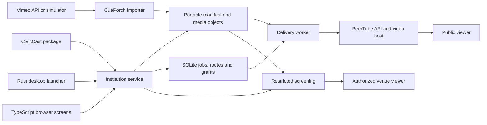
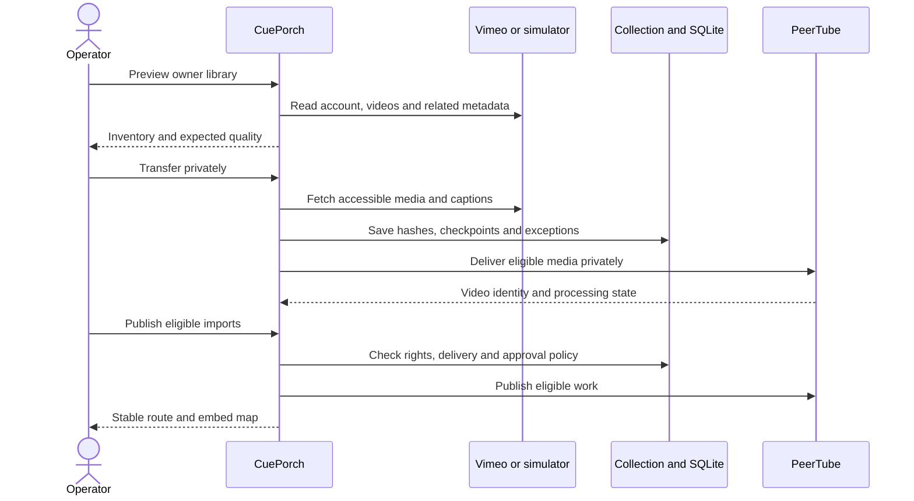
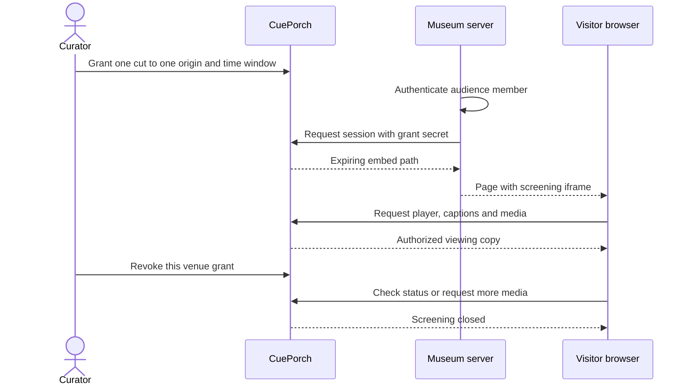

# CuePorch user manual

**Development version 0.3.0 · ForkCommons**

[Project home](README.md) · [README](README.md) · [Operations](OPERATIONS.md) · [Acceptance record](evidence/ACCEPTANCE.md)

## New user guide

If your institution already runs CuePorch, ask its operator for the site address and the credential for your role. An artist starts at `/submit`. An operator starts at `/operator`. A visitor can open the public catalog at `/`. A museum visitor starts on the museum’s authorized screening page. Only the person setting up the institution needs the installation instructions.

### Install and open CuePorch

For a signed Windows release, double-click **CuePorch-0.3.0-Windows-x64-Setup.exe**. Windows should identify Scott Converse as the verified publisher. Keep the suggested library folder for a new institution. To restore a library, close CuePorch, back up the data and select the restored folder containing both operator.json and institution.sqlite. Open **ForkCommons → CuePorch** from Start. The installer bundles the runtime and FFmpeg.

Open the macOS arm64 package on an Apple Silicon Mac or install the amd64 Debian package on Ubuntu 24.04. The Mac app has an ad-hoc signature and the installer has no Apple notarization. On these platforms use the launcher's `--data PATH` option to open an existing library outside its default location.

Enter your institution name, select **Save setup**, then open the operator console. To publish video, connect a PeerTube host using its address and publishing account, or use **Set up a local video host** with a running Docker-compatible engine. The local desktop console opens on this computer. The operations guide describes the separate deployment for a public institutional site.

### Use the operator Home

Select **Open workspace overview** to see recent uploads and imports alongside the last 30 days of observed playback. Choose **Upload** or drop a file onto Home, then select a destination in the upload dialog. Use **Create** to start a project from an existing video or open the upload, import, recording, event or showcase workflows. **Search videos** can look through your authorized Library or public Watch. Use **Workspace navigation** to reach the Library, Recently deleted, Analytics and other operator screens. The menu remembers whether you collapsed it in this browser.

### Browse public videos and curate Staff Picks

Open **Watch** at `/watch` or the site home page. Use **Explore** to browse public videos and move through the featured picks. Use **Categories** to narrow the list or enter a title, description keyword, category or tag in **Search public videos**. **Channels** links to the institution’s published channel pages. Each result opens its existing watch address.

In the operator Library, open **Staff Picks**. Add public videos, use **Move up** and **Move down** to arrange them, then select **Save Staff Picks**. The first picks appear in Explore, and the full list has its own page. Making a pick private or deleting it hides it from Watch and closes its public cover link. The selection stays in the editor so it can be removed or shown again if the video becomes public.

Open **Viewer account** from Watch to create an account or sign in. Use **Save to Watch Later** on a public video, then open **Watch Later** from the Watch navigation. Your list follows your account across browsers. A saved item is visible while its video is public. To remove an item, use the list or the video's **Remove from Watch Later** button.

In **Viewer account**, you can change your display name, pronouns or sign-in email, update your password, sign out, and delete the account and its list. Use your current password to change email, change password or delete the account. Changing your password signs out your other browsers. Browsing and public playback are available to signed-out visitors.

Use **Viewing preferences** to show everything, hide mature videos, or hide selected descriptors and unrated videos. The setting follows your account and applies to Explore, search, Staff Picks and your Feed. A direct link to a filtered public video gives you the option to show it. The video's publishing and registration rules still apply.

On a public video, use **Like video** to save it to **Liked videos**. The public count shows how many viewers liked it. Your Liked videos list is private. Use **Add to collection** to create or choose a personal collection and add the current video. Open **Collections** to play saved videos, edit a collection, remove entries or delete the collection. Video access still follows the publisher’s privacy settings. Deleting a collection leaves the videos in CuePorch.

On a public watch page, read the discussion under **Comments**. Search by text or author and sort newest or oldest first. Sign in to post under your display name or delete one of your own comments. If the operator requires approval, see the comment’s status under **Your unpublished comments**.

New public comments publish automatically by default. In the operator console, select **Load settings and review queue**, then turn on **Require approval for public comments** to review new posts. Read each comment in the queue and choose **approve** or **reject**. Turning the setting off releases comments that are still waiting. Use **Public comments** on the same screen to find and remove published comments.

### Invite people to your team

Open **Team members** from the Operator console. Enter the person’s email and role and select **Create invitation**. If your workspace has a mail relay, **Email the invitation** is selected by default and you can include a message. Clear the checkbox to share the private link yourself. The link is also available to copy after creating the invitation if email delivery fails. The link expires after seven days and can be used once. Use **Replace link** or **Email replacement link** to issue a new one, or **Cancel invitation** to withdraw it. The recipient opens the link and chooses a password. They can sign in again from **Team sign-in** using the invited email address and that password.

Administrators can open the Library and manage invitations, roles, and video access. Contributors can upload private videos to **My Library** and view videos shared with them. Viewers can play the videos you share with them. Choose **Manage media access** next to a member to share a video or a folder for viewing. A folder share includes playable videos in its subfolders. Moving a video out of that branch or revoking the folder share removes that path to it. A direct video share still applies. **Remove access** ends the member’s team sessions. Their retained uploads remain available to administrators. The installation’s operator credential remains available for owner access. Viewer accounts for public Watch are independent of team membership.

Shares start with **Can view**. Select **Can edit** on a video or folder share to let a Contributor update its video details and editorial status. Contributors can also edit their own uploads. They open **Edit video details** from the team player. Viewers can play a video shared with them, including one shared with a group that has edit access. Administrators manage privacy and public sharing.

**Contributor Plus** includes Contributor access and adds **Edit video interactivity** on videos the member owns or can edit. The team editor can update chapters, timed cards and end screens using artwork already assigned to that video. Administrators can upload new artwork and manage video rating and registration.

Open **Video analytics** from the team player to see the video's playback totals, daily activity and retention. Use the date and playback surface filters, or choose **Download CSV**. Contributors can open this report on their own uploads. Owners and Administrators can open it on any video in their workspace.

Owners and Administrators can open **Team analytics** from **Team members**. Named viewing activity starts off. Turn on **Record named viewing activity** to report signed-in playback from the team player. The player shows that recording is enabled and honors browser Do Not Track and Global Privacy Control. Filter by date, select a member or video, or download the matching CSV. Turning it off stops collection and hides the report. Turning it back on makes earlier recorded activity available again.

Use **Edit creator profile** in your team workspace to save a creator name, handle, biography and links. Select a cover video and order the featured section from your own uploads. Turn on **Publish profile** when you want to share the profile link. Only your videos currently available in public Watch appear. If an administrator withdraws a video or makes it private, it disappears from the profile too.

Sign in with a viewer account to **Follow creator** from a public profile or one of the creator's public videos. Open **Feed** in Watch to see their new public videos. **Unfollow creator** removes that creator's videos from your feed. Private videos and unpublished profiles stay out of the feed.

In **Groups**, select **New group**, enter a name, and choose the members and each folder's access. Folder shares include subfolders. Choose **No access** to remove a folder from the group. You can also remove a member or delete the group. Separate video, folder and group shares still apply. If another administrator saved changes first, use **Reload groups** before editing again.

Use **Manage workspace links** in **Team members** to add a CuePorch workspace by name and HTTPS origin. Choose the groups that can find it under **Workspaces** in their team library. Set up the member's role in the destination workspace. After they sign in there, the same browser can keep both sessions. Remove access to a workspace from its own **Team members** screen.

Open **Team settings** in **Team members** to set the workspace's display name, accent and JPEG or PNG logo. The name takes up to 32 characters and the logo up to 5 MB. Changes appear on team screens, creator intake and the public catalog. The local data directory and institution identity stay bound to the original installation.

The Owner or installation credential can open **Sharing restrictions** in **Team settings**. Choose which visibility modes, embed settings, third-party publishing actions and direct file link actions Administrators and Contributors can use. Private stays available. Contributors start with workspace-only access. Allow additional modes to let Contributors use **Video sharing** when they can edit the video. Removing a visibility mode for Administrators also removes it for Contributors. Saving the change makes affected Library videos private, updates defaults in that mode and cancels pending shares in that mode. Designated public records retain their settings. Existing delivery jobs and third-party copies have separate controls.

Use the installation credential to assign an active member as **Owner**. The Owner can transfer ownership to another active member from **Team members**. The previous Owner becomes an Administrator. The installation credential can recover ownership if the Owner loses access. Team administrators can choose **Download team roster** for a CSV of members and invitations, including roles, dates and membership status.

### First migration

1. Choose **Move from Vimeo**, enter the operator credential, leave the Vimeo token blank for the practice source and select **Preview transfer**. Expect three rows. Read each source ID, quality and viewing permission. Inventory completes before media transfer.
2. Choose **Transfer privately**. Wait for **transferred**, then go to **Manage library and embeds** and **Load library**. The library worker may still be preparing playback. The practice source yields two playable works and one item with no downloadable file.
3. Choose **Publish eligible Vimeo imports**. In the fixture, one staged work qualifies. A restricted work stays private. If a review step is enabled, use the review queue. Reload the library to see the current state.
4. Follow **Watch**. Start the video and check the picture, sound and available caption track. In **Move from Vimeo** or the Library, **Download embed map** gives site owners the old URL, new watch and embed URLs, source and work IDs, recovery disposition and known external page. Blank destination URLs mean the work has no public route. Keep the CSV private because it can contain restricted links.

For an actual account, start a separate installation without `--simulate`. Use the owner’s Vimeo token with the required scopes and access to the account’s files and captions. Preview before transferring. **Original recovered** means a source designated as an original was retrieved. **Playback copy only** means the preserved file is a rendition. **Owner file needed** means the item still needs media. Keep those items on the reconciliation list. A new website embed cannot redirect a link controlled by Vimeo. Keep the old site mapping available while testing replacements. [Vimeo file access](https://help.vimeo.com/hc/en-us/articles/12427806914577) · [Vimeo caption access](https://help.vimeo.com/hc/en-us/articles/17480150130833)

When CuePorch restarts, **Move from Vimeo** shows the saved inventory or result to an authorized operator. If the service stopped during a transfer, re-enter the same Vimeo account token and choose **Transfer privately**. CuePorch reuses verified files from that job. The token stays in process memory.

The transfer shows how many videos have been processed. After a preview or transfer, use the inventory pages and **Source issues** column to find missing media, incomplete downloads, checksum mismatches and metadata Vimeo did not return. The summary counts cover the entire inventory. CuePorch checks the source checksum when Vimeo provides one, and stores a SHA-256 checksum for each recovered file. Retry **Transfer privately** after correcting source access or a network problem. When a transfer returns incomplete media for a previously imported video, CuePorch keeps the earlier playable cut in the Library.

To record where a video is already embedded, open **Edit video details** and enter each page URL under **Pages that embed this video**. Save the details before downloading the embed map. Each recorded page gets its own row, and the entries stay with the work when you transfer the Vimeo account again.

After transfer, choose **Restore Vimeo privacy** from the imported video’s actions to prepare viewer links from its recorded visibility, embed allowlist and download permission. Use a replacement password for a password-protected transfer. Unlisted videos receive a CuePorch key. If the source embed allowlist is unavailable, CuePorch keeps embedding off. For a public work previously delivered by CuePorch, the service verifies its PeerTube copy has become private before it switches the existing CuePorch work addresses to the new player. The operator can see the handoff status from the same action. Designated public records continue to use their protected routes. [Vimeo’s documented privacy settings](https://developer.vimeo.com/api/guides/videos/interact)

### Organize imported works

Open **Manage library and embeds**, then **Load library**. The root lists works without a folder. Choose **New folder** and select its parent and color. Open an existing folder to edit its name, parent or color. Select works, choose a destination and select **Move selected**. Work IDs and delivery history are retained. Search titles and filter by privacy within the current folder. Choose a list or grid and sort by title, added date, modification date or duration. Filter by creator when the source provides a name. Use Star work or Star folder to keep frequently used items in your personal Starred view. Dates and attribution depend on the available import and library history. For Vimeo imports, the privacy column displays the source record.

### Work actions

To add local files, open a library folder and choose **Upload**, or drop files anywhere on the library page. Confirm the folder and choose **Upload selected files**. CuePorch preserves the original and shows when each file is uploading, preparing or ready. You can retry failed files from the same dialog. New uploads start private until you change **Upload defaults** for your operator account. Open **Customize privacy for these videos** to override your defaults for the current upload. Audio, images and documents stay private.

Accepted video is MP4, MOV, WebM or MKV. Image uploads accept JPEG, PNG and WebP, and audio accepts MP3, WAV, FLAC, Ogg and M4A. Open **File info** to preview a stored image or play audio. PDF, DOCX and TXT are available for download. Use **Type** to show videos or other files in the current folder.

For videos uploaded directly to the library, select the privacy badge and choose **Private**, **Password**, **Unlisted**, **Public** or **Embed only**. Unlisted links include an access key. Public videos appear in the institution’s video catalog. For embeds, choose **Anywhere** or enter the allowed domains, one per line, and copy the player code from **Share**. Use **Allow viewers to download** if they should see a download link. If the institution turns on publication approval, CuePorch shows changes waiting for that approval. Setting a video to Private closes its viewer and embed links. Review links and licensed venue screenings have their own controls.

Select multiple directly uploaded videos and choose **Privacy for selected** to apply the same link mode, embed restrictions and download permission to the selection.

Use **Type** to browse videos, folders or supporting files. Hover over a video's **Preview** control to play it silently. Press the same control to start or stop the preview with the keyboard or on a touch screen.

Select up to 50 videos and choose **Add to showcases** to add them to one or more existing showcases in order. Showcase visitors still need access to the individual videos. Choose **Set video rating** to add the same thumbs or stars prompt, choose its start time, or turn the widget off. Earlier votes stay in the reports. The same actions are available in each video’s **Actions** menu.

Choose **Folder privacy** to apply an override to directly uploaded videos in the selected folder and its subfolders. Subfolders with their own override keep their settings. New uploads and videos moved in use the nearest folder override. Removing an override keeps each existing video’s current settings. Future uploads inherit the closest remaining override or the uploader’s account defaults.

Open **Actions** beside a work. **Share**, **Copy link** and **Copy embed code** use the published CuePorch address. For a restricted work, use **Manage private screening grants** to assign access. **Watch later** saves a work to your personal queue. The queue is available from the folder navigation.

**Rename** updates the displayed title and synchronizes the name on a connected video host when CuePorch manages the hosted copy. Existing CuePorch watch and embed URLs stay the same. **Create a copy** starts a separate private work in the library root, with its own ID and the same retained media. **Video info** shows source and file details and can preview a stored video. **Download** saves a retained original or viewing copy. A download link expires after ten minutes or when the work is deleted.

**Change thumbnail** accepts JPEG, PNG or WebP, or a frame from the archived video. Use the **Frame time** slider to inspect the frame before saving. CuePorch keeps the selected image with the institution's collection and updates a managed PeerTube video in place.

Choose **Edit video details** to update the title, description, tags, categories, credits, Creative Commons license, content rating or disclosures. The form also shows the stored file’s size, resolution, frame rate and audio format when available. These edits stay with the work when you replace the media. The CuePorch viewer page shows the saved details after the viewer is authorized to play it.

Use **Playback projection** for equirectangular 180° or 360° videos. Pick monoscopic, top-and-bottom stereo or side-by-side stereo. Existing videos stay flat until you choose a projection. **Use imported projection** uses a recognized Vimeo projection flag. Authorized viewers can drag, use the arrow keys, reset the view or return to flat playback. In a conventional browser, a stereo master plays as a single-eye preview. Flat playback stays available if the browser cannot render the panorama. Watch and embed links keep the video's existing privacy rules and the stored master stays intact.

The video workspace previews the retained copy and opens the version, review, download and other library actions for that work. Set **Editorial status** for the current version. A reviewer with permission to change status can update the same version’s status. The editorial label does not change viewer access or turn on an approval requirement.

For a CuePorch viewer link, use **Start at** to enter a playback time or take it from the preview. A **Custom link name** creates a separate watch address that uses the same privacy rules as the video. Choose whether it expires after one day, one week or 30 days. Changing, removing or expiring a custom address also closes its media links. The video’s original watch address still follows its own privacy settings.

For a video that permits embedding, choose fixed dimensions or responsive sizing, and whether the player should autoplay, start muted or loop. Copy the generated iframe to your website. Allowed domains apply to the generated code. Browsers can require muted playback or a viewer gesture before autoplay.

CuePorch’s own embedded player offers an optional JavaScript API. Select **Include player API script** to turn it on for the generated iframe. Import the `Player` class from your CuePorch host and pass the iframe element. The API supports playback, pause, seek, elapsed time, duration, volume, mute, loop and playback events.

```javascript
import { Player } from "https://video.example.org/player.js";

const player = new Player(document.querySelector("#film-player"));
await player.ready();
player.on("pause", ({ seconds }) => console.log(seconds));
await player.setCurrentTime(12);
```

Set the iframe’s HTML ID to `film-player` in this example. For an embed still delivered by PeerTube, use its documented API. [PeerTube Embed API](https://docs.joinpeertube.org/api/embed-player)

Open **Player and page appearance** from the workspace to change the CuePorch watch player or embed separately. Pick colors, upload a logo, set the page theme, choose visible controls and save settings as a named preset. The preview updates as you edit the theme. **Apply this theme to all existing videos** changes the watch page theme while keeping those videos’ player controls. For a video delivered by an external host, customize its player on that host.

Open **Manage brand kits** from appearance or the timeline editor. Save a named palette and title font, add a logo or use the existing workspace logo, and optionally select archived intro and outro videos. **Use brand kit** in appearance fills the visual settings for the current surface. Save appearance to apply them to the viewer page or embed. In the timeline, the kit sets the canvas background and adds the retained intro and outro to the rendered output. Applying a kit again replaces those two slots. Existing player settings and saved timelines retain their applied settings when a kit is edited or removed.

In **Record Studio**, choose a **Recording brand kit** before starting a take to use its background and draw its logo into the picture. In **Live Studio**, open **Scenes and graphics** and choose **Use brand kit** to set the event's graphic colors, title font and logo. Take a scene to show those settings in the program. Event scenes keep the applied logo when the kit is edited or removed. Use the timeline to place retained intro and outro clips around a recording.

Open **Languages and subtitles** to set the recording’s original language or upload a WebVTT or SRT subtitle file. Use a language code such as `en` or `fr-CA`. Search the transcript, edit cue text and timestamps, or jump to a cue in the preview. CuePorch exports the edited track as WebVTT and retains it with that cut. Existing review comments and status stay on the same cut after subtitle changes.

Under **Alternate audio**, upload a synchronized dubbed, audio-description, or commentary track and enter its language code. CuePorch accepts WAV, M4A, AAC, MP3, FLAC, Ogg, or audio from MP4. It keeps the upload and prepares a playback copy for that cut. Playback aligns audio to the start of the video and pads or trims its end to match the cut. Use the track’s controls to download, replace, or remove it. Viewers can switch using **Audio track** on CuePorch-hosted watch pages and allowed embeds. The player keeps the current time and captions. When viewer downloads are enabled, **Download video** includes the selected audio. **Appearance** can hide the picker independently for the watch page and embed.

With local TextFlowKit installed, CuePorch can generate subtitles as soon as you set the original language. Clear the generation checkbox if you plan to upload a track yourself. **Generate subtitles with TextFlowKit** requests another pass. If the institution enables caption approval, the job waits in the operator queue. It proceeds automatically when that approval switch is off. Generated tracks can be reviewed and edited in the same cue editor.

Use **Interactivity** to add or edit chapters. Play the preview and select **Add chapter** to use the current position, or enter a different start time in hours, minutes and seconds. **Preview time** jumps to the selected row. Choose **Save chapters** to update the viewer’s chapter menu on the watch page and embed. Each surface has a **Chapters** toggle under **Player and page appearance**. Hosted PeerTube copies use PeerTube’s player controls.

For a CuePorch-hosted player, **Timed cards** lets you place a title, image and link over the video. Each card starts at the time you choose and stays up for six seconds. The **End screen** can show a link, image, message or up to three public videos, or change how the player finishes. Choose **Save cards and end screen** to apply these choices to the current cut. Videos hidden after you select them are omitted from the end screen.

Use **Video rating** to collect thumbs or star ratings from viewers. Choose when to show the prompt. Each viewing session can respond once. **Video Rating report** displays the totals and exports a CSV grouped by cut. Turning the widget off preserves earlier ratings.

In **Registration**, turn on the form to require an email before CuePorch-hosted playback. You can ask for names, add text fields, dropdowns and checkboxes, and link to your privacy policy. Choose one or two steps and save the settings as a preset to reuse on another video. Campaign fields are recorded only when **Save UTM campaign fields** is enabled. View **Recent registrants** or download the complete list as a CSV. Registration works together with the video’s password and embed permissions. Designated public records remain open.

Open **Analytics** from the workspace to see impressions, views, view rate, finishes and time watched on CuePorch watch pages and embeds. One loaded player counts as an impression. Its first play counts as a view, and time watched includes repeat playback. Filter by dates in UTC and by playback surface. The retention graph and its accessible table show which portions of the current cut were played. Select a position to seek in the operator preview. The daily CSV follows your date and surface filters.

Open **Analytics** from the library to compare videos. Pick specific works or report across the library, then group by video, date, device, referring site or playback surface. Add a second breakdown or choose day, week, month or year for the trend. **Advanced report** from a video's analytics preselects that video. Downloads use the selected filters and breakdown. Referral data records the site's origin when the browser supplies it, and earlier observations without device or referral information appear as **Unknown**.

In the **Video** report, **Top by views** ranks up to five videos, regions, device types and referring sites under your current filters. Select a video title to open its analytics. The rankings appear when the selection has playback views.

**Downloads** counts authorized viewer download requests that begin at the start of the file on CuePorch's watch pages and embeds. It includes a full-file request or a range beginning at byte zero. The report records requests, including retries from the start, and cannot confirm how much a visitor saved. Ordinary playback, later ranges, file checks and operator downloads do not count. Viewer analytics opt-outs also apply to downloads.

**Likes** and **Comments** in the video and date reports count active likes and published public comments on library videos by UTC date. Comments count on the date they become public. Unlikes, comment removals and viewer account deletion remove the corresponding activity from the report. Browser analytics opt-outs keep a like or comment visible publicly and exclude it from these reports. The report starts counting when this feature is installed. Earlier likes and comments stay on their watch pages. Device, region, referring site and text-track filters or breakdowns leave these metrics blank.

In the video, region, referring site, device and date reports, narrow results by **Text track language** or **Text track type**. Add **Captions and subtitles** as a breakdown to see when viewers use each available language. Watch time is split by the track shown during playback, so a session that switches tracks appears in each applicable row and counts once in the report totals. **Off** means playback was observed with captions disabled. **Unknown** includes older sessions and sessions without a measured track. Operator uploads can be marked as subtitles or captions, and TextFlowKit tracks appear as automated captions.

Use **Audio track language**, **Audio track type**, or the **Audio track** breakdown to see how viewers use the original, dubbed, described, or commentary audio on CuePorch video pages and embeds. Set the video's original language in **Languages and subtitles** to label original audio. The report uses `und` when the original language is unspecified. Combine audio and text track controls to measure time played with both selections together. **Unknown** includes older playback, live and replay event players, and playback without an observed audio track.

Select videos and events together, or filter or break down the report by **Streaming type**. **On demand** covers library videos, **Live** covers active broadcasts, and **Replay** covers event recordings. Direct playback in an external player has no event viewing record here. Event sessions recorded before the shared report captured first-view dates remain available in the event's occurrence analytics. Viewers can opt out of CuePorch's native event measurement with their browser privacy settings or by adding `dnt=1` to an event URL. Average percent watched for event replays uses the recording duration when the video host supplies it.

Choose **Engagement** to compare retention across the selected videos. CuePorch aligns each cut by percentage of its duration and counts each playback session once at a point it played. Completion includes sessions that reached the last two seconds or ended. The table lists average watched, completion rate and views at five milestones. Choose **Video ratings** for thumbs up and down or star votes, with totals, score breakdowns and averages. Date and video filters apply to both reports and their CSV downloads.

Choose **Region**, **Source URL**, **Device**, or **Date** for a dedicated breakdown with the same viewing metrics. You can add a second dimension and download the filtered table. Source URL shows the referring origin when the viewer's browser makes it available. Region shows the geographic code supplied by your configured proxy, or **Unknown**. The region filter accepts codes such as `US` and `US-CO`, or `Unknown`.

**Unique impressions** and **Unique viewers** count identifiable browser profiles within the selected date and report filters. Repeat plays in the same browser count as separate views and one unique viewer. Data from different browsers, devices and isolated embed storage can represent separate profiles. Older observations and views with unavailable browser storage still contribute to ordinary impression and view totals. The report shows identity coverage and uses a random browser value stored on the player origin. CuePorch only retains a deployment-specific digest in analytics. **Average percent watched** divides each view's observed watch time by that version's duration and averages the resulting percentages. Views without a known duration are omitted from that metric.

To enable region reporting, set `CUEPORCH_ANALYTICS_PROXIES` to the comma-separated IP addresses of the reverse proxies that connect directly to CuePorch. Configure those proxies to remove any incoming `X-CuePorch-Region` header and set it from the deployment's geographic lookup. The header accepts a two-letter country code or a subdivision code such as `US-CO`. Leave the variable unset for deployments without a trusted lookup. The regional report stores the code with the playback observation. CuePorch does not store the viewer's IP address in this report.

In the native embed builder, select **Disable playback analytics for this embed** to add `dnt=1` to the iframe URL. The player still plays and skips CuePorch playback measurement. Native watch pages and embeds also honor the browser's Do Not Track and Global Privacy Control request headers.

Choose **Bandwidth** to see media payload served by CuePorch, grouped by UTC month or content and split into live and on-demand delivery. The selector includes live events. The page shows decimal gigabytes and exports exact byte totals in CSV. The service measures video playback and downloads, review and showcase video, screening media, and live or replay media served by its HLS gateway. Bandwidth is an aggregate delivery counter, so disabling playback analytics still leaves delivered bytes in this report. Requests directly to PeerTube or a CDN do not pass through this counter.

Open **Edit video** from the workspace. Set the start and end in seconds, move the timeline and take the preview time, or choose boundaries from a subtitle cue. Play the selection before saving if you want to check its boundaries. **Save as new version** replaces the current viewing cut and adjusts its captions and chapters. Earlier cuts and their original media can be restored from **Versions**. **Download GIF** exports up to six seconds from the selection without replacing the video.

Open **Timeline editor** to combine clips from the library. Use **Upload and add clip** or **Record a clip** to bring in new footage without leaving the editor. CuePorch saves these sources to the library and adds them to the draft. Record Studio opens in the editor and uses the selected folder’s privacy settings or your upload defaults. Select a source, change the bounds, split at the preview time or omit a subtitle cue. Move clips earlier or later, adjust the canvas and mix a library audio work beneath the video. Undo and redo edit actions before rendering. CuePorch saves a draft while you work and opens it again when you return. **Render as a new version** queues the edit and keeps the original cuts available through **Versions**.

### Record Studio

Open **Record Studio** from the library. Choose a camera and microphone, connect them in the browser, or share a screen, window or tab. The studio can combine camera and screen side by side or as an inset. Pick the canvas ratio, output size and background.

In Record Studio or Live Studio, enter a script in **Teleprompter**. Set the font size and scroll speed, or choose **Off** to scroll by hand. Use **Play script**, **Pause script** and **Reset script** to rehearse. Starting a take opens the script and starts scrolling if enabled. CuePorch hides the script preview while sharing your screen.

Choose **Float script window** to position it over your browser. Drag **Move script** or focus that button and use the arrow keys. Drag the lower corner of the script to resize it. Clear the checkbox to return the script to the Studio controls.

Choose **Auto (follow my voice)** to keep an English script in step with a connected microphone. Auto uses your installation's local TextFlowKit runtime. Voice recognition does not retain the microphone buffers or recognized text. The normal recording keeps the audio routed to your program mix. If Auto is unavailable, select a fixed scroll speed or scroll by hand.

An admitted guest speaker can open **Teleprompter** in the speaker room and use their own script and microphone. The script stays in the guest's browser. Leaving the room or losing admission cuts off access.

Start, pause, resume and stop the take from the preview. Play or download the result, or choose a library folder and save. CuePorch uses the same folder privacy and upload defaults as an ordinary upload. A browser draft can be recovered when you return to Studio on that browser and app address. Browser storage and device access depend on your browser and its permissions. Desktop loopback and HTTPS installations support media capture.

**Replace** saves another MP4, MOV, WebM or MKV as the current version. CuePorch retains the original of each version and prepares a separate viewing copy. Choose **Restore previous version** in the same dialog to make that cut current again. Timed captions and chapters stay with their cut. Existing exhibition grants continue to play the version selected when the grant was made. A managed public video updates through the existing publication policy and uses the same watch and embed addresses.

**Review link** opens the list of external review links for the work. Enter an internal name and expiration, which defaults to 30 days. Add a password or enable downloads and earlier versions as needed. Give reviewers the link and, if set, its password. Reviewers can play the permitted cuts in a browser. Use **Disable** to suspend the link and revoke its active review sessions, **Manage** to change its settings, or **Make a copy** to create a separate link.

The link settings also control posting comments, changing the review status, and seeing resolved threads. Select **Use current time** in the review player to pin feedback to the frame you are viewing. Select a posted timecode to jump there. Use **Reply** to keep a discussion in the same thread. In the operator’s link list, **Comments** opens the selected version’s feedback with options to resolve or reopen threads and export a CSV.

Customize each review with a logo, dark mode, and optional suggestions for other public works after playback. The default end card offers **Play again**. **Save as default settings** applies your choices, expiration length, and permissions to future links. Turn on **Automatically create review links for new uploads** in those defaults to generate a review link for new videos from the operator library, artists and station intake. Use the link list to share it with the intended recipients.

**Preview as reviewer** opens an operator preview with the review link’s current permissions and settings. The review player offers loop, playback speed, and next/previous frame on videos with a readable frame rate. When the archive contains both a playable original and screening copy, use **Playback quality** to switch between them.

Comment text supports clickable HTTP and HTTPS links. Select an emoji below a comment to add your reaction and select it again to remove it. **Upload new version** is available in the operator preview. Recipients can keep using the original review link after the update. Previous feedback stays with its original cut.

Type `@` and the beginning of a reviewer’s name, then select their name from the suggestions. **Notifications** on the review page lists new mentions and replies for that browser. A notification opens the comment that prompted it. You can choose all comments, mentions and replies, or off.

When the host enables device notifications, open **Notifications** and select **Enable device notifications**. Your browser will ask whether it can show alerts even after you close the review. Use **Turn off device notifications** to stop alerts from that review on this browser. Your comment notification preference also applies to device alerts.

For HTTPS installations, set `CUEPORCH_PUSH_CONTACT` to a `mailto:` address or HTTPS contact URL controlled by the operator and restart the CuePorch service. CuePorch stores its Web Push application key in the institution database. Keep that database available across upgrades to preserve subscriptions. An operator who runs a compatible push service can allow its HTTPS origin with `CUEPORCH_PUSH_SERVICE_ORIGINS`.

### Showcases

Open **Showcases** from the library. **New showcase** creates a private gallery. Give it a title and link name, add videos, and use **Move up** or **Move down** to set playback order. Choose a gallery grid or a player with a playlist, add a logo and featured information, and pick a card size. Preview the saved gallery at desktop or mobile width before sharing.

Choose **Public**, **Password** or **Embed only** to create viewer links. The optional list of allowed sites restricts embeds. A public showcase lists publicly visible videos. A password-protected showcase can play other restricted videos when their embed settings permit it. Private videos stay in the operator preview. A video with its own registration form keeps that gate and is omitted from guest playlists. Use **Registration** to require a form for the whole showcase and export the answers as CSV. Use **Make a copy** to start a private gallery with the same presentation and video order.

**Move from Vimeo** lists showcases and their source visibility during inventory. The transfer creates private galleries with ordered members found in the account inventory and reports the source video IDs that were unavailable. Repeated transfers keep the gallery and operator edits. Set the appropriate visibility, password and embed domains in CuePorch when the transferred gallery is ready. The transfer preserves names, descriptions and available video order. Recreate design and registration settings in CuePorch.

### Live events

Open **Live events** from the library and choose **New event**. Set up from scratch, choose an event type for editable defaults, or reuse an earlier event's settings. Live broadcast starts with an external encoder, chat and captions. Webinar starts with the browser, registration, chat, captions and Q&A. Team event starts with the browser, low latency, chat and captions. Online learning starts with the browser, registration, captions and Q&A. Custom starts with audience options off. All start private. Set the preferred production method and change any of the suggested options before saving.

Reusing settings fills in the title, description and time zone. It also copies production choices, registration form design, player appearance and the most recent saved chat, captions and Q&A settings. Enter a new link name and schedule. The prior event's attendee responses, chat messages, questions, media, encoder credentials and destinations stay with that event. Edit any inherited audience options before saving. Change them later in the selected occurrence's production controls. Private encoder preview and question review are optional controls and start off in the built-in presets.

Enter the start and end in the chosen time zone. For repeat programs, select daily, weekly or monthly and choose the interval. A weekly event can use several weekdays. End the schedule on a date, after a specified number of occurrences, or leave it open. The calendar flags overlapping times. Use **Edit event** to change an unprepared event and keep its viewer link.

To prepare an external encoder, connect a live-enabled PeerTube host. In the calendar open production for the intended occurrence and choose **Prepare encoder**. Paste the private server address and stream key into your encoder. **Refresh stream status** checks whether the host is receiving the stream. A public event has a CuePorch watch page and iframe. These addresses use the calendar occurrence for live playback and its replay when recording is enabled. Public events are available automatically unless the publication approval switch is enabled. A private production has no public player.

Use **Where may this event be embedded?** to allow any site, turn embedding off, or list specific domains. Enter domain names without a scheme or path. A domain also allows its subdomains. For a test site with a nonstandard port, include the port to allow only that port. The public watch link remains available when embedding is restricted. An allowed venue must send its referrer when loading the iframe.

Choose **Unlisted** to give viewers a secret link, **Password** to ask for a single viewing password, or **Embed only** to play within an iframe without a separate watch page. Registration, when enabled, follows the password. A saved change to a password or visibility revokes previous viewing access. Reusing an event starts a private draft with separate access settings. Share an unlisted link only with its audience and send a protected event's password separately.

Use **Regional availability** to allow or block listed countries, subdivisions, U.S. cities or ZIP codes. Enter one location per line, such as `CA`, `US-CO`, `US-CO | Longmont` or `80501`. Import a Vimeo-format CSV to fill in the fields or download the saved CSV from the event editor. Events default to **Anywhere**. With a rule active, CuePorch rechecks the location on the watch page, embeds, media, captions and audience requests. The event remains private on PeerTube and cannot be sent to a third-party simulcast destination while regional rules apply.

Regional rules use the trusted proxy configured for region reporting. Configure it to remove any viewer-supplied `X-CuePorch-Region`, `X-CuePorch-City` and `X-CuePorch-Postal-Code` headers and set the appropriate values from its lookup. City and postal code are required only when the event rule needs them to decide access. A request with no trusted information or an indeterminate block is denied.

Open **Content and disclosures** to rate the event for all audiences or mature audiences. Choose the descriptors that apply and mark advertising or realistic AI-generated material where appropriate. Viewers see the disclosures on the event page and embed. Reusing the event carries those settings into its private draft.

The viewer's waiting room checks for a stream automatically. New event links play through CuePorch while the connected PeerTube copy stays private. After recording, the same link plays the finished replay. Turn on **Replay** under approvals to hold the finished recording privately for a decision. Choose **Cancel this occurrence** to cancel an unprepared session in a repeating schedule. For a prepared or active session, choose **Withdraw this occurrence** to close the watch page and embed. End an external encoder's signal from the encoder. For older occurrences published directly on PeerTube, end that signal before retrying a host privacy change.

New events that record a replay also keep a private copy in the Library by default. Clear **Keep a private copy in the Library** in the event editor to turn that off. For an existing recorded event, open **Library recording** on the occurrence and choose **Save to Library**. Use **Refresh Library recording** to check progress and **Open Library recording** to play or organize the finished MP4. CuePorch retains the video host's playback copy and gives it the date of the event in its scheduled time zone. The copy starts private and stays in the Library if you withdraw the occurrence. To give the Library copy its own link, open **Video privacy and embed rules**. The Library link follows the institution's Publication approval setting.

For a repeating public event, open **Replay playlist** and enable **Show past broadcasts in the player**. Choose whether playback should advance automatically or loop. The watch page and embed list released recordings in schedule order. Attendees who register can select other released recordings in that player without signing up again. A replay leaves the playlist when you withdraw its occurrence.

Choose **Registration** before preparing the encoder if viewers must sign up. Reuse a saved form or create a new one. The event link still opens the waiting room. A registered viewer can stay on that page for the stream to start. CuePorch keeps the PeerTube copy private and serves the video through the event page. Saving a form change asks existing viewers to register again. Download responses from **Registration** with an operator credential.

For browser capture, choose **Open browser studio** for the occurrence. Connect a camera and microphone, or choose a screen to share, and preview the composition. Choose **Broadcast from this browser** and start the stream. Keep the studio tab open while broadcasting. When you stop, you can save or download the local take. Choose **Recording only** to use the same studio without sending media to the host. Browser broadcasting needs localhost or HTTPS and WebM media capture support.

Expand **Scenes and graphics** in Live Studio. Add a template and edit its layout, colors, title and lower-third text. Choose **Event logo** from the library and save the brand settings to apply it across the event. For a full-screen image, choose the title layout and select a library image. Preview a scene and choose **Save scene** before taking it to air. **Take scene** changes the live output and resets its lower third to hidden until you choose **Show lower third**. Scene order and brand settings are saved for the event. Selecting a scene for editing keeps the current live output on air.

To present slides, choose a PDF or PowerPoint `.pptx` of up to 100 MB and 500 slides under **Presentation file**, then select **Import slides**. Choose the deck under **Slide presentation**, select the **Camera inset** layout if you want your camera on screen, and save and take the scene. Use **Previous slide** and **Next slide** to change the slide in the broadcast. The uploaded deck is private to the operator workspace. Viewers see the composed video. Slides are rendered as still images, so embedded video, audio, and animations do not play.

CuePorch renders PDF presentations with bundled PDFium. PowerPoint import uses LibreOffice Impress on the computer running CuePorch. Install Impress in its standard location or set `CUEPORCH_SOFFICE` to the full path to its command-line executable before starting CuePorch. You can also export a PowerPoint presentation to PDF before uploading it.

Choose **Scene video** to use a retained library cut. Taking the scene starts the clip and adds its audio to the live and local recording mixes. Use **Pause clip**, **Play clip** and **Restart clip** to control it without ending the broadcast. The saved scene keeps the selected cut if a new library version is later uploaded.

Open **Audio mixer** to check the input level of the microphone, shared screen audio, active scene clip and each connected guest. Adjust **Program volume** or select **Mute in program** before or during the broadcast. The level meter continues to show that source's signal while muted, and connected guests can check in backstage while their audio is still off air. Mixer controls apply in the current Studio tab.

Open **Q&A and polls** in Live Studio to manage audience questions and polls. Take a scene, then choose **Show question on scene** for a published question or **Show poll on scene** for an open poll. The current scene displays one audience graphic at a time in the lower part of the program. **Publish results** adds vote percentages and the marked answer to an on-air poll. Hiding or archiving the item removes the graphic. Returning to a scene restores its selected graphic during the current Studio session.

Open **Speakers** in Live Studio to invite a guest. Enter their name and send them the complete invitation link. They can join from a browser with a camera and a microphone. The link can be used once, and expires at the end of the occurrence. Reissue an invitation by removing the old entry and creating another. Up to seven guests can be invited to an occurrence.

Guests join the speaker room automatically unless you turn on **Approve invited speakers before they connect**. Use **Admit** for a waiting guest, or turn off approval to admit everyone already waiting. Preview the guest's feed before placing it on air. Incoming speaker audio joins the program when that speaker is on air. Use **Take off air** to move the speaker backstage, or **Remove** to end their access. An admitted guest can post in **Speaker chat**. The audience never receives the speaker messages.

An admitted guest can open **Presentation** and use **Share slides with producer** to send a PDF or PowerPoint deck into the event's slide picker. The producer chooses the deck, saves the scene and takes it to air. Speakers on air can see the current slide in their guest browser and use **Previous slide** or **Next slide**. The producer and guest share the same slide position. Taking a speaker off air removes their preview and slide controls.

The speaker roster shows incoming video frame rate, bitrate and round-trip time when the browser reports them. Round-trip time measures the link between the producer and the speaker.

Guest links need a reachable HTTPS CuePorch address outside localhost. For guest networks that require a relay, the self-hosted service accepts `CUEPORCH_STUN_URL`, `CUEPORCH_TURN_URL` and `CUEPORCH_TURN_SECRET` for a configured STUN or coturn deployment. Set `CUEPORCH_TURN_SECRET` on the service to your TURN server's shared authentication secret. CuePorch issues temporary credentials for the guest session.

Set **Live DVR window in seconds** before preparing the encoder. Leave it blank for the connected PeerTube host's default. Enter 0 to turn off extended live rewind, or choose a window within the host's maximum. With DVR enabled, the audience can go back to a portion of the stream the host has already buffered. DVR and the finished replay are separate settings.

To check an external feed privately, select **Preview external encoder privately** before preparing the RTMP or RTMPS encoder or starting the SRT listener. The switch applies to future streams in this event, including recurring dates. Start sending from the encoder and play **Private encoder preview** in the production panel. Choose **Go live** when the signal is ready. CuePorch starts a separate audience feed for playback, recordings and simulcast when the occurrence is scheduled to start. Leave the switch off for automatic delivery on the normal event schedule. Previewing and releasing a live broadcast uses two simultaneous live inputs on the connected PeerTube host.

Use **Refresh stream status** to see the connected host's current delivery state, viewer count, latency mode and DVR window. During a browser, SRT or scheduled program transmission that CuePorch relays, the status also shows recent encoder frame rate, bitrate and dropped frames. Live Studio updates its relay measurements while on air. A direct RTMP encoder connected to PeerTube reports through the host, so CuePorch may have only the delivery state. The configured latency mode describes the host setting and does not measure a viewer's delay.

Open **Event player** in production settings to preview and save a poster, the next broadcast time, and the recurring schedule. The same settings apply to the event page and its existing embed. A published event's poster is visible in the waiting view, including when viewers must register before playback. The live player replaces the waiting view when the stream is ready. Choose **Remove poster** and save to withdraw the old artwork.

Add a **Player logo** and **Player byline** to identify the event during live playback and replay. **Show live badge** and **Show current viewer count** are optional and appear during the live broadcast. The count represents CuePorch players currently watching, with privacy opt-outs excluded. To remove the logo from open players and revoke its address, choose **Remove logo** and save.

Turn on **Customize viewer controls** to choose the play button position, primary, accent and icon colors, and whether viewers see the event title, progress, volume, picture-in-picture and fullscreen controls. Viewers can seek through the available live DVR window or a replay when progress is shown. Browser support determines whether picture-in-picture and fullscreen appear. The same settings apply to the watch page and its embeds. Turn the switch off to restore the standard player.

Select **Show the latest released replay before going live** to let viewers watch the most recent available recording while waiting for the next stream. A replay awaiting approval stays unavailable. Viewers still register if the event requires registration. When the live stream is ready, the same player switches from the recording to the live broadcast.

Expand **Audience analytics** to see current and peak playback sessions, player loads, plays and time watched, with separate rows for live playback and replay. A player load counts when CuePorch makes a stream available in that browser. A play counts once the viewer starts playback. The current count drops when a viewer pauses or leaves, and an interrupted viewer expires after 30 seconds. These counts cover the CuePorch watch page and embed. A browser session is counted separately each time the page opens. CuePorch honors browser tracking preferences and collects these counts without saving viewers' IP addresses or linking them to registration responses.

For SRT, expand **SRT encoder** in the occurrence's production controls and start the listener. The default interface, 127.0.0.1, accepts a sender on the same computer. For a remote sender, select the station's intended receiving interface and route that UDP port. Use caller mode with MPEG-TS, the displayed endpoint and passphrase, and a 128-bit key. Stop the listener when the contribution ends.

Open **Simulcast destinations** to send the event to a cable receiver or another service that accepts RTMP or RTMPS. Enter its server and stream key separately. Leave **Send when this event goes live** checked to start automatically, or turn the destination on during the broadcast. Each destination can be turned off independently. Settings carry across occurrences of a recurring event. CuePorch only sends programs open to the public without registration. RTMPS validates the receiver's certificate. For an internal certificate authority, set `SSL_CERT_FILE` to a trusted PEM bundle on the CuePorch service.

In production controls, expand **Live captions** for the occurrence. On Windows, install TextFlowKit with its local streaming model before enabling captions. Select the spoken language and save before starting your stream. The panel shows the engine status and the number of generated lines. Caption approval starts off. When the operator turns it on, CuePorch keeps the generated lines private until the action is approved or the switch is turned off. Viewers can choose **Show live captions** in the player and open **Live transcript**. Selecting a line seeks to that point when it is still inside the DVR window.

When replay recording and live captions are enabled, CuePorch uses local TextFlowKit to caption the finished recording. Open **Replay captions** in the production controls and refresh its status. You can download the WebVTT while the release is held, correct the file and upload it again. The Caption approval controls the subtitle track independently of the Replay approval for the video. After release, viewers can turn on replay captions, open the replay transcript and select a line to seek to that part of the video.

To schedule unattended playback, open a future occurrence and expand **Prerecorded event**. Add library videos, put them in playback order and choose **Schedule playback**. Each entry uses the retained cut that was current when you selected it. A public program uses videos permitted for public viewing. Leave the CuePorch service and its video host running. The browser can close. CuePorch prepares the program, begins sending it at the scheduled time when ready, plays the videos through in order and ends the signal after the last video. Publication and replay use the event's existing approval controls. Use **Refresh program** to check preparation and completion. **Switch to manual production** clears the program before its scheduled start.

In production controls, expand **Audience chat** and enable it for the selected occurrence. An audience member opens the event page or embed, registers if required, and can post under a display name. Messages appear automatically. Operators can set how long each viewer must wait between messages, remove a message, block its sender for the occurrence, download the visible conversation as CSV, or turn chat off. A viewer can remove their own messages.

Expand **Q&A and polls** in production controls. After you enable Q&A, audience questions appear automatically. Enable **Approve questions before publishing** only when you want to review them. Disable it to publish pending questions. Viewers can upvote and sort questions. Operators can pin a question, reply, archive and restore it, or download the question log.

Add two to four options to a poll and optionally choose one correct answer for a quiz. Save a draft and open it when the audience is ready. Only one poll accepts votes at a time. **Publish results** closes voting and shows the totals, percentages and the correct answer if one is set. Archive the poll to remove it from the audience panel. **Download polls** includes the aggregate results for the occurrence.

### Direct video file links

In a video's **File actions**, open **Video file links** and select **Prepare file links**. CuePorch offers HLS and DASH streaming links and progressive MP4 links at resolutions up to 1080p. The highest available resolution depends on the stored video. When downloads are enabled, the separate **Download MP4** links prompt the browser to save the file.

Direct links are available for locally retained public videos that allow embedding anywhere. Anyone with a link can access its media bytes. Share the watch page or CuePorch embed to enforce a password, registration or domain restriction. Direct links stay valid for the linked cut and sharing settings until you choose **Revoke file links** or the cut or access changes.

### Delete and restore

Select works and choose **Delete selected**, or open a folder and choose **Delete folder**. Deleting a folder includes its subfolders and works. Open **Recently deleted** to filter by type or operator and restore within 30 days. A deleted screening stops accepting video requests. Previously issued screening sessions expire on their original schedule. CuePorch withdraws its managed video on the original PeerTube host and reports a pending state if it cannot reach that host. Restoring a work reuses its previous link when the source still permits public viewing. Designated public records stay available. Separately managed routes must be withdrawn through their owner before deleting the work. Expired works stay withdrawn and leave the recovery list. Archival media stays in local storage.

### Artists and exhibitors

1. An artist opens **Submit a work**, enters the creator credential, gives the work a title and selects the master. The preview is local to the browser. Add credits, description, an English WebVTT caption file or a poster as needed.
2. Choose the viewing terms for the film. **Private screening** preserves the master and prepares a separate viewing copy. To make a trailer public, attach it and explicitly select the trailer’s public-viewing checkbox. A publication time is optional and uses local time. Save the work ID returned by the form.
3. The operator opens **Exhibitions** and loads the available screening copies. Choose the work and exact cut, then enter the exhibitor’s web origin, audience, agreement reference and opening and closing times. Check the displayed time zone. Create a separate grant for each venue.
4. Send the grant ID and secret privately to the exhibitor’s **server operator**. The museum authenticates each visitor, then requests a session from CuePorch. Its web page embeds the returned session path. The server retains the grant secret. See the exchange below.
5. To end one exhibition, use **View grants** and revoke the selected venue’s grant. A curator can inspect its status, agreement, origin, cut and dates. The pilot exercised closure of an already open player, continued access for the second venue and continued availability of the separately authorized trailer.

### Reviews, complaints and appeals

Open **Help** from the operator navigation or **Help center** from your team workspace. Search by task or open **Requests** to start a private support conversation, see replies and track its status. Workspace administrators and owners can choose **Workspace inbox** to reply and resolve requests. Replying to a resolved request reopens it. For reports about a specific video or rights appeals, use **Report an issue or appeal** on the video page.

Open **What's New** to browse released and upcoming announcements. Search or filter by product area and category. Signed-in workspace members can leave or remove a thumbs vote or send a support request from **Send feedback**. Administrators and owners can manage dated announcements. Moving an entry from **Up next** to **Released** keeps its link. A **Draft** is visible in the announcement editor.

All nine approval switches start **off**. In the operator console, select **Load settings and review queue**. Enable **Require approval** for any of intake, caption, publication, replay, migration, grant, catalog, moderation and restoration. Each choice applies to this institution and this step. Reload to inspect waiting actions. Approve or reject the intended action. Turning a switch off releases eligible waiting work. A recorded rejection stands. Privacy, grant windows and source permissions still apply in automatic mode.

For a work-specific problem, open **Support and appeals** with the work ID, describe the issue and save the returned case ID and private case key. Use them to add context, read the decision or submit an appeal. The operator monitors the inbox, records reasons and can suspend or restore the affected screenings. Set real support hours and contacts before inviting public reports.

## Technical user guide

### Deployment choices

| Arrangement | Setup | Evidence for 0.1.0 |
|---|---|---|
| Existing PeerTube | Set `PEERTUBE_USERNAME` and `PEERTUBE_PASSWORD` privately for its publishing account. Run `python launch.py ../station --institution station --existing-peer https://video.example.org`, substituting the actual origin. | Windows application, remote API and browser playback exercised against a local running PeerTube host. |
| Provisioned PeerTube | Run `python launch.py ../station --institution station`. The launcher uses Compose and provisions a limited publisher. | Fresh Ubuntu under WSL with cached images and installed system prerequisites. |
| Institution domains | Set `--public-url` for the canonical watch origin and `--video-url` for a newly provisioned video host. Terminate HTTPS at the reverse proxy. | Example configuration is supplied. Production DNS and field cutover remain unverified. |

The defaults are **19001** for the app, **19000** for PeerTube HTTP and **11935** for RTMP. Use `--port`, `--peer-port` and `--rtmp-port` when running additional institutions. Give each an isolated installation and video destination. Set the upload limit with `CUEPORCH_MAX_UPLOAD_BYTES` and align proxy size and timeout settings. Name individual reviewers with `CUEPORCH_OPERATOR_KEYS`. Configure contacts and operating hours as described in the [runbook](OPERATIONS.md). These command-line flags apply to the source deployment. The desktop installer starts the Python service through its native Rust launcher. The screens are compiled from TypeScript.

### Station publication

In CivicCast, use the existing **Cable file package** output with its caption sidecar. Configure `CUEPORCH_STATION_KEY` in the connector’s environment and run the connector with the product dependencies installed. Example once an approved station has a CuePorch host:

```sh
python civiccast_destination.py ./station-packages --institution-url https://watch.example.org --watch --kind meeting
```

The directory watcher hands packages to CuePorch. Use a ZIP path without `--watch` for a single package. Add `--public` only for a work cleared for public viewing and embedding. A receipt identifies the local job. Corrections to the same station work can retain its remote identity. CivicCast continues to own the schedule, playout and local recording.

For live use, `live_destination.py ORIGIN TITLE PRIVATE_SETTINGS_FILE` creates a PeerTube destination and writes encoder settings. Keep the stream key private. Stable channel and meeting routes can point to the captioned CivicCast player or a PeerTube embed. The rehearsal demonstrated synchronized live captions on the CivicCast web path and separate RTMP playback on PeerTube. Choose the path whose caption behavior your station has verified. [Live configuration and replay handoff](OPERATIONS.md#live-and-replay)

### HTTP integrations

Use `Authorization: Bearer <credential>` with the credential for the operation. Send mutation bodies as JSON except for file uploads. The institution origin and the video-host origin serve different APIs.

| Operation | CuePorch interface | Who uses it |
|---|---|---|
| Preview or transfer, poll status | `POST /api/migration` with `dry_run` and optional owner `token`, then `GET /api/migration` | Operator |
| Reconcile and publish | `GET /api/library`, `GET /api/delivery`, `POST /api/migration/publish-eligible`, `GET /api/embed-map.csv` | Operator |
| Request delivery of one work | `POST /api/delivery/<work_id>` with `public`, optional `scheduled` and `kind` | Operator |
| Submit media | `POST /api/submissions` or `POST /api/station-packages` | Creator or station, respectively |
| Configure approvals and decide | `GET /api/policy`, `PUT /api/policy/<step>` with `required`, `GET /api/actions`, `POST /api/actions/<uid>/decision` with `decision` | Operator |
| Create or revoke an exhibition | `GET /api/screening-copies`, `POST /api/grants`, `DELETE /api/grants/<uid>` | Operator |
| Request a screening session | `POST /api/grants/<uid>/session` | Exhibitor server with its grant secret |
| Configure public routes | `PUT /api/routes/<kind>/<slug>` | Operator |
| Report or respond | `POST /api/works/<work>/complaints`, `GET` or `POST /api/cases/<uid>` | Reporter opens case, case holder or operator follows up |

The exhibitor session response contains `embed` (a relative path) and `expires` (Unix time). Resolve the path against the CuePorch origin. Set the iframe’s `referrerpolicy="origin"` on the authorized site. A grant specifies the allowed origin including scheme and port. A bare session URL opened in a new tab can be denied because it lacks the expected exhibitor context. The institution’s public watch URL and a venue’s expiring screening URL serve different audiences.

### Storage, recovery and troubleshooting

The installation directory holds the collection manifest and hashed objects, institution SQLite database, receipts, private credentials and runtime. A provisioned host adds a Compose project with persistent database and media volumes. Vimeo checkpoints bind a migration to its source account and institution. Keep private storage separate from the unpacked software.

| Symptom | What to check |
|---|---|
| Console is reachable but reports access denied | Use the operator value for this installation. The creator and station keys have narrower scopes. |
| Preview succeeds but a work lacks a master | Read its recovery disposition and source permissions. Preserve any available rendition and obtain an owner copy if archival quality is required. |
| Transfer shows complete but the player is unavailable | Reload **Manage library and embeds**. Check the delivery job, due time, review queue, processing and destination warning. A private delivery has no public watch route. |
| A caption is preserved locally but absent from PeerTube | Inspect its language and any duplicate tracks for that language. Use a supported, distinct track and submit the correction. Generated captions depend on the optional TextFlowKit runtime. |
| A venue receives access denied | Check grant status, selected cut, agreement window, venue origin, session expiration, referrer and work-specific holds. Issue a fresh session through the venue server. |
| A transfer or upload was interrupted | Restart with the same private directory, source account and institution. Retry the intended delivery in the library so CuePorch can reconcile the saved receipt. |

Run `python cueporch.py verify COLLECTION` to verify stored files. For a portable exit, quiesce writes and run `python export_institution.py COLLECTION DATABASE NEW_DIRECTORY`. To resume the complete service elsewhere, take an offline host snapshot including the institution database, credentials, receipts and video-host data. Restore into fresh volumes and check public **and** restricted viewing before redirecting an institution-owned domain. [Backup and restore commands](OPERATIONS.md#recover-and-exit)

## Architecture

### Components and ownership



Flask and Waitress serve the institutional UI and API. The delivery worker reads retained objects, applies operator policy and records PeerTube receipts. PeerTube owns transcoding and hosted playback. CuePorch serves grant-protected viewing copies directly so it can check access during delivery. Keeping a separate master lets the institution preserve the work when a publisher or exhibition changes.

### Migration and publication



An item can be preserved even when hosting is incomplete. Source IDs keep cuts distinct. Checkpoints avoid unnecessary retransfers. A receipt binds a work and destination to the hosted video. Publication updates the stable institutional route after destination processing.

### One film in two museums



A second museum has its own grant and session. Revocation is scoped to the selected grant. A decision suspending screenings for the **work** has broader effect. The separately authorized public trailer is a related work with its own publication.

## Evidence and release boundaries

The 0.2.0 packages passed fresh and upgraded migration, restricted exhibition playback and real hosted publishing on Windows x64, macOS arm64 and Ubuntu amd64. The following field and recovery observations belong to the 0.1.0 baseline.

The acceptance record distinguishes live software behavior, simulated source responses and field observations. The tested Vimeo source was synthetic. Tests played actual LPM viewing copies on PeerTube, exercised an artist and two venues, followed an appeal, and restored access and publishing records on separate volumes. Production Vimeo authentication, physical cable reception, public DNS cutover and staffed support were unobserved. Historical analytics, commerce and subscriptions, full showcase reconstruction and Vimeo-specific player scripts remain gaps. [Acceptance record](evidence/ACCEPTANCE.md) · [Historical feature comparison](evidence/vimeo-comparison.md)

